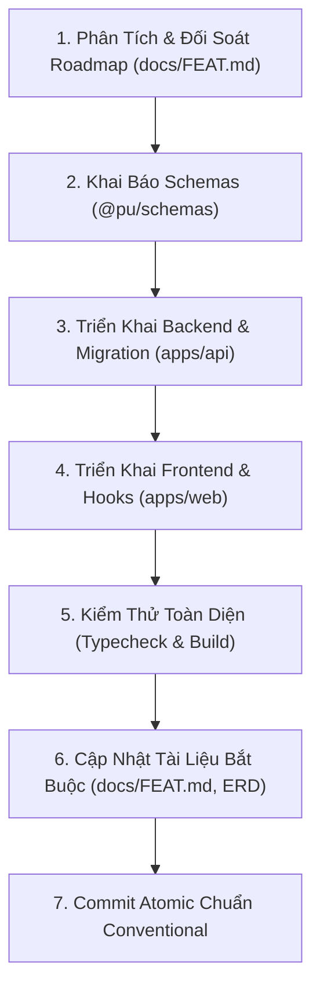

# Feature Development Workflow (PU Connect)

Quy trình chuẩn mực 7 bước khi phát triển bất kỳ tính năng mới nào trong hệ thống PU Connect, đảm bảo tính nhất quán tuyệt đối từ Database, Schema, Backend, Frontend đến Tài liệu và Kiểm thử.

---

## 📋 Quy Trình 7 Bước Chuẩn



---

### Bước 1: Phân Tích Yêu Cầu & Kế Hoạch
* Kiểm tra danh mục roadmap và kiến trúc domain trong [`docs/FEAT.md`](../../docs/FEAT.md).
* Xác định rõ:
  * Mô hình thực thể cần thiết trong Database.
  * API endpoints (REST / WebSocket / GraphQL).
  * Caching strategy (Khóa TanStack Query tương ứng trong `queryKeys`).
  * Giao diện người dùng & các state tương tác trên cả Desktop lẫn Mobile.

---

### Bước 2: Khai Báo Zod Schemas & Types (`packages/schemas`)
* Thêm schema validation và TypeScript type vào `packages/schemas/src/<feature>.schema.ts`.
* Xuất (export) từ `packages/schemas/src/index.ts`.
* Đảm bảo schema là Single Source of Truth giữa Client và Server.

---

### Bước 3: Triển Khai Backend (`apps/api`)
1. **Database Migration (Idempotent):**
   * Nếu có bảng hoặc cột mới, tạo file migration idempotent tại `apps/api/src/database/<feature>-upgrade.sql`.
   * Khai báo lệnh chạy migration trong `scripts/deploy.sh`.
2. **Module NestJS:**
   * Tạo Controller, Service, Module trong `apps/api/src/modules/<feature>/`.
   * Sử dụng `DatabaseService` (Native Postgres). Nếu có từ 2 bước ghi dữ liệu, bọc trong `this.db.transaction(async (client) => { ... })`.
   * Kiểm tra quyền bằng `AuthenticatedGuard` và bóc tách user bằng `requireUserId(req)`. Tuyệt đối không mock fallback.
   * Đăng ký Module vào `apps/api/src/app.module.ts`.

---

### Bước 4: Triển Khai Frontend (`apps/web`)
1. **Query Hooks:**
   * Thêm khóa query vào `apps/web/src/lib/query-keys.ts`.
   * Tạo hook dữ liệu bằng `useQuery` hoặc `useInfiniteQuery`.
2. **UI & Responsive Components:**
   * Tạo components trong `apps/web/src/components/<feature>/`.
   * Sử dụng 100% semantic CSS tokens (`bg-card`, `text-foreground`, `border-border`...).
   * Thiết kế thích ứng mượt mà trên Mobile (< 768px), không để tràn ngang màn hình.
   * Tạo Skeleton loader chuẩn kích thước trong `apps/web/src/components/skeletons/` cho trạng thái tải ban đầu.

---

### Bước 5: Kiểm Thử & Xác Minh (Test & Build)
* Chạy kiểm tra TypeScript và Build toàn bộ monorepo:
  ```bash
  pnpm typecheck
  pnpm build
  ```
* Nếu có test suite liên quan:
  ```bash
  pnpm --filter @pu/api test
  ```
* Xác minh không có lỗi console, cảnh báo hydration hoặc cảnh báo ESLint.

---

### Bước 6: Cập Nhật Tài Liệu Bắt Buộc (Mandatory Docs Update)
1. **Cập nhật [`docs/FEAT.md`](../../docs/FEAT.md):**
   * Chuyển tính năng từ mục **"Kế hoạch (Roadmap)"** sang mục **"Đã hoàn thành (Completed)"** kèm checklist `[x]`, mô tả chi tiết endpoints, component và cơ chế hoạt động.
2. **Cập nhật [`README.md`](../../README.md)** nếu có thêm biến môi trường hoặc script mới.
3. **Cập nhật sơ đồ hệ thống:**
   * Nếu có migration SQL mới: chạy migration lên DB local và chạy `pnpm docs:erd` để sinh lại ERD.
   * Nếu thêm module/trang mới: cập nhật sơ đồ tương ứng trong [`docs/diagrams/`](../../docs/diagrams/).

---

### Bước 7: Commit Chuẩn Conventional Commits
* Chia nhỏ thay đổi thành các commit nguyên tử (Atomic commits) theo chuẩn:
  ```bash
  git add packages/schemas/
  git commit -m "feat(<feature>): add schemas and types"

  git add apps/api/
  git commit -m "feat(<feature>): implement backend service and endpoints"

  git add apps/web/
  git commit -m "feat(<feature>): implement responsive UI and query hooks"

  git add docs/
  git commit -m "docs(<feature>): update FEAT.md and architecture diagrams"
  ```
