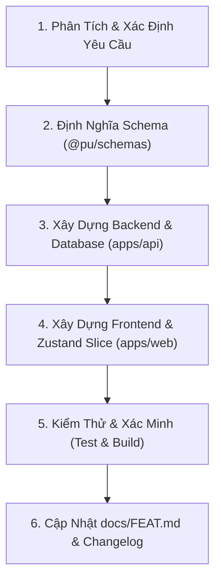

# Feature Development Workflow (PU Connector)

Quy trình chuẩn khi phát triển bất kỳ tính năng mới nào trong hệ thống PU Connector, đảm bảo tính nhất quán từ Database, Schema, Backend, Frontend đến Tài liệu.

---

## 📋 Quy Trình 6 Bước Phát Triển Tính Năng



---

### Bước 1: Phân Tích Yêu Cầu & Kế Hoạch
* Kiểm tra danh mục roadmap trong [`docs/FEAT.md`](file:///home/nhatcoi/Documents/personal/pu-connector/docs/FEAT.md).
* Xác định rõ:
  * Mô hình thực thể cần thiết trong Database.
  * API endpoints (REST / WebSocket).
  * Giao diện người dùng & các state tương tác.

---

### Bước 2: Khai Báo Zod Schemas & Types (`packages/schemas`)
* Thêm schema validation và TypeScript type vào `packages/schemas/src/<feature>.schema.ts`.
* Export từ `packages/schemas/src/index.ts`.
* Chạy `pnpm --filter @pu/schemas build` (nếu có build step) hoặc xác minh import không lỗi.

---

### Bước 3: Triển Khai Backend (`apps/api`)
1. **Database Migration:** Bổ sung bảng/cột vào `apps/api/src/database/schema.sql` nếu cần.
2. **Module NestJS:**
   * Tạo Controller, Service, Module trong `apps/api/src/modules/<feature>/`.
   * Sử dụng Zod validation pipe từ `@pu/schemas`.
   * Đăng ký Module vào `apps/api/src/app.module.ts`.
3. **Kiểm tra API:** Xác minh endpoint hoạt động trả về đúng JSON format.

---

### Bước 4: Triển Khai Frontend (`apps/web`)
1. **Zustand Slice:** Tạo `apps/web/src/store/slices/<feature>-slice.ts` và gộp vào root `useAppStore`.
2. **UI Components:**
   * Tạo các thẻ card, dialog, hoặc view trong `apps/web/src/components/<feature>/`.
   * Đảm bảo KHÔNG dùng emoji trong text; dùng icon Lucide SVG chuẩn.
   * Sử dụng token màu CSS semantic từ theme (`bg-card`, `text-foreground`, `border-border`...).
3. **Kết nối API:** Sử dụng `apiClient` từ `@/lib/api-client`.

---

### Bước 5: Kiểm Thử & Xác Minh (Build & Test)
* Chạy kiểm tra TypeScript và Build toàn bộ monorepo:
  ```bash
  export PATH="/home/nhatcoi/.nvm/versions/node/v24.14.0/bin:$PATH"
  pnpm build
  ```
* Kiểm tra runtime:
  * Xác minh `procman status` tất cả các tiến trình (`db`, `api`, `web`) đều ở trạng thái `up`.
  * Xác minh không có lỗi console hoặc cảnh báo hydration trong browser.

---

### Bước 6: Cập Nhật Tài Liệu & Ghi Nhận Tính Năng
* **Cập nhật [`docs/FEAT.md`](file:///home/nhatcoi/Documents/personal/pu-connector/docs/FEAT.md):**
  * Chuyển tính năng từ mục **"Kế hoạch (Roadmap)"** sang mục **"Đã triển khai (Implemented & Live)"**.
  * Ghi chú ngắn gọn, súc tích về các endpoints và component vừa bổ sung.
* **Cập nhật `CHANGELOG.md`** nếu có phiên bản phát hành mới.
