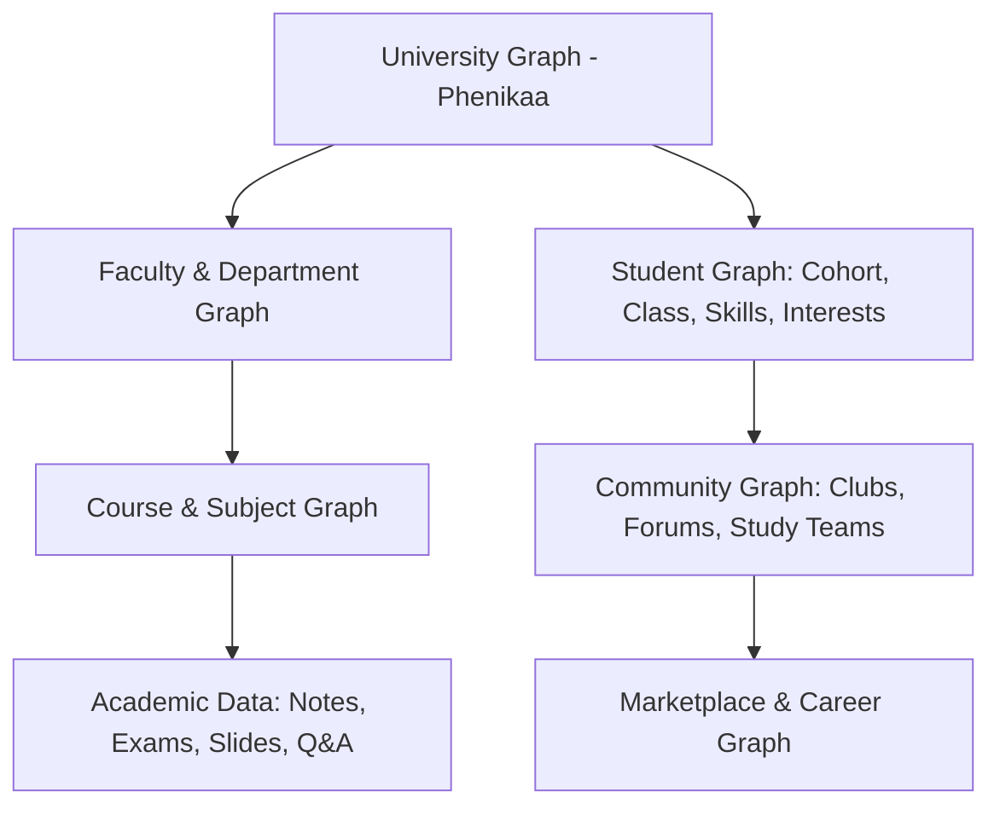
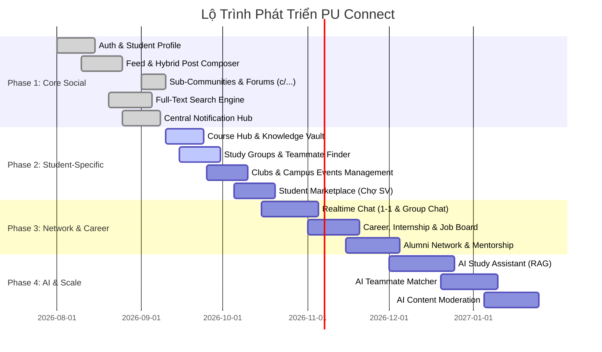

# 🎓 PU Connect — Mạng Xã Hội Sinh Viên Toàn Diện (Master Architecture Plan)

> **Tài liệu đặc tả kiến trúc, 14 phân hệ nghiệp vụ (Domains) và lộ trình phát triển chi tiết cho nền tảng Mạng xã hội Sinh viên PU Connect.**

---

## 💡 Triết Lý & Lợi Thế Sản Phẩm (Product Moat)

PU Connect **không phải là một bản sao generic của Facebook hay X**. Lợi thế cạnh tranh cốt lõi (Product Moat) nằm ở mô hình đồ thị quan hệ học đường khép kín:

$$\mathbf{Product\ Moat} = \mathbf{University\ Graph} \times \mathbf{Course\ Graph} \times \mathbf{Student\ Graph} \times \mathbf{Academic\ Data}$$



---

## 🏛️ 8 Miền Kiến Trúc Cốt Lõi (System Architecture Domains)

Hệ thống được tổ chức thành 8 domain nghiệp vụ độc lập nhưng liên kết chặt chẽ:

```text
                                PU CONNECT   
                                     │
        ┌────────────────────────────┼────────────────────────────┐
        │                            │                            │
   1. Identity                  2. Social                    3. Community
   ├── Auth & Session           ├── Social Feed              ├── University & Faculty
   ├── Student Profile          ├── Posts & Reactions        ├── Sub-Forums (Reddit-like)
   └── Privacy & Verify         └── Comments & Thread        └── Clubs & Organizations
        │                            │                            │
        └────────────────────────────┼────────────────────────────┘
                                     │
                    ┌────────────────┴────────────────┐
                    │                                 │
               4. Academic                        5. Career
               ├── Course & Subject Hub           ├── Internship & Job Board
               ├── Notes & Vault                  ├── Student Portfolio & CV
               └── Q&A & Reviews                  └── Alumni Network
                    │                                 │
                    └────────────────┬────────────────┘
                                     │
                    ┌────────────────┴────────────────┐
                    │                                 │
              6. Marketplace                    7. Messaging
              ├── Used Books & Tech             ├── 1-1 Direct Chat
              ├── Room & Roommates              ├── Group & Team Chat
              └── Gigs & Tutoring               └── Community Channels
                    │                                 │
                    └────────────────┬────────────────┘
                                     │
                             8. AI & Search
                             ├── AI Study Assistant (RAG)
                             ├── Semantic Platform Search
                             └── Moderation & Safety
```

---

## 📦 Chi Tiết 14 Phân Hệ Nghiệp Vụ (14 Business Domains)

---

### 1. 👤 Identity & Profile (Định Danh & Hồ Sơ Sinh Viên)
* **Student Profile**: Thông tin sinh viên chuyên sâu (MSSV, Họ tên, Avatar, Ảnh bìa, Tiểu sử).
* **Học vấn**: Khoa/Viện đào tạo (`FIT`, `FCS`, `FEE`...), Niên khóa (`K16`, `K17`, `K18`...), Lớp sinh hoạt, Chuyên ngành.
* **Kỹ năng & Quan tâm**: Danh mục `skills` (Next.js, Python, Figma...) và `interests` (AI Lab, Web Dev, EV...).
* **Xác thực sinh viên (University Verification)**: Tích hợp xác thực email trường (`@phenikaa-uni.edu.vn`) cấp huy hiệu tài khoản chính chủ.
* **Mạng lưới kết nối (Social Graph)**: Cơ chế Follow / Friend, danh sách Người theo dõi và Đang theo dõi.
* **Thiết lập quyền riêng tư (Privacy Settings)**: Ẩn/hiện thông tin cá nhân, chặn tài khoản (Block), tắt thông báo (Mute).

---

### 2. 📰 Social Feed (Bảng Tin Xã Hội Đa Chiều)
* **Mô hình Hybrid (Facebook + X + Reddit)**:
  * Đăng bài đa phương tiện: Văn bản, Markdown, 1–4 hình ảnh (Mosaic grid), tài liệu đính kèm.
  * Tương tác: Like / Reactions, Trả lời phân cấp (Nested Comment Threads).
  * Chia sẻ / Repost: Trích dẫn bài viết (Quote Post) hoặc chia sẻ link nội bộ.
  * Đã lưu (Bookmark): Tạo các bộ sưu tập bài viết đã lưu để tra cứu lại.
  * Nhận diện thực thể: Tự động phân tích Mention `@username` và Hashtag `#tag`.
  * Thuật toán Feed: Kết hợp bài mới, bài nổi bật trong khoa, môn học đang theo dõi và trending toàn trường.

---

### 3. 🏫 University Community (Cộng Đồng Học Đường Phân Cấp)
Tổ chức không gian sinh hoạt học đường theo cấu trúc phân cấp tự nhiên của trường đại học:
* **Trường Đại học (University Hub)**: Cấp cao nhất toàn trường Phenikaa.
* **Khoa / Viện (Faculty & Department)**: Không gian riêng của từng khoa (`Khoa CNTT`, `Khoa Điện - Điện tử`, `Khoa Y Dược`...).
* **Khóa đào tạo (Cohorts)**: Cộng đồng theo năm nhập học (`K17`, `K18`, `K19`...).
* **Ngành học (Majors)**: Cộng đồng theo chuyên ngành sâu (`Kỹ thuật phần mềm`, `Khoa học dữ liệu & AI`, `Hệ thống nhúng`...).
* **Lớp học phần (Course Class)**: Không gian trao đổi tài liệu và bài tập cho từng lớp tín chỉ cụ thể.

---

### 4. 💬 Discussion / Forum (Diễn Đàn Thảo Luận Reddit-style)
Cấu trúc phân cấp diễn đàn dạng Sub-community:

```text
Community (r/...)
 ├── Post (Thảo luận / Tin tức)
 │    ├── Comment
 │    └── Nested Reply
 ├── Question (Hỏi đáp học thuật)
 ├── Poll (Khảo sát biểu quyết ý kiến)
 └── Resource (Chia sẻ tài liệu / Mã nguồn)
```

**Các Diễn đàn Khởi tạo Tiêu biểu:**
* `r/Phenikaa`: Đại sảnh chung, Confessions, tin tức sự kiện toàn trường.
* `r/CNTT`: Trao đổi học thuật Khoa CNTT & Khoa học Máy tính.
* `r/Java` / `r/Python`: Diễn đàn chuyên sâu theo ngôn ngữ và công nghệ.
* `r/ThucTap`: Kinh nghiệm phỏng vấn, thực tập và việc làm sớm.
* `r/TimPhong`: Chuyên mục tìm bạn cùng phòng và nhà trọ gần trường.
* `r/DoAn`: Hỗ trợ đề tài, bảo vệ đồ án tốt nghiệp và môn dự án.

---

### 5. 📚 Study / Academic (Học Tập & Tri Thức Học Phần)
* **Học phần & Môn học (Courses & Subjects)**: Danh mục mã môn (`IT101`, `MATH201`...), mô tả, số tín chỉ, đề cương.
* **Kho ghi chú & Tài liệu (Notes & Documents Vault)**:
  * Lưu trữ và tra cứu Slide bài giảng, Đề thi giữa kỳ / cuối kỳ, Báo cáo mẫu.
  * Trình xem trước file PDF in-app, bộ lọc theo định dạng (PDF, Code, Sheet).
* **Hỏi & Đáp Học phần (Course Q&A)**: Đặt câu hỏi theo môn học, cơ chế duyệt Lời giải chính xác (Accepted Answer).
* **Ghép nhóm học tập (Study Groups & Teammate Finder)**: Tìm bạn cùng học, tìm đồng đội làm bài tập lớn/project môn học.
* **Thời khóa biểu & Lịch thi (Exam Schedule & Timetable)**: Nhắc lịch nộp assignment, lịch thi hết môn.
* **Đánh giá & Review**:
  * Đánh giá môn học (Course Review): Độ khó, khối lượng bài tập, tài liệu nên đọc.
  * Review Giảng viên (Lecturer Review): Phong cách giảng dạy, mức độ nhiệt tình.
* **Công cụ Học tập (Academic Tools)**: Tính điểm GPA dự kiến, gợi ý lộ trình môn học tiên quyết.

---

### 6. 🤝 Student Marketplace (Chợ Sinh Viên Nội Bộ)
Một Campus Marketplace an toàn, chỉ dành cho sinh viên xác thực:
* **Mua bán & Thanh lý**:
  * Giáo trình, sách bài tập, slide in cũ.
  * Laptop, màn hình, máy tính Casio, bàn phím, linh kiện thực hành Arduino/Vi điều khiển.
  * Đồ gia dụng phòng trọ: Quạt, tủ lạnh mini, bàn ghế học tập.
* **Nhà trọ & Phòng ở (Housing)**:
  * Đăng tin cho thuê phòng trọ quanh khu vực trường.
  * Tìm bạn sinh viên ở ghép (ghi rõ thói quen, mức ngân sách, giờ giấc).
* **Dịch vụ & Việc làm sinh viên (Student Services & Gigs)**:
  * Gia sư môn đại cương (Toán cao cấp, Vật lý, Tiếng Anh).
  * Nhận freelance: Code demo bài tập lớn, thiết kế poster, chỉnh sửa video, dịch thuật.
  * Việc làm bán thời gian (Part-time jobs) gần trường.

---

### 7. 💼 Career & Alumni (Hướng Nghiệp & Mạng Lưới Cựu Sinh Viên)
* **Student Digital Portfolio & CV**: Trang hồ sơ năng lực số gồm các dự án môn học đã làm, chứng chỉ, liên kết GitHub / LinkedIn.
* **Bảng tin Tuyển dụng & Thực tập (Job Board)**:
  * Tin tuyển thực tập sinh (Internship) từ các doanh nghiệp đối tác của trường.
  * Tin tuyển dụng chính thức cho sinh viên sắp tốt nghiệp.
* **Trang Doanh nghiệp (Company Profiles)**: Thông tin các công ty đang tuyển dụng sinh viên trường.
* **Mạng lưới Cựu sinh viên (Alumni Network)**:
  * Kết nối cựu sinh viên các khóa trước với sinh viên đang học.
  * Chương trình Cố vấn nghề nghiệp (Career Mentorship).

---

### 8. 🎓 Events (Sự Kiện & Hoạt Động Campus)
* **Đa dạng thể loại**: Sự kiện trường, Hoạt động Đoàn - Hội, Workshop học thuật, Hackathon, Hội thảo công nghệ, Ngày hội việc làm (Career Fair), Giải thi đấu thể thao.
* **Đăng ký tham gia (Registration)**: Form đăng ký 1 chạm trong app, xuất vé điện tử hoặc mã QR Check-in.
* **Nhắc nhở sự kiện (Event Reminder)**: Tự động gửi thông báo trước giờ diễn ra sự kiện.

---

### 9. 🏢 Clubs & Organizations (Câu Lạc Bộ & Đội Nhóm)
Mô hình Hub toàn diện cho từng CLB trực thuộc trường:
* **Hồ sơ CLB**: Giới thiệu, Logo, Banner, Ban chủ nhiệm, Lĩnh vực hoạt động (Học thuật, Thể thao, Tình nguyện, Nghệ thuật).
* **Quản lý thành viên**: Danh sách thành viên chính thức, phân ban (Nội dung, Truyền thông, Kỹ thuật).
* **Bảng tin & Thông báo CLB**: Đăng bài tin tức, tài liệu nội bộ.
* **Mùa tuyển thành viên (Recruitment Seasons)**: Form đăng ký ứng tuyển CTV/thành viên mới hàng kỳ.

---

### 10. 💬 Messaging (Hệ Thống Nhắn Tin Thời Gian Thực)
* **Các loại phòng chat**:
  * Chat 1-1 (Direct Messages).
  * Chat nhóm học tập / Nhóm đồ án (Team Chat).
  * Kênh chat cộng đồng / CLB (Community Channels).
* **Tính năng trò chuyện**: Gửi văn bản, ảnh, tệp tin PDF/Word/Code, trả lời tin nhắn (Reply), thả cảm xúc (Reactions).
* **Trạng thái**: Đã xem (Read status), Đang nhập (Typing indicator), Trạng thái online.
* **Kiến trúc Realtime**:
  $$\text{WebSocket (Socket.io)} \longrightarrow \text{Chat Gateway} \longrightarrow \text{Message Service} \longrightarrow \text{PostgreSQL Storage}$$

---

### 11. 🔔 Centralized Notification (Trung Tâm Thông Báo Tập Trung)
Hệ thống thông báo phân loại theo các nhánh nguồn:
* **Social**: Thông báo Like, Bình luận, Nhắc tên (`@`), Lượt theo dõi mới.
* **Academic**: Thông báo tài liệu mới trong môn học đang theo dõi, câu trả lời mới trong bài hỏi đáp.
* **Event**: Nhắc nhở sự kiện sắp bắt đầu, cập nhật lịch tổ chức.
* **Marketplace**: Có người hỏi mua hoặc phản hồi tin rao bán đồ.
* **Message**: Tin nhắn mới khi không mở cửa sổ chat.
* **System**: Thông báo từ Ban Giám hiệu, Phòng Đào tạo hoặc Ban Quản trị.

---

### 12. 🔎 Search & Discovery (Tìm Kiếm & Khám Phá Toàn Sàn)
Khả năng tìm kiếm tổng hợp trên mọi thực thể của nền tảng:
* Sinh viên / Giảng viên (User).
* Bài viết thảo luận (Post).
* Diễn đàn / Tiểu cộng đồng (Community).
* Môn học & Học phần (Course).
* Câu lạc bộ (Club).
* Sự kiện (Event).
* Mặt hàng chợ sinh viên (Marketplace listing).
* Cơ hội thực tập & việc làm (Job).

---

### 13. 🤖 AI Layer (Lớp Trí Tuệ Nhân Tạo Thông Minh)
Lợi thế tạo nên sự đột phá cho mạng xã hội sinh viên:
* **N7AI Study Assistant (RAG Engine)**:
  * Trích xuất và lập chỉ mục nội dung từ slide, giáo trình, đề thi cũ trong Knowledge Vault bằng `pgvector`.
  * Trả lời thắc mắc môn học dựa trên tài liệu chính thống của trường.
  * Tóm tắt bài giảng (Summarize) và sinh câu hỏi trắc nghiệm ôn tập (Quiz Generator).
* **AI Smart Teammate Matcher**: Tìm đồng đội đồ án dựa trên kỹ năng, môn học, lịch rảnh và định hướng đề tài.
* **AI Recommendation**: Cá nhân hóa bảng tin học thuật theo chuyên ngành và hành vi học tập.
* **AI Moderation**: Tự động phát hiện bài viết spam, lộ đề thi mật hoặc nội dung độc hại.

---

### 14. 🛡️ Moderation & Safety (Kiểm Duyệt & An Toàn Môi Trường Học Đường)
* **Báo cáo vi phạm (Report System)**: Người dùng báo cáo bài viết hoặc tài khoản vi phạm với lý do rõ ràng.
* **Quyền kiểm duyệt cộng đồng (Community Moderators)**: Ban quản trị diễn đàn hoặc Trưởng CLB có quyền gỡ bài, khóa thảo luận trong cộng đồng của mình.
* **Bảng điều khiển Quản trị (Admin Dashboard)**: Xem xét danh sách bài báo cáo, khóa tạm thời hoặc vĩnh viễn tài khoản vi phạm.
* **Kiểm soát cá nhân**: Chặn người dùng (Block), Tắt thông báo từ người dùng (Mute).
* **Nhật ký kiểm duyệt (Audit Log)**: Lưu lại toàn bộ lịch sử can thiệp của Quản trị viên để đảm bảo minh bạch.

---

## 🗺️ Lộ Trình Triển Khai 4 Giai Đoạn (4-Phase Execution Roadmap)



---

## 💾 Thiết Kế Cơ Sở Dữ Liệu Chi Tiết Cho Các Phân Hệ Mới

```sql
-- =========================================================================
-- PHẦN 1: SUB-COMMUNITIES & FORUMS (Reddit-style)
-- =========================================================================
CREATE TABLE IF NOT EXISTS communities (
    id UUID PRIMARY KEY DEFAULT gen_random_uuid(),
    slug VARCHAR(100) UNIQUE NOT NULL,
    name VARCHAR(255) NOT NULL,
    description TEXT NOT NULL,
    community_type VARCHAR(50) DEFAULT 'academic', -- 'campus', 'faculty', 'academic', 'life', 'club'
    avatar_url VARCHAR(500),
    banner_url VARCHAR(500),
    rules JSONB DEFAULT '[]',
    members_count INT DEFAULT 0,
    posts_count INT DEFAULT 0,
    created_at TIMESTAMPTZ DEFAULT NOW(),
    updated_at TIMESTAMPTZ DEFAULT NOW()
);

CREATE TABLE IF NOT EXISTS community_members (
    community_id UUID REFERENCES communities(id) ON DELETE CASCADE,
    user_id UUID REFERENCES users(id) ON DELETE CASCADE,
    role VARCHAR(30) DEFAULT 'member', -- 'admin', 'moderator', 'member'
    joined_at TIMESTAMPTZ DEFAULT NOW(),
    PRIMARY KEY (community_id, user_id)
);

-- =========================================================================
-- PHẦN 2: CAMPUS MARKETPLACE (Chợ Sinh Viên)
-- =========================================================================
CREATE TABLE IF NOT EXISTS marketplace_listings (
    id UUID PRIMARY KEY DEFAULT gen_random_uuid(),
    seller_id UUID NOT NULL REFERENCES users(id) ON DELETE CASCADE,
    category VARCHAR(50) NOT NULL, -- 'textbook', 'electronics', 'furniture', 'roommate', 'gigs'
    title VARCHAR(255) NOT NULL,
    description TEXT NOT NULL,
    price NUMERIC(12, 2) NOT NULL DEFAULT 0,
    images TEXT[] DEFAULT '{}',
    status VARCHAR(20) DEFAULT 'available', -- 'available', 'reserved', 'sold'
    location VARCHAR(200) DEFAULT 'ĐH Phenikaa, Yên Nghĩa, Hà Đông',
    contact_phone VARCHAR(20),
    created_at TIMESTAMPTZ DEFAULT NOW(),
    updated_at TIMESTAMPTZ DEFAULT NOW()
);

CREATE INDEX IF NOT EXISTS idx_marketplace_category ON marketplace_listings(category, created_at DESC);
CREATE INDEX IF NOT EXISTS idx_marketplace_status ON marketplace_listings(status);

-- =========================================================================
-- PHẦN 3: CAREER & INTERNSHIPS (Thực Tập & Hướng Nghiệp)
-- =========================================================================
CREATE TABLE IF NOT EXISTS job_postings (
    id UUID PRIMARY KEY DEFAULT gen_random_uuid(),
    company_name VARCHAR(200) NOT NULL,
    company_logo VARCHAR(500),
    job_title VARCHAR(255) NOT NULL,
    job_type VARCHAR(50) DEFAULT 'internship', -- 'internship', 'part_time', 'fresh_graduate'
    faculty_codes TEXT[] DEFAULT '{}', -- Khối ngành phù hợp ('FIT', 'FEE'...)
    location VARCHAR(200) NOT NULL,
    salary_range VARCHAR(100) DEFAULT 'Thỏa thuận',
    description TEXT NOT NULL,
    requirements TEXT NOT NULL,
    apply_url VARCHAR(1000),
    contact_email VARCHAR(255),
    expires_at TIMESTAMPTZ,
    created_at TIMESTAMPTZ DEFAULT NOW()
);

-- =========================================================================
-- PHẦN 4: REALTIME CHAT & MESSAGING
-- =========================================================================
CREATE TABLE IF NOT EXISTS chat_conversations (
    id UUID PRIMARY KEY DEFAULT gen_random_uuid(),
    type VARCHAR(30) DEFAULT 'direct', -- 'direct', 'study_group', 'community'
    name VARCHAR(200),
    avatar_url VARCHAR(500),
    entity_id VARCHAR(100),
    created_at TIMESTAMPTZ DEFAULT NOW(),
    updated_at TIMESTAMPTZ DEFAULT NOW()
);

CREATE TABLE IF NOT EXISTS chat_participants (
    conversation_id UUID REFERENCES chat_conversations(id) ON DELETE CASCADE,
    user_id UUID REFERENCES users(id) ON DELETE CASCADE,
    last_read_at TIMESTAMPTZ DEFAULT NOW(),
    is_muted BOOLEAN DEFAULT FALSE,
    PRIMARY KEY (conversation_id, user_id)
);

CREATE TABLE IF NOT EXISTS chat_messages (
    id UUID PRIMARY KEY DEFAULT gen_random_uuid(),
    conversation_id UUID REFERENCES chat_conversations(id) ON DELETE CASCADE,
    sender_id UUID REFERENCES users(id) ON DELETE CASCADE,
    content TEXT NOT NULL,
    media_urls TEXT[] DEFAULT '{}',
    created_at TIMESTAMPTZ DEFAULT NOW()
);

CREATE INDEX IF NOT EXISTS idx_chat_messages_conv ON chat_messages(conversation_id, created_at ASC);
```

---

Tài liệu này là **kim chỉ nam kiến trúc độc lập và chuẩn mực** cho toàn bộ quá trình mở rộng hệ thống PU Connect. Toàn bộ các module tiếp theo đều phải tuân thủ đúng 14 domain và 4 giai đoạn đã được hoạch định ở trên.
