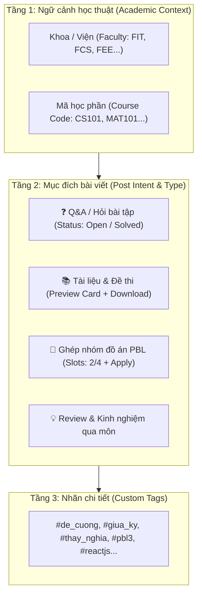

# 📐 Đặc Tả Logic Phân Loại & Trực Quan Hóa Chia Sẻ Học Thuật (Academic Sharing & Visual Taxonomy Spec)

Tài liệu thiết kế kiến trúc dữ liệu, luồng tương tác và giao diện trực quan cho tính năng cốt lõi: **Chia sẻ thông tin và trao đổi học tập sinh viên Phenikaa (PU Connector)**.

---

## 🎯 1. Mục Tiêu Thiết Kế (Core Design Goals)

1. **Chống phân mảnh thông tin:** Mọi bài viết, câu hỏi, tài liệu đều được neo vào đúng ngữ cảnh học thuật (Khoa $\rightarrow$ Mã học phần $\rightarrow$ Chủ đề).
2. **Nhận diện trong 1 giây (Instant Visual Recognition):** Sinh viên lướt feed có thể phân biệt ngay lập tức bài hỏi đáp, chia sẻ tài liệu hay tuyển nhóm PBL qua màu sắc, icon và thẻ trạng thái.
3. **Tra cứu & Tái sử dụng dài hạn:** Sinh viên khóa sau dễ dàng tìm lại toàn bộ đề thi, lời giải bài tập theo từng kỳ thi (`#GiuaKy`, `#CuoiKy`, `#Nam2025`).

---

## 🏗️ 2. Mô Hình Phân Loại 3 Tầng (3-Layer Taxonomy)



### Chi tiết các tầng:

| Tầng | Tên gọi | Định dạng | Ví dụ | Bắt buộc? |
| :--- | :--- | :--- | :--- | :--- |
| **Tầng 1** | **Ngữ cảnh (Context)** | Mã môn học hoặc Khoa | `CS101 - Nhập môn Lập trình`, `Khoa CNTT` | Khuyến khích |
| **Tầng 2** | **Mục đích (Intent)** | Enum: `qa`, `document`, `group_recruit`, `review`, `general` | `Q&A (Hỏi đáp)` | Bắt buộc |
| **Tầng 3** | **Custom Tags** | Mảng chuỗi tag (String Array) | `["#GiuaKy2025", "#ThayPhuong", "#ConTro"]` | Tùy chọn |

---

## 🎨 3. Quy Chuẩn Trực Quan Hóa Trên Giao Diện (Visual Design Guidelines)

### 3.1. Hệ thống Phù Hiệu Màu Sắc (Color Badges & Status Pills)

| Loại bài viết | Màu chủ đạo | Badge hiển thị | Trạng thái tương tác (Status Pills) |
| :--- | :--- | :--- | :--- |
| **Hỏi đáp bài tập (Q&A)** | Vàng Hổ Phách / Cam | `🟡 [❓ Hỏi đáp]` | • `[Chưa giải quyết]` (Vàng)<br>• `[✅ Đã giải quyết]` (Xanh lục khi tác giả duyệt câu trả lời đúng) |
| **Tài liệu & Đề thi** | Xanh Lục (Emerald) | `🟢 [📚 Tài liệu]` | • Thẻ xem trước (File Type, Size, Pages)<br>• Nút `[👁️ Xem nhanh]` mở modal PDF |
| **Ghép nhóm PBL** | Tím (Indigo/Violet) | `🟣 [👥 Ghép nhóm]` | • Tiến độ slot: `[Slot: 2/4]`<br>• Nút `[Ứng tuyển]` mở form xin vào nhóm |
| **Review môn học** | Xanh Dương (Sky) | `🔵 [💡 Review & Tip]` | • Điểm đánh giá độ khó: `⭐⭐⭐⭐☆` |

---

### 3.2. Trình Soạn Thảo Thông Minh (Smart Composer UX)

Khi sinh viên bấm vào ô tạo bài viết:
1. **Chọn nhanh Tab mục đích (Intent Tabs):** `[❓ Đặt câu hỏi]` | `[📚 Chia sẻ tài liệu]` | `[👥 Tuyển nhóm PBL]` | `[📝 Bài viết thường]`.
2. **Gợi ý Tag tự động (Auto-tagging / Smart Suggestions):**
   * Khi gõ tiêu đề: *"Cần xin đề thi Giải tích 1 thầy Dũng năm ngoái"*, hệ thống tự nhận diện và hiển thị gợi ý 1-click:
     * `[+ Gắn môn: MAT101 - Giải tích 1]`
     * `[+ Gắn tag: #DeThi, #ThayDung, #CuoiKy]`
3. **Hỗ trợ nhúng học thuật:**
   * Gõ `$x^2 + y^2 = z^2$` $\rightarrow$ Render công thức toán KaTeX.
   * Gõ code block $\rightarrow$ Syntax highlight đa ngôn ngữ.
   * Kéo thả file PDF/DOCX $\rightarrow$ Tự động tạo Document Card.

---

### 3.3. Thanh Lọc Thông Minh Trên Đầu Feed (Smart Filter Bar)

Thay vì chỉ có thanh tìm kiếm chung chung, đặt thanh lọc đa chiều dạng pill buttons ngay trên đầu bảng tin:

```text
[ 🌐 Tất cả ]  [ 📘 Môn tôi đang học ]  [ ❓ Câu hỏi chưa giải ]  [ 📚 Chỉ đề thi & slide ]  [ 👥 Tuyển nhóm còn slot ]
```

---

## 🗄️ 4. Thiết Kế Cơ Sở Dữ Liệu & Schema Đề Xuất

### Cập nhật bảng `posts` (Post Table Schema):

```sql
-- Bổ sung các cột phân loại học thuật vào bảng posts
ALTER TABLE posts 
  ADD COLUMN IF NOT EXISTS post_type VARCHAR(30) DEFAULT 'general', -- 'qa', 'document', 'group_recruit', 'review', 'general'
  ADD COLUMN IF NOT EXISTS course_id VARCHAR(50) REFERENCES courses(id) ON DELETE SET NULL,
  ADD COLUMN IF NOT EXISTS faculty_code VARCHAR(20),                -- 'FIT', 'FEE', 'FBA'...
  ADD COLUMN IF NOT EXISTS is_resolved BOOLEAN DEFAULT FALSE,       -- Áp dụng cho Q&A
  ADD COLUMN IF NOT EXISTS accepted_comment_id VARCHAR(50),         -- Câu trả lời được tác giả duyệt
  ADD COLUMN IF NOT EXISTS recruit_slots_total INT DEFAULT 0,       -- Áp dụng cho Ghép nhóm PBL
  ADD COLUMN IF NOT EXISTS recruit_slots_filled INT DEFAULT 0;

-- Index tăng tốc truy vấn lọc theo môn học và loại bài viết
CREATE INDEX IF NOT EXISTS idx_posts_course_type ON posts(course_id, post_type);
CREATE INDEX IF NOT EXISTS idx_posts_faculty ON posts(faculty_code);
```

---

## 🗺️ 5. Lộ Trình Triển Khai (Step-by-Step Implementation Roadmap)

### Giai đoạn 1: Database & Shared Schema (Sprint 1)
- [ ] Cập nhật Zod schemas trong `packages/schemas` (`CreatePostSchema`, `PostFilterSchema`).
- [ ] Bổ sung các cột `post_type`, `course_id`, `is_resolved`, `accepted_comment_id` vào NestJS Posts Module.

### Giai đoạn 2: UI Composer & Feed Badges (Sprint 2)
- [ ] Cải tiến `CreatePostDialog` trên Web (`apps/web`): Hỗ trợ chọn Post Type, chọn Mã môn học autocomplete, gắn tags.
- [ ] Cải tiến `PostCard`: Render huy hiệu phân loại theo màu sắc (Q&A Vàng, Doc Xanh lá, PBL Tím), hiển thị badge `[Đã giải quyết]` / `[Cần giúp đỡ]`.
- [ ] Bổ sung tính năng "Duyệt câu trả lời đúng" (Accept Answer) cho tác giả bài viết Q&A.

### Giai đoạn 3: Smart Filter Bar & Tra Cứu (Sprint 3)
- [ ] Thêm thanh lọc nhanh trên `/home` feed theo `Môn học của tôi`, `Câu hỏi chưa giải`, `Kho đề thi`.
- [ ] Tích hợp tính năng xem trước tài liệu đính kèm ngay trên Post Card (PDF Quick Preview Modal).

### Giai đoạn 4: Đưa lên Mobile App (Sprint 4)
- [ ] Triển khai giao diện phân loại và lướt bài trực quan tương tự lên `apps/mobile` (Expo React Native).
