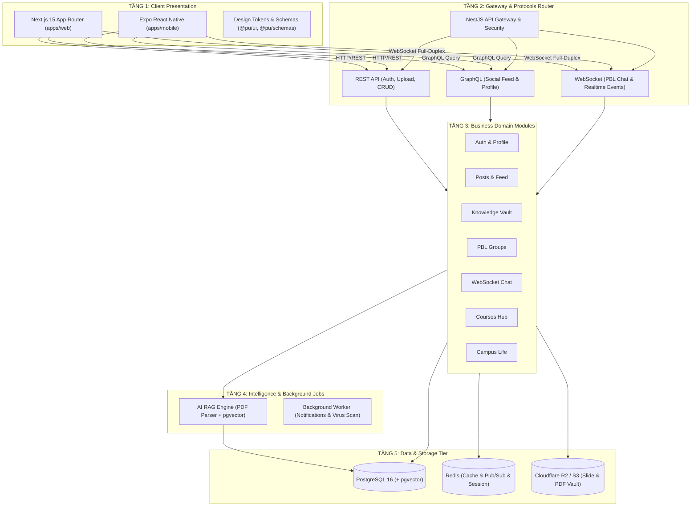

# 🏗️ Kiến trúc Hệ thống — PU Connector Architecture

> 🗺️ Sơ đồ **đúng theo hệ thống đang chạy** (được cập nhật mỗi khi code đổi) nằm ở [`docs/diagrams/`](./diagrams/README.md). Tài liệu này mô tả định hướng kiến trúc tổng thể.

Tài liệu mô tả chi tiết mô hình kiến trúc 5 tầng kỹ thuật, 7 phân hệ nghiệp vụ cốt lõi, và **chiến lược giao thức giao tiếp đa kênh (Communication Protocols Strategy)** của nền tảng mạng xã hội học thuật **PU Connector**.

---

## 1. Bản Đồ 5 Tầng Kỹ Thuật (Architectural Layers)



### Chi tiết các tầng:
1. **Tầng 1 - Client Presentation:**
   - `apps/web`: Next.js 15, React 19, Tailwind CSS v4, Zustand v5, Tiptap 3 WYSIWYG, KaTeX, Mermaid.js.
   - `apps/mobile`: Expo (React Native), NativeWind, SecureStore.
   - `packages/schemas` & `packages/ui`: Hợp đồng dữ liệu Zod và hệ thống UI Tokens dùng chung.
2. **Tầng 2 - API Gateway & Security:**
   - Giao thức định tuyến: **REST + GraphQL + WebSocket (Socket.io)**.
   - Xác thực: Session-based Auth với cookie `pu_session` (`HttpOnly`, `SameSite=Lax`, 7 ngày), bảo vệ qua `AuthenticatedGuard`.
   - Phân quyền RBAC: `student`, `lecturer`, `ta`, `club_lead`, `admin`.
3. **Tầng 3 - Business Domain Modules:**
   - Áp dụng triết lý **Module-based (DDD)**: Mỗi feature đóng gói riêng Controller/Resolver, Service, DTOs, Entities và Guards.
4. **Tầng 4 - Intelligence & Background Jobs:**
   - Trích xuất văn bản đề thi/slide, tạo Vector Embeddings lưu vào `document_chunks`.
   - Xử lý tác vụ nền: Nén ảnh, gửi Push Notifications, kiểm duyệt tệp tin.
5. **Tầng 5 - Data Persistence & Storage:**
   - **PostgreSQL 16 + pgvector:** Cơ sở dữ liệu chính (11 bảng chuẩn hóa).
   - **Redis:** Lưu trữ phiên đăng nhập, bộ đếm tương tác, và Pub/Sub sự kiện WebSocket.
   - **Object Storage (S3 / Cloudflare R2):** Lưu trữ tài liệu học phần và ảnh đại diện.

---

## 2. Chiến Lược Giao Thức Giao Tiếp & Phân Tích Kỹ Thuật (Protocols Strategy)

Hệ thống mạng xã hội học thuật PU Connector áp dụng mô hình **Hybrid Multi-Protocol** để tối ưu hóa hiệu năng, độ trễ và băng thông:

### 📊 Bảng Phân Bổ Giao Thức Theo Phân Hệ Nghiệp Vụ

| Phân Hệ Nghiệp Vụ | Giao Thức Sử Dụng | Lý Do Kỹ Thuật Lựa Chọn |
|---|---|---|
| **1. Bảng Tin & Profile (`Social Feed & Profile`)** | **GraphQL** *(hoặc REST lồng nhau)* | • Loại bỏ thừa dữ liệu (**No Over-fetching**) cho App Mobile.<br>• Gom dữ liệu lồng nhau (Bài viết + Tác giả + Bình luận + Đã like) trong **1 round-trip duy nhất**.<br>• Client tự quyết định trường hiển thị theo từng kích thước màn hình. |
| **2. Phòng Chat Nhóm Đồ Án (`PBL Realtime Chat`)** | **WebSocket (`Socket.io`)** | • Kết nối 2 chiều liên tục (**Full-duplex TCP**), độ trễ cực thấp **< 20ms**.<br>• Loại bỏ chi phí đóng/mở kết nối HTTP Header (1-2KB mỗi request).<br>• Server chủ động đẩy tin nhắn mới, sự kiện đang gõ (`typing...`) và trạng thái online. |
| **3. Thông Báo Đẩy Thời Gian Thực (`Notifications`)** | **WebSocket / SSE** *(Server-Sent Events)* | • Đẩy thông báo tức thời khi có người xin vào nhóm đồ án, có bình luận mới hoặc tài liệu mới được tải lên môn học đang theo dõi. |
| **4. Xác Thực Phiên Làm Việc (`Authentication`)** | **REST API** | • Tương thích hoàn hảo với cơ chế Cookie Session `pu_session` (`HttpOnly`, `SameSite=Lax`).<br>• Đơn giản, an toàn, chống XSS triệt để. |
| **5. Tải & Đọc Tài Liệu Lớn (`Document Vault / Upload`)** | **REST API (Presigned URL / Multipart)** | • Streaming dữ liệu nhị phân (Binary) và tải file PDF/Slide dung lượng lớn (50MB - 100MB) trực tiếp lên Cloudflare R2 / S3 mà không nghẽn máy chủ API. |
| **6. Quản Trị & Tra Cứu Danh Mục (`Courses & Admin CRUD`)** | **REST API** | • Tận dụng **HTTP Caching** (Browser & CDN Cache theo URL `GET /api/courses/IT101`).<br>• Cấu trúc dữ liệu tĩnh, ít lồng nhau, thao tác CRUD chuẩn RESTful. |

---

### 🔍 Phân Tích Chuyên Sâu: Tại Sao Lại Phân Chia Giao Thức Như Vậy?

#### A. Tại sao Social Feed & Profile nên dùng GraphQL?
1. **Vấn đề của REST trong mạng xã hội:**
   * Khi mở trang cá nhân `/[username]`, giao diện cần: Thông tin sinh viên, Danh sách 10 bài viết gần nhất, Danh sách 5 tài liệu đã chia sẻ, Danh sách 3 nhóm đồ án đang tham gia.
   * Nếu dùng REST thuần: Client phải bắn **4 HTTP Requests riêng biệt** hoặc Backend phải viết một endpoint cồng kềnh `GET /users/:id/dashboard-everything` (vi phạm tính tái sử dụng).
2. **Ưu thế của GraphQL:**
   * Client chỉ gửi **1 truy vấn duy nhất**, lấy đúng những gì UI cần:
     ```graphql
     query GetUserProfile($username: String!) {
       user(username: $username) {
         displayName
         avatarUrl
         faculty
         reputationPoints
         posts(limit: 10) { id, title, likesCount }
         documents(limit: 5) { id, title, type }
         studyGroups(limit: 3) { id, topic, role }
       }
     }
     ```

#### B. Tại sao Chat & Thông báo bắt buộc phải dùng WebSocket?
* **Polling qua HTTP:** Client cứ 2 giây gửi 1 request hỏi server *"Có tin nhắn mới không?"* $\rightarrow$ Lãng phí 99% tài nguyên server và pin điện thoại khi không có tin nhắn.
* **WebSocket:** Duy trì 1 kênh truyền duy nhất. Khi bạn A gửi tin nhắn vào nhóm PBL, Server đẩy ngay lập tức qua socket room của nhóm đó cho bạn B và C trong **10 mili-giây**.

#### C. Tại sao Auth và Upload File vẫn dùng REST API?
* **Auth:** Cookie Session được xử lý tự nhiên và bảo mật nhất thông qua header `Set-Cookie` của HTTP chuẩn.
* **Upload File lớn:** Gửi file nhị phân (Binary/Stream) qua GraphQL Mutation thường phải encode Base64 làm phình to 33% dung lượng file. REST Multipart hoặc S3 Presigned URL là chuẩn mực tối ưu nhất thế giới hiện nay.

---

## 3. 7 Phân Hệ Nghiệp Vụ Cốt Lõi (Core Business Domains)

```text
┌───────────────────────────────────────────────────────────────────────────┐
│                     CÁC PHÂN HỆ NGHIỆP VỤ PU CONNECTOR                    │
├────────────────────────────────┬──────────────────────────────────────────┤
│ 1. Identity & Profile          │ Quản lý định danh, sinh viên/giảng viên, │
│                                │ điểm danh vọng và huy hiệu học thuật.    │
├────────────────────────────────┼──────────────────────────────────────────┤
│ 2. Academic Social Feed        │ Bảng tin học thuật, hỏi đáp bài tập,     │
│                                │ công thức KaTeX, sơ đồ thuật toán.       │
├────────────────────────────────┼──────────────────────────────────────────┤
│ 3. Knowledge Vault             │ Kho tài liệu, đề thi giữa kỳ/cuối kỳ     │
│                                │ kèm trình xem trước In-App (PDF/Code).   │
├────────────────────────────────┼──────────────────────────────────────────┤
│ 4. PBL Matchmaking & Chat      │ Đăng tin ghép nhóm đồ án theo kỹ năng,   │
│                                │ duyệt thành viên, phòng chat nội bộ WS.  │
├────────────────────────────────┼──────────────────────────────────────────┤
│ 5. Courses & Academic Hub      │ Danh mục môn học 8 Khoa/Viện đào tạo,    │
│                                │ đánh giá độ khó và tài liệu theo môn.    │
├────────────────────────────────┼──────────────────────────────────────────┤
│ 6. Gamification & Reputation   │ Bảng xếp hạng Top Contributor, tính điểm │
│                                │ cống hiến cho sinh viên tích cực.        │
├────────────────────────────────┼──────────────────────────────────────────┤
│ 7. AI Semantic Search & Tutor  │ Trợ lý AI trả lời câu hỏi ôn thi dựa     │
│                                │ trên kho đề thi và slide bài giảng.      │
└────────────────────────────────┴──────────────────────────────────────────┘
```

---

## 4. Kiến Trúc Định Tuyến Giao Diện Chuẩn X (Routing Structure)

* **`/` (Public Landing Page):** Trang chào đón phong cách X (*"Happening now / Đang diễn ra ngay bây giờ"*), tự động chuyển tiếp sang `/home` nếu đã đăng nhập.
* **`/home` (Protected Feed):** Bảng tin 3 cột: Sidebar điều hướng $\rightarrow$ Bảng tin học thuật $\rightarrow$ Xu hướng & Thống kê realtime.
* **`/[username]` (Profile Page):** Trang cá nhân sinh viên/giảng viên với các tab: Bài viết, Tài liệu, Nhóm đồ án, Hoạt động.
* **`/courses`:** Danh mục học phần và đề thi theo môn.
* **`/groups`:** Bảng tin tuyển thành viên đồ án PBL và phòng chat.

---

## 5. Luồng Onboarding & Thuật Toán Đề Xuất Bài Viết (Recommendation Engine)

### 5.1. Luồng Khởi Tạo Hồ Sơ Lần Đầu (Onboarding Wizard 4 Bước)
1. **Bước 1: Danh tính học thuật (Mandatory):** Thu thập Mã SV/Cán bộ, Khoa/Viện đào tạo (`FIT`, `FCS`, `FEE`...), Niên khóa (`K15`, `K16`...).
2. **Bước 2: Môn học quan tâm (Optional):** Chọn tối thiểu 1 môn học đang học trong kỳ (`IT101`, `MATH201`...) $\rightarrow$ giải quyết bài toán Cold-Start.
3. **Bước 3: Kỹ năng & Đồ án PBL (Optional):** Chọn các tags công nghệ sở trường (`React Native`, `NestJS`, `Python AI`, `Matlab`...) $\rightarrow$ phục vụ gợi ý ghép nhóm đồ án.
4. **Bước 4: Gợi ý kết nối ban đầu & Thưởng danh vọng:** Gợi ý theo dõi bạn học cùng khoa và Giảng viên bộ môn, cộng ngay **+100 Điểm danh vọng**.

### 5.2. Công Thức Đề Xuất Bài Viết Cá Nhân Hóa (Hybrid Ranking Formula)
Hệ thống xếp hạng bài viết trên Tab *"Dành cho bạn"* theo công thức:

$$S(u, p) = w_1 \cdot C(u, p) + w_2 \cdot F(u, p) + w_3 \cdot Follow(u, p) + w_4 \cdot E(p) - \lambda \cdot \Delta t$$

* $C(u, p)$: Điểm trùng khớp môn học ($+40$ nếu bài viết thuộc môn học user đã chọn).
* $F(u, p)$: Điểm trùng khớp Khoa/Viện ($+20$ nếu tác giả cùng Khoa).
* $Follow(u, p)$: Điểm quan hệ mạng lưới ($+25$ nếu user đang follow tác giả).
* $E(p)$: Điểm tương tác ($2 \times \text{Likes} + 5 \times \text{Comments} + 10 \times \text{Downloads}$).
* $\lambda \cdot \Delta t$: Hệ số suy giảm theo thời gian (giảm dần bài cũ sau 7-14 ngày).

