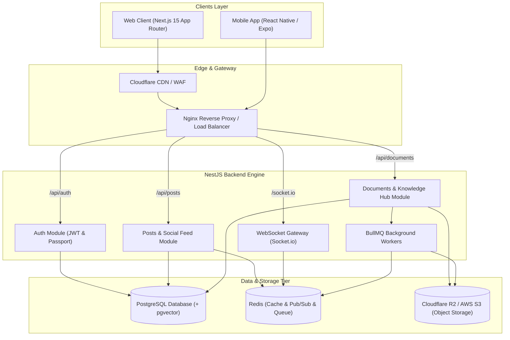
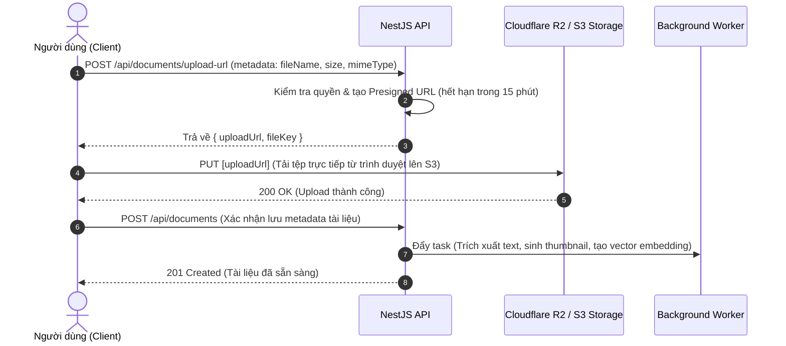

# 🏗️ Kiến trúc Hệ thống — PU Connector Architecture

Tài liệu này mô tả chi tiết kiến trúc tổng thể, luồng xử lý dữ liệu và các thành phần cốt lõi của hệ thống **PU Connector**.

---

## 1. Cấu trúc Monorepo (Turborepo + pnpm Workspace)

Hệ thống được tổ chức theo mô hình **Monorepo** nhằm chia sẻ tối đa mã nguồn, kiểu dữ liệu (Types/Schemas), cấu hình (Config) và UI Design Tokens giữa các ứng dụng:

```text
pu-connector/
├── apps/
│   ├── web/                     # Ứng dụng Web (Next.js 15+ App Router, shadcn/ui, Tailwind v4)
│   └── api/                     # Backend API (NestJS 11+, Modular Architecture, WebSocket)
│
├── packages/
│   ├── schemas/                 # Shared Zod Schemas & DTO Type Contracts
│   ├── ui/                      # Shared Design Tokens & Theme Variables
│   └── tsconfig/                # Shared TypeScript Configurations (Base, Next.js, NestJS)
│
├── docs/                        # Tài liệu kỹ thuật chi tiết
├── pnpm-workspace.yaml          # Định nghĩa Workspace Monorepo
├── turbo.json                   # Pipeline Build/Dev Cache của Turborepo
└── package.json                 # Quản lý dependencies chung
```

---

## 2. Sơ đồ Kiến trúc Tổng thể (System Architecture)



---

## 3. Các Luồng Dữ liệu Đặc thù (Key Data Flows)

### 3.1. Luồng Tải tệp Trực tiếp (Direct S3/R2 Upload via Presigned URL)
Để tránh làm nghẽn CPU và băng thông của NestJS Server khi người dùng tải lên tài liệu PDF hoặc video lớn:



---

## 4. Pipeline Render Tài liệu & Kỹ thuật Rich Text (Document Rendering Engine)

Kế thừa từ kiến trúc của **Orca IDE**, bộ engine render Markdown/LaTeX/Mermaid của PU Connector hoạt động theo các nguyên tắc:

1. **Markdown AST Pipeline:**
   * Trích xuất Frontmatter $\rightarrow$ Parser AST (`remark-parse`, `remark-gfm`, `remark-math`) $\rightarrow$ Compiler HTML (`rehype-katex`, `rehype-highlight`, `rehype-slug`, `rehype-sanitize`).
2. **Dynamic Lazy-loading & Concurrency Protection cho Mermaid:**
   * Module `mermaid` (~650KB) chỉ được tải bất đồng bộ khi trong tài liệu có xuất hiện block code `mermaid`.
   * **Serialized Render Queue:** Sử dụng hàng đợi tuần tự (`enqueueMermaidRender`) để tránh lỗi race-condition đè DOM khi có nhiều biểu đồ hiển thị đồng thời.
   * **XSS Sanitization:** Toàn bộ SVG sinh ra đều được lọc qua `DOMPurify` theo chuẩn profile SVG an toàn.
3. **LaTeX Math Formula Rendering:**
   * Tự động nhận diện cú pháp inline `$f(x) = \sin(x)$` và block `$$\int_{-\infty}^{\infty} e^{-x^2} dx = \sqrt{\pi}$$` thông qua KaTeX với tốc độ render gần như tức thì.
