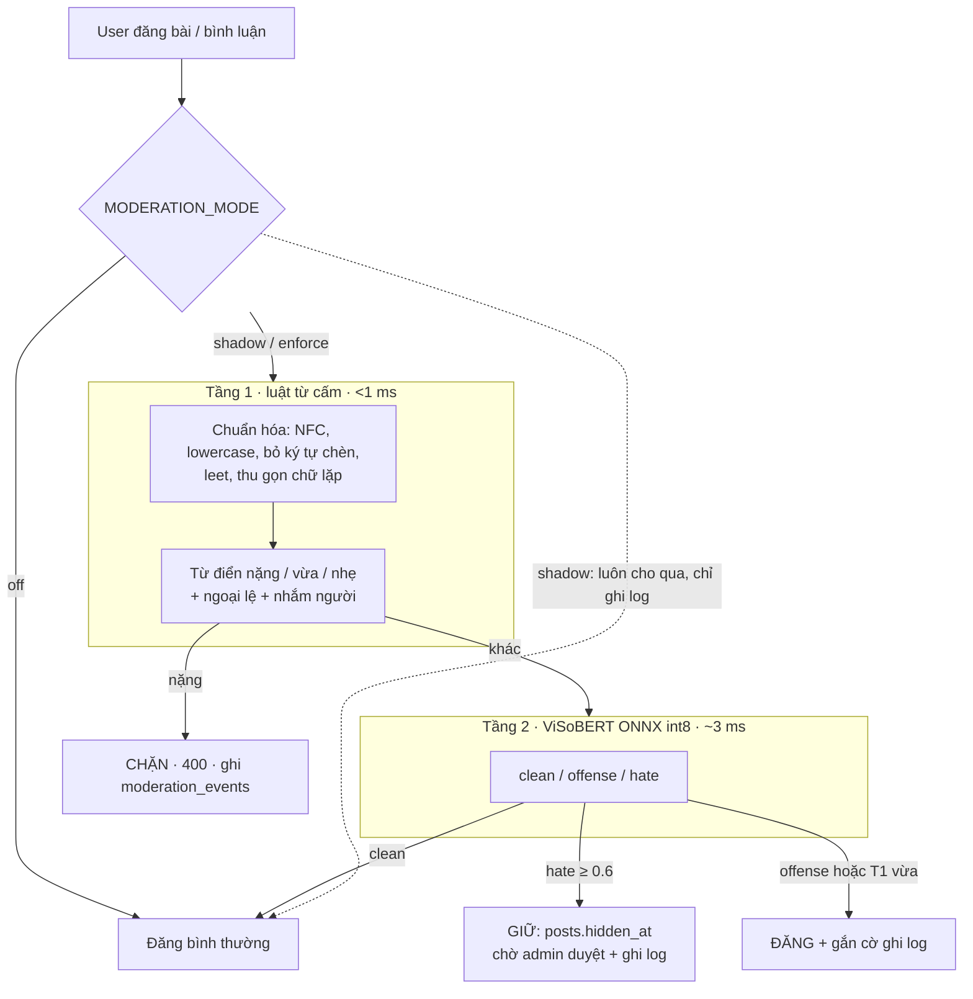

# Kiểm duyệt nội dung tự động

Trạng thái: **đã code, mặc định tắt** (`MODERATION_MODE=off`). Chưa deploy, chưa áp migration lên DB thật.

Mục tiêu: chặn từ tục / ngôn từ thù ghét tiếng Việt khi đăng bài và bình luận, rẻ và nhanh (3 ms/bài), không gọi LLM ngoài ở luồng đăng. Gồm 2 tầng tự động; hàng đợi người duyệt dùng cơ chế ẩn bài có sẵn của admin.

## 1. Sơ đồ hệ thống

### Luồng đăng bài



### Thành phần và dữ liệu

```mermaid
flowchart LR
    subgraph API[apps/api · NestJS]
      PS[PostsService.create] --> MS[ModerationService.check]
      CS[CommentsService.create] --> MS
      MS --> P1[vi-profanity.filter<br/>+ vi-text-normalizer]
      MS --> P2[OnnxToxicityClassifier<br/>onnxruntime-node]
      MS --> POL[decide&#40;&#41; · moderation.policy]
    end
    P2 --> MF[(models/visobert-onnx<br/>model_int8.onnx 98 MB)]
    MS --> EV[(moderation_events)]
    PS --> PO[(posts.hidden_at / hidden_reason)]
    ADM[Admin: danh sách bài ẩn + log] -. đọc .-> EV
    ADM -. đọc / bỏ ẩn .-> PO
```



Đường nét đứt là phần thuộc admin, chưa làm (xem mục 6).

## 2. Chính sách quyết định

| Điều kiện | Hành động | Với bài | Với bình luận |
|---|---|---|---|
| Tầng 1 mức nặng (`lồn`, `địt mẹ`, `l0n`, `đ.ị.t`...) | `block` | Từ chối 400, không tạo bài | Từ chối 400 |
| p(hate) ≥ 0.6 | `hold` | Lưu, ẩn bằng `hidden_at`, không báo mention/follower | Lưu, ẩn bằng `comments.hidden_at` (xem bên dưới) |
| p(offense)+p(hate) ≥ 0.7, hoặc tầng 1 mức vừa / nhẹ nhắm người | `flag` | Lưu, ẩn chờ duyệt như `hold` | Lưu, ẩn chờ duyệt như `hold` |
| Còn lại | `allow` | Đăng | Đăng |

- **Bình luận chờ duyệt** (`flag`/`hold`): ghi `comments.hidden_at` + `hidden_reason = 'auto-moderation:<lý do>'`. Chỉ tác giả thấy (UI mờ, nhãn "đang chờ quản trị viên duyệt", chưa thích / trả lời / sửa được); không tính vào `posts.comments_count`; chưa báo chủ bài, người được trả lời, @mention. Admin → Kiểm duyệt → Tự động: *Bác cờ* (`dismissed`) ⇒ hiện lại, đếm +1, gửi các thông báo bị hoãn và báo tác giả; *Xác nhận* (`confirmed`) ⇒ `hidden_reason = 'moderation-rejected'`, tác giả thấy "không được duyệt" và được báo. Sửa bình luận cũng bị kiểm tra từ cấm nặng.
- Model lỗi hoặc chưa nạp được: chỉ dùng tầng 1, bài vẫn đăng (fail-open ở tầng 2).
- Tầng 1 đã chặn thì không chạy model.
- Chửi thân mật không nhắm ai ("đm mệt quá") bị `flag`, không chặn.

## 3. Tầng 1: luật + chuẩn hóa

Code: `apps/api/src/modules/moderation/vi-text-normalizer.ts`, `vi-profanity.lexicon.ts`, `vi-profanity.filter.ts`.

**Chuẩn hóa** (theo từng token):
1. NFC + lowercase.
2. Ghép dãy ≥ 2 chữ rời: `đ m m`, `d.i.t` → `đmm`, `dit`.
3. Leet chỉ khi nằm **giữa hai chữ cái**: `l0n` → `lon`, `d1t` → `dit` (`5 dm` giữ nguyên).
4. Bỏ ký tự chèn `. - _ * ' \` ~ · • +` giữa chữ.
5. Thu gọn chữ lặp khi so khớp: `địttttt` → `địt`.

Mỗi token ghi cờ `altered` (đã bị lách) và `hasMarks` (có dấu).

**Khớp:**
- Có dấu: khớp nguyên token / cụm theo ranh giới từ.
- Không dấu `always`: chỉ cụm đủ đặc trưng (`dit me`, `du ma`, `vcl`, `dmm`) và chỉ khi mọi token đều không dấu (tránh `đủ mà` ≠ `du ma`).
- Không dấu `obfuscated`: từ ngắn mơ hồ (`lon`, `dit`, `cac`) chỉ khớp khi token **đã bị lách**, nên `lon bia` qua, `l0n` bị bắt.
- Độ dài token ≥ độ dài từ gốc, để `5 dm` không bị coi là `dmm`.
- Ngoại lệ: `điên đảo`, `điên cuồng`, `ngốc nghếch`, `ngu ngơ`; `đm` đứng sau số (đơn vị dm) bị bỏ qua.
- "Nhắm người": có đại từ/danh xưng (`mày`, `thằng`, `đồ`, `bạn`...) trong 3 token quanh từ khớp.

**Verdict tầng 1:** nặng → `block`; vừa → `review`; nhẹ → `review` nếu nhắm người, ngược lại `pass`.

Thêm từ: sửa `LEXICON` trong `vi-profanity.lexicon.ts`, thêm test dương tính giả tương ứng trong `test/unit/vi-profanity.spec.ts`.

## 4. Tầng 2: ViSoBERT

- Model: `nd-khoa/vihsd-uit-visobert-v2` (ViSoBERT của UIT, fine-tune trên ViHSD bởi một cá nhân; giấy phép MIT theo metadata HF). Nhãn: 0 clean, 1 offense, 2 hate. **Thứ tự nhãn là giả định theo quy ước ViHSD**, chưa đối chiếu model card.
- Đã xuất sang ONNX và lượng tử hóa int8 (390 MB → 98 MB); khớp 205/208 dự đoán với bản gốc.
- Chạy trong tiến trình Node bằng `onnxruntime-node`, tokenizer `@huggingface/tokenizers` (cho cùng id token với bản Python). Nạp lười ở lần gọi đầu.
- Đầu vào: văn bản gốc; nếu tầng 1 phát hiện lách luật thì dùng văn bản đã chuẩn hóa.
- Interface `ToxicityClassifier` cho phép đổi sang sidecar Python sau này mà không sửa service.

## 5. Dữ liệu

**Bảng `moderation_events`** (`database/moderation-upgrade.sql`, idempotent):

| Cột | Ý nghĩa |
|---|---|
| `user_id`, `surface` | Ai đăng, ở đâu (`post` / `comment`) |
| `action`, `tier`, `reason` | `flag` / `hold` / `block`; tầng 1 hay 2; lý do (`profanity_heavy`, `hate`, `offense`, `profanity_mild`) |
| `scores` | `{clean, offense, hate}` |
| `matched_terms`, `content` | Từ khớp; nội dung (cắt 2000 ký tự) |
| `enforced` | `false` = chạy chế độ shadow |
| `target_type`, `target_id` | Trỏ tới bài / bình luận được tạo |
| `review_status`, `reviewed_by`, `reviewed_at` | `pending` / `confirmed` / `dismissed` |

Bài `hold` dùng cột sẵn có `posts.hidden_at`, `hidden_reason = 'auto-moderation: <lý do>'`; các truy vấn feed, search, RAG, chat đã lọc `hidden_at IS NULL` nên không phải sửa thêm.

## 6. Cấu hình

| Biến môi trường | Mặc định | Ý nghĩa |
|---|---|---|
| `MODERATION_MODE` | `off` | `off` / `shadow` (chạy + ghi log, luôn cho qua) / `enforce` |
| `MODERATION_HATE_THRESHOLD` | `0.6` | Ngưỡng giữ chờ duyệt |
| `MODERATION_OFFENSE_THRESHOLD` | `0.7` | Ngưỡng gắn cờ |
| `MODERATION_OFFENSE_ACTION` | `flag` | `hold` = offense cũng vào hàng đợi duyệt |
| `MODERATION_MODEL_DIR` | `apps/api/models/visobert-onnx` | Thư mục model ONNX + tokenizer |

## 7. Kết quả đo (208 câu viết tay)

| | Recall | Precision | FP câu lành | Trễ |
|---|---|---|---|---|
| Chỉ tầng 1 | 0.95 | 1.00 | 0/68 | 0.006 ms |
| ViSoBERT riêng | 0.87 | 0.91 | 9/68 | 16 ms (PyTorch) |
| **Pipeline (T1 + ViSoBERT ONNX, Node)** | **0.99** | **0.94** | **7/68**, đều chỉ là `flag` | **3 ms p50 / 4 ms p95**, RSS ~350 MB |

Đã loại: Qwen3Guard 0.6B (recall 0.27, gần như không nhận tục tiếng Việt), 4B (recall 0.59, 540 ms, ~3 GB RAM), distilbert-multilingual-toxicity (recall 0.41, 9 FP).

**Hạn chế của số liệu:** bộ thử và từ điển cùng một người viết nên điểm tầng 1 lạc quan; 208 câu là quá nhỏ để huấn luyện. 16/25 câu xúc phạm không tục bị model xếp vào `hate` nên bị giữ chờ duyệt: hàng đợi sẽ có cả xúc phạm thường, không chỉ thù ghét.

Chạy lại đo: `tools/moderation-eval/` (`eval-tier1.ts`, `eval-pipeline.ts`; `dataset.mjs` có từ tục, không commit).

## 8. Việc còn lại

1. **Admin** (session admin): màn hình `moderation_events`; hàng đợi bài `auto-moderation`; cập nhật `review_status` khi admin duyệt / bỏ ẩn.
2. **Deploy:** chạy `moderation-upgrade.sql`, đưa model (98 MB, ngoài git) lên máy chủ, cài `onnxruntime-node` vào image; thêm migration vào `deploy-mac-vps.sh`.
3. **Bật dần:** `shadow` 1–2 tuần trên dữ liệu thật → chỉnh ngưỡng → `enforce`.
4. **Giấy phép:** đọc giấy phép ViSoBERT gốc và ViHSD trước khi dùng thương mại.
5. **Finetune** (khi có ≥ 2–3 nghìn mẫu nhãn thật từ admin): đổi nhãn thành clean / chửi thân mật / xúc phạm nhắm người / thù ghét; thêm mẫu khó (`5 dm`, `cc anh`, `lon bia`) và biến thể lách luật.
6. **Chưa bao phủ:** spam (URL, SĐT, lặp), ảnh, tên hiển thị, chat, bình luận nhiều tin chia mảnh.

## 9. File liên quan

```
apps/api/src/modules/moderation/
  vi-text-normalizer.ts        chuẩn hóa
  vi-profanity.lexicon.ts      từ điển + ngoại lệ + đại từ nhắm người
  vi-profanity.filter.ts       khớp từ điển → verdict tầng 1
  toxicity-classifier.ts       ViSoBERT ONNX (tầng 2)
  moderation.policy.ts         decide(): ghép các tầng
  moderation.service.ts        check(), ghi log, attachTarget()
  moderation.module.ts
apps/api/src/database/moderation-upgrade.sql
apps/api/test/unit/            vi-profanity.spec.ts, moderation-policy.spec.ts
apps/api/jest.unit.config.js   chạy: npx jest --config jest.unit.config.js
apps/api/models/visobert-onnx/ (gitignore)
tools/moderation-eval/         bộ thử + script đo
```
