# 💬 Đặc Tả Chi Tiết: Bình Luận Phân Cấp & Duyệt Lời Giải Q&A (Comments & Q&A)

---

## 1. Hệ Thống Bình Luận Phân Cấp (Threaded Comments)

Mô hình thảo luận học thuật yêu cầu trao đổi sâu sắc theo từng luồng chủ đề (Threads). PU Connection áp dụng cấu trúc bình luận cây lồng nhau (Hierarchical Comments).

### 1.1. Cấu Trúc Bảng Dữ Liệu `comments`

```sql
CREATE TABLE IF NOT EXISTS comments (
    id UUID PRIMARY KEY DEFAULT gen_random_uuid(),
    post_id UUID NOT NULL REFERENCES posts(id) ON DELETE CASCADE,
    author_id UUID NOT NULL REFERENCES users(id) ON DELETE CASCADE,
    parent_id UUID REFERENCES comments(id) ON DELETE CASCADE, -- NULL nếu là bình luận gốc
    content TEXT NOT NULL,
    likes_count INT DEFAULT 0,
    is_solution BOOLEAN DEFAULT FALSE,
    created_at TIMESTAMPTZ DEFAULT NOW(),
    updated_at TIMESTAMPTZ DEFAULT NOW()
);

-- Chỉ mục tăng tốc độ truy vấn bình luận theo bài viết và theo cây phân cấp
CREATE INDEX IF NOT EXISTS idx_comments_post_parent ON comments(post_id, parent_id, created_at ASC);
CREATE INDEX IF NOT EXISTS idx_comments_author ON comments(author_id);
```

### 1.2. Chiến Lược Tải Dữ Liệu & Zero Layout Shift
* **Tải trước tối ưu (Pre-fetching):** Mỗi bài viết trên Feed tải trước **3 bình luận gốc mới nhất** kèm tổng số bình luận con (`replies_count`).
* **Mở rộng theo nhu cầu (On-Demand Loading):**
  * Nút `"Xem thêm N bình luận"` gọi API phân trang `GET /api/posts/:id/comments?offset=3&limit=10`.
  * Nút `"Xem N phản hồi"` mở rộng nhánh con tương ứng mà không làm giật layout giao diện.

---

## 2. Cơ Chế Duyệt Lời Giải Q&A (Accepted Solution Workflow)

Đối với các bài viết loại Hỏi đáp (`post_type = 'qa'`), sinh viên đặt câu hỏi có quyền xác nhận câu trả lời chính xác nhất.

```mermaid
sequenceDiagram
    autonumber
    actor Author as Sinh viên đặt câu hỏi
    participant Client as Web / Mobile UI
    participant API as Comments API (NestJS)
    participant DB as PostgreSQL 16
    actor Solver as Sinh viên giải đáp

    Solver->>API: Gửi bình luận hướng dẫn giải bài
    API->>DB: INSERT INTO comments ... (+2 Rep Points)
    Author->>Client: Bấm "Chấp nhận lời giải" (Accept Solution)
    Client->>API: PATCH /api/posts/:postId/comments/:commentId/accept
    
    rect rgb(20, 35, 20)
        Note over API,DB: ACID Transaction
        API->>DB: UPDATE comments SET is_solution = TRUE WHERE id = $commentId
        API->>DB: UPDATE posts SET is_resolved = TRUE WHERE id = $postId
        API->>DB: UPDATE users SET reputation_points = reputation_points + 10 WHERE id = $solverId
    end
    
    API-->>Client: Trả về trạng thái đã duyệt & điểm danh vọng mới
    Client-->>Author: Hiển thị huy hiệu xanh lá "Lời giải được chấp nhận" ghim trên đầu
```



---

## 3. Hệ Thống Thưởng Danh Vọng Tự Động (Gamification Reputation)

Điểm danh vọng (`reputation_points`) phản ánh mức độ đóng góp học thuật và uy tín của sinh viên/giảng viên trong cộng đồng Phenikaa.

| Hành Động | Điểm Thưởng | Điều Kiện & Xử Lý |
|---|:---:|---|
| **Đăng bài viết học thuật** | **+5 điểm** | Tự động cộng khi tạo bài viết mới thành công. |
| **Đóng góp bình luận / giải đáp** | **+2 điểm** | Tự động cộng khi đăng bình luận (chống spam độ dài tối thiểu). |
| **Được duyệt lời giải chính xác** | **+10 điểm** | Được tác giả câu hỏi chọn làm `Accepted Solution`. |
| **Tải lên tài liệu hữu ích** | **+20 điểm** | Khi tài liệu được kiểm duyệt và đưa vào Kho học liệu. |

> [!IMPORTANT]
> **Quy tắc ACID:** Mọi điểm thưởng danh vọng bắt buộc thực thi trong cùng một Database Transaction với hành động gốc để đảm bảo tính toàn vẹn dữ liệu tuyệt đối.
