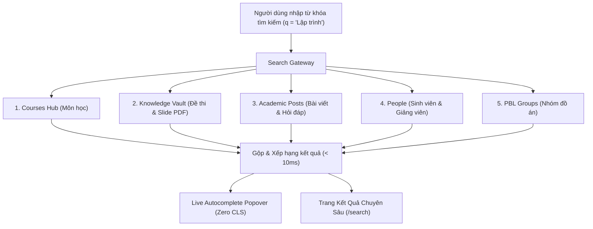

# 🔍 Đặc Tả Chi Tiết: Tìm Kiếm, Hashtag & Xu Hướng (Search & Trending)

---

## 1. Hệ Thống Hashtag `#tag` & Chủ Đề Nóng (Trending Topics)

Hashtag là công cụ phân loại chủ đề linh hoạt do cộng đồng tự khởi tạo, kết hợp với các mã học phần chính thức của trường.

### 1.1. Cấu Trúc & Phân Loại Hashtag
* **Hashtag Môn học:** `#IT101`, `#GiaiTich2`, `#LapTrinhWeb`, `#CS102`.
* **Hashtag Hoạt động:** `#DoAnTotNghiep`, `#PBL2026`, `#TuyenThanhVien`, `#NckhPhenikaa`.
* **Hashtag Đời sống:** `#CLBTinHoc`, `#HoiTraiK16`, `#HocBongKy1`.

### 1.2. Thuật Toán Tổng Hợp Xu Hướng (Trending Engine)
Cột Sidebar bên phải (`RightSidebar`) tự động tính toán và hiển thị Top 5 chủ đề nóng nhất trong tuần:

$$TrendingScore(tag) = \sum_{p \in Posts(tag, 7\text{ days})} (1.0 \times \text{Views} + 3.0 \times \text{Likes} + 5.0 \times \text{Comments})$$

---

## 2. Bộ Máy Tìm Kiếm Hợp Nhất (Unified Academic Search Engine)

PU Connect sở hữu hệ thống tìm kiếm đa thực thể thời gian thực, phục vụ tra cứu toàn diện trên toàn bộ hệ thống đại học.

### 2.1. Các Kênh Hiển Thị Tìm Kiếm
1. **Live Autocomplete Popover ([`AcademicSearchBar`](file:///home/nhatcoi/Documents/personal/pu-connector/apps/web/src/components/search/academic-search-bar.tsx)):**
   * Mở popover nổi ngay dưới ô nhập liệu với **Zero Layout Shift**.
   * Lưu lịch sử tìm kiếm gần đây (Recent Searches) trong LocalStorage.
   * Gợi ý nhanh Top 3 kết quả phù hợp nhất của từng danh mục.
2. **Trang Kết Quả Chuyên Sâu ([`/search`](file:///home/nhatcoi/Documents/personal/pu-connector/apps/web/src/app/search/page.tsx)):**
   * Cấu trúc 3 cột chuẩn X với 6 tabs phân loại: *Tất cả, Môn học, Đề thi & Tài liệu, Bài viết Q&A, Mọi người, Nhóm PBL*.
   * Bộ lọc theo Khoa/Viện đào tạo (`FIT`, `FEE`, `FBA`...).
