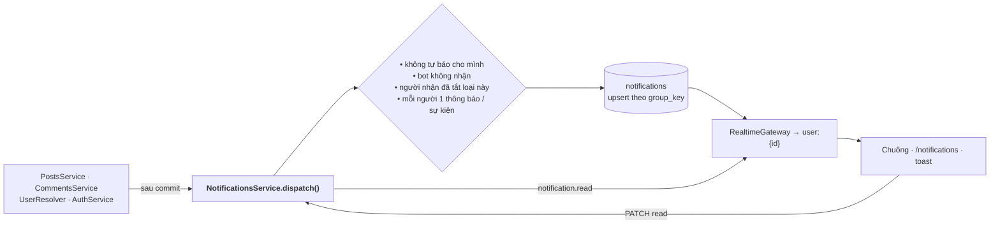

# 🔔 Đặc Tả Chi Tiết: Trung Tâm Thông Báo & Thời Gian Thực (Notifications & Realtime)

> Cập nhật lần cuối: **2026-10-04**. Đặc tả chi tiết phân loại thông báo toàn hệ thống, kiến trúc xử lý ngầm (Async Worker) và quyết định kiến trúc triển khai.
>
> ✅ **Trạng thái:** v1 đã triển khai — in-app realtime, gộp thông báo, cài đặt theo loại, trang `/notifications`, trang chi tiết bài viết. Xem **[mục 6 — Triển khai v1](#6-triển-khai-v1-đang-chạy)**. Push/Email và hàng đợi BullMQ vẫn là kiến trúc mục tiêu.

---

## 1. Kiến Trúc Trung Tâm Thông Báo Hợp Nhất (Notification Hub)

Trung tâm thông báo là nơi tiếp nhận, điều phối, gộp (aggregation) và phân phối toàn bộ sự kiện diễn ra trên hệ thống tới sinh viên và giảng viên qua 3 kênh: **In-App Realtime**, **Push Notification (Web/Mobile)** và **Email**.

```text
               [ HÀNH ĐỘNG CỦA USER ]
       (Like bài viết, Bình luận, Nhắc tên @mention)
                          │
                          ▼
            ┌───────────────────────────┐
            │    NestJS Controller      │ ───► Phản hồi HTTP 200 ngay (< 20ms)
            └─────────────┬─────────────┘
                          │ (Đẩy job chạy ngầm)
                          ▼
            ┌───────────────────────────┐
            │    BullMQ (Redis Queue)   │ ───► Hàng đợi chống nghẽn hệ thống
            └─────────────┬─────────────┘
                          │
                          ▼
            ┌───────────────────────────┐
            │    Notification Worker    │
            │   (Gộp & Lọc thông báo)   │
            └──────┬─────────────┬──────┘
                   │             │
        (Lưu trữ)  │             │ (Phân phối tới người nhận)
                   ▼             ▼
          ┌─────────────┐   ┌───────────────────────────────────────────┐
          │ PostgreSQL  │   │             3 KÊNH PHÂN PHỐI              │
          │ (Bảng notif)│   ├───────────────────────────────────────────┤
          └─────────────┘   │ 1. In-App Realtime (Socket.io)            │
                            │    └──► Máy đang mở web (chuông đỏ tức thì)
                            │                                           │
                            │ 2. Push Notification (FCM / Web Push)     │
                            │    └──► Máy tắt web / Điện thoại khóa màn hình
                            │                                           │
                            │ 3. Email (SMTP / Resend)                  │
                            │    └──► Hộp thư sinh viên (Sự kiện quan trọng)
                            └───────────────────────────────────────────┘
```

---

## 2. Quyết Định Kiến Trúc: Có Nên Tách Thành 1 Server Riêng (Microservice)?

###  Quyết định: **KHÔNG tách Server riêng**, triển khai theo mô hình **Modular Monolith + Async Worker**.

| Tiêu chí | Tách Server riêng (Microservice) | Modular Monolith + BullMQ Worker (Được chọn) |
| :--- | :--- | :--- |
| **Xác thực (Auth)** | Phải làm distributed auth / JWT shared secret hoặc Redis session sharing giữa 2 server. | **Tái sử dụng 100% session cookie `pu_session`** và Passport hiện tại của backend. |
| **Tài nguyên VPS** | Tốn thêm 80MB – 150MB RAM cho tiến trình Node.js mới trên VPS Debian (`puc.vnhat.dev`). | **Chạy chung runtime hoặc worker process nhẹ**, tối ưu chi phí hosting. |
| **Độ trễ API** | Thêm 20ms – 50ms cho mỗi request vì API chính phải gọi HTTP/gRPC sang server noti. | **< 2ms**: Controller chỉ ném payload vào Redis Queue rồi trả về ngay cho client. |
| **Bảo trì & CI/CD** | Thêm cấu hình Nginx proxy, systemd service riêng, port riêng, script deploy phức tạp. | Nằm gọn trong Monorepo `Turborepo` + `pnpm`, deploy 1 lệnh `pnpm run deploy:vps`. |
| **Khả năng scale** | Độc lập nhưng tốn công vận hành. | Khi tải tăng cao, chỉ cần spawn thêm instance của Worker kéo job từ Redis mà **không cần sửa code**. |

> **Ghi chú triển khai v1:** chưa dùng BullMQ/Redis (VPS chưa có Redis, khối lượng còn nhỏ). Thông báo được ghi **ngay sau commit** và không chặn response (`void notifications.dispatch(...)`), gộp bằng upsert nguyên tử trong Postgres. Khi thêm Push/Email hoặc chạy nhiều instance: thêm job nền — trước tiên bằng bảng Postgres làm hàng đợi (`FOR UPDATE SKIP LOCKED`, như doc 06), rồi chuyển BullMQ khi cần scale. API `dispatch()` giữ nguyên nên không phải sửa code gọi.

---

## 3. Ma Trận Toàn Bộ Các Loại Notification (Taxonomy Matrix)

Hệ thống phân loại toàn diện thành **6 nhóm nghiệp vụ chính** bao quát toàn bộ 14 Domain:

| Nhóm nghiệp vụ | Mã Enum (`type`) | Tiêu đề / Nội dung mẫu | Điều hướng khi bấm | Kênh gửi |
| :--- | :--- | :--- | :--- | :--- |
| **1. Tương tác Bảng tin (Social Feed)** | `post_like` | *"Nguyễn Văn A và 3 người khác đã thích bài viết của bạn"* | `/?post={id}` | In-app |
| | `post_comment` | *"Trần Thị B đã bình luận về bài viết của bạn"* | `/?post={id}` | In-app, Push |
| | `comment_reply` | *"Lê Văn C đã trả lời bình luận của bạn"* | `/?post={id}&cmt={id}` | In-app, Push |
| | `user_mention` | *"Phạm D đã nhắc đến bạn trong một thảo luận"* | `/?post={id}` | In-app, Push |
| | `user_follow` | *"Hoàng E đã bắt đầu theo dõi bạn"* | `/{username}` | In-app |
| | `poll_ended` | *"Biểu quyết bạn đã tham gia đã có kết quả chung cuộc"* | `/?post={id}` | In-app |
| **2. Hỏi đáp Học thuật (Academic Q&A)** | `accepted_solution` | *"🎉 Câu trả lời của bạn được chọn làm Lời giải chính xác"* | `/?post={id}` | In-app, Push |
| | `question_answered` | *"Có câu trả lời mới cho thắc mắc của bạn"* | `/?post={id}` | In-app |
| **3. Nhóm Học tập & Đồ án (Study Groups)** | `group_join_request` | *"Sinh viên F xin tham gia nhóm đồ án Hệ điều hành"* | `/groups/{id}/members` | In-app, Push |
| | `group_member_accepted`| *"Yêu cầu vào nhóm của bạn đã được Trưởng nhóm duyệt"* | `/groups/{id}` | In-app, Push |
| | `group_role_promoted` | *"Bạn đã được chỉ định làm Phó nhóm"* | `/groups/{id}` | In-app |
| **4. Kho Tri thức (Knowledge Vault)** | `course_document_uploaded`| *"Môn Cấu trúc dữ liệu có đề thi mới được chia sẻ"* | `/courses/{code}` | In-app |
| | `document_upvoted` | *"Tài liệu bạn chia sẻ đã đạt 50 lượt tải về"* | `/documents/{id}` | In-app |
| **5. Thông báo Nhà trường (Announcements)** | `system_announcement` | *"Thông báo từ Phòng Đào tạo: Lịch đăng ký tín chỉ K16"* | `/announcements/{id}` | In-app, Push, Email |
| | `academic_deadline` | *"⏰ Nhắc nhở: Hạn nộp học phí học kỳ II kết thúc sau 2 ngày"*| `/campus/tuition` | Push, Email |
| | `campus_event_reminder`| *"Hội thảo Công nghệ Phenikaa sẽ diễn ra lúc 09:00 ngày mai"*| `/events/{id}` | In-app, Push |
| **6. An toàn & Tài khoản (Security)** | `account_verified` | *"🔵 Chúc mừng! Tài khoản của bạn đã đạt Tích Xanh chính quy"* | `/{username}` | In-app, Email |
| | `security_new_login` | *"Phát hiện đăng nhập mới từ Chrome trên Windows"* | `/settings/security` | Email |

---

## 4. Thiết Kế Cơ Sở Dữ Liệu `notifications`

```sql
CREATE TYPE notification_type_enum AS ENUM (
    -- 1. Social
    'post_like',
    'post_comment',
    'comment_reply',
    'user_mention',
    'user_follow',
    'poll_ended',
    -- 2. Academic Q&A
    'accepted_solution',
    'question_answered',
    -- 3. Groups
    'group_join_request',
    'group_member_accepted',
    'group_role_promoted',
    -- 4. Documents & Courses
    'course_document_uploaded',
    'document_upvoted',
    -- 5. Announcements
    'system_announcement',
    'academic_deadline',
    'campus_event_reminder',
    -- 6. Security
    'account_verified',
    'security_new_login'
);

CREATE TABLE IF NOT EXISTS notifications (
    id UUID PRIMARY KEY DEFAULT gen_random_uuid(),
    recipient_id UUID NOT NULL REFERENCES users(id) ON DELETE CASCADE,
    actor_id UUID REFERENCES users(id) ON DELETE SET NULL,
    type notification_type_enum NOT NULL,
    title VARCHAR(255) NOT NULL,
    message TEXT NOT NULL,
    entity_id VARCHAR(100),       -- ID bài viết, comment, môn học hoặc nhóm đồ án
    entity_type VARCHAR(50),      -- 'post', 'comment', 'study_group', 'document', 'course'
    group_key VARCHAR(100),       -- Khóa gom nhóm thông báo: e.g. 'post_like:POST_UUID'
    actors_count INT DEFAULT 1,   -- Số người cùng tương tác: hiển thị '... và N người khác'
    is_read BOOLEAN DEFAULT FALSE,
    created_at TIMESTAMPTZ DEFAULT NOW(),
    updated_at TIMESTAMPTZ DEFAULT NOW()
);

-- Chỉ mục truy vấn danh sách thông báo chưa đọc của user (< 5ms)
CREATE INDEX IF NOT EXISTS idx_notifications_recipient_unread 
ON notifications(recipient_id, is_read, created_at DESC);

-- Chỉ mục hỗ trợ gom nhóm thông báo chưa đọc
CREATE INDEX IF NOT EXISTS idx_notifications_group_key
ON notifications(recipient_id, group_key)
WHERE is_read = FALSE;
```

---

## 5. Giao Thức Đẩy Thời Gian Thực & Cơ Chế Gộp Thông Báo

### 5.1. Kênh Truyền In-App WebSocket (`Socket.io`)
* **Trạng thái:** Đã triển khai hoàn tất (P0) tại endpoint `/api/socket.io`.
* **Cơ chế:**
  * Xác thực qua cookie phiên `pu_session` ở bước handshake đầu tiên; từ chối mọi socket không có phiên đăng nhập hợp lệ.
  * Server tự động gán client vào room cá nhân `user:{recipient_id}` (`RealtimeGateway.handleConnection`). Client **không** được tự ý join room tùy tiện.
  * Khi có thông báo mới, Worker gọi `RealtimeGateway.emitToUser(recipientId, 'notification', payload)`.
  * Web Client bắt sự kiện qua hook `useRealtimeEvent('notification', fetchNotifications)` để cập nhật Badge đỏ và Popover ngay tức thì.

### 5.2. Thuật Toán Gộp Thông Báo (Notification Aggregation / Debounce Window)
* **Vấn đề:** Khi một bài viết nhận được nhiều lượt like/bình luận liên tiếp trong thời gian ngắn (ví dụ 10 like trong 5 phút), việc gửi 10 thông báo riêng rẽ sẽ làm nghẽn DB và gây phiền toái cho người dùng.
* **Cơ chế gộp:**
  1. Khi có sự kiện `post_like` cho bài viết `P1`, worker kiểm tra bản ghi chưa đọc với `group_key = 'post_like:P1'`.
  2. Nếu **đã có** thông báo chưa đọc tồn tại trong vòng 10 phút:
     * Cập nhật bản ghi: `actors_count = actors_count + 1`, `updated_at = NOW()`.
     * Cập nhật nội dung: `"{actor_latest} và {actors_count - 1} người khác đã thích bài viết của bạn"`.
     * Không insert bản ghi mới.
  3. Nếu **chưa có**: Tạo bản ghi mới với `actors_count = 1`.
* **Kết quả:** Giảm thiểu hơn **85%** số lượng bản ghi dư thừa trong cơ sở dữ liệu và giữ bảng tin thông báo gọn gàng, chuyên nghiệp.

### 5.3. Kênh Push Notification (Web Push / FCM)
* Dành cho thiết bị khi tắt tab hoặc trên Mobile App tương lai.
* Sử dụng **Firebase Cloud Messaging (FCM)** hoặc chuẩn **Web Push (VAPID keys + Service Worker)**.
* Chỉ bắn Push cho các sự kiện có mức độ ưu tiên từ Trung bình đến Cao (`post_comment`, `comment_reply`, `accepted_solution`, `user_mention`, `group_join_request`, `system_announcement`).

---

## 6. Triển Khai v1 (đang chạy)

### 6.1. Luồng



**Ưu tiên khi một sự kiện chạm nhiều người:** `comment_reply` > `user_mention` > `post_comment`. Ví dụ C bình luận vào bài của A và tag `@A` ⇒ A chỉ nhận *"C đã nhắc đến bạn"*.

### 6.2. Loại đã bật

| `type` | Kích hoạt | Gộp (`group_key`) | `link` |
|---|---|---|---|
| `post_like` | Thích bài của bạn | `post_like:{postId}` | `/post/{id}` |
| `post_comment` | Bình luận vào bài của bạn | `post_comment:{postId}` | `/post/{id}?comment={cid}` |
| `comment_reply` | Trả lời bình luận của bạn | — | `/post/{id}?comment={cid}` |
| `user_mention` | `@username` trong bài/bình luận | — | `/post/{id}(?comment=)` |
| `user_follow` | Theo dõi bạn | `user_follow` | `/{username}` |
| `accepted_solution` | Được chọn làm lời giải | — | `/post/{id}?comment={cid}` |
| `account_verified` | Được cấp tích xanh sau xác thực email trường | — | `/{username}` |
| `ai_reply` | (enum đã có, dùng ở P3 `@puai`) | — | — |

Các loại khác trong ma trận mục 3 bật khi có tính năng tương ứng (trang nhóm, theo dõi môn, thông báo nhà trường…).

### 6.3. Cơ sở dữ liệu thực tế

Migration [`notifications-upgrade.sql`](../../apps/api/src/database/notifications-upgrade.sql) (idempotent). So với thiết kế mục 4: thêm `actor_ids UUID[]` (tối đa 50 — chống đếm trùng khi bỏ thích rồi thích lại) và `link`; `notification_settings JSONB` trên `users`.

- `uq_notifications_group_unread` — UNIQUE `(recipient_id, group_key) WHERE is_read = FALSE AND group_key IS NOT NULL` ⇒ mỗi nhóm một thông báo chưa đọc; upsert nguyên tử:

```sql
INSERT ... ON CONFLICT (recipient_id, group_key) WHERE is_read = FALSE AND group_key IS NOT NULL
DO UPDATE SET actor_ids = (ARRAY[EXCLUDED.actor_id] || notifications.actor_ids)[1:50],
              actors_count = notifications.actors_count + 1, updated_at = NOW()
WHERE NOT (notifications.actor_ids @> ARRAY[EXCLUDED.actor_id])  -- actor đã có ⇒ không báo lại
```

- Gộp không giới hạn cửa sổ 10 phút: mọi sự kiện cùng nhóm dồn vào thông báo **chưa đọc**; đọc rồi thì sự kiện sau tạo thông báo mới.
- `idx_notifications_recipient_updated (recipient_id, updated_at DESC, id DESC)` — cursor pagination.
- Retention: xóa thông báo **đã đọc** quá 90 ngày, job chạy mỗi 24h.

### 6.4. API & realtime

| Method | Path | Mô tả |
|---|---|---|
| GET | `/api/notifications?limit&before&unread=1&type` | `{ data, unreadCount, nextCursor }`, sắp theo `updated_at` (cursor `updatedAt\|id`) |
| GET | `/api/notifications/unread-count` | Số chưa đọc |
| PATCH | `/api/notifications/:id/read` · `/api/notifications/read-all` | Đánh dấu đã đọc |
| GET / PATCH | `/api/notifications/settings` | Bật/tắt theo loại (chỉ key hợp lệ, boolean) |

Socket: `notification` `{ notification, unreadCount }` (thông báo gộp giữ nguyên `id` ⇒ client thay thế và đưa lên đầu, hiện toast có nút **Xem**) · `notification.read` `{ ids?, all?, unreadCount }` (đồng bộ giữa các tab). Polling 120s chỉ dự phòng.

### 6.5. Web

| Thành phần | Vai trò |
|---|---|
| `hooks/use-notifications.ts` | Store dùng chung + `useNotificationsSync` (tải, realtime, toast) + `openNotification` |
| `components/social/notifications-popover.tsx` | Chuông: 10 mới nhất, đánh dấu đã đọc, "Xem tất cả" |
| `components/notifications/notification-row.tsx` | Avatar actor (logo PU cho thông báo hệ thống) + icon theo loại + tiêu đề + trích dẫn |
| `app/notifications/page.tsx` | Tab Tất cả / Chưa đọc / Nhắc đến · cuộn vô hạn · **Cài đặt thông báo** |
| `app/post/[id]/page.tsx` | Chi tiết bài viết: mở sẵn bình luận, tự tải thêm tới khi thấy `?comment=`, cuộn tới + viền nổi bật 3s |
| Sidebar | Mục **Thông báo** có badge |

> Mutation GraphQL `toggleLikePost` / `createComment` chưa phát thông báo (web dùng REST). Nếu chuyển client sang GraphQL cần gọi `dispatch()` tương tự.

