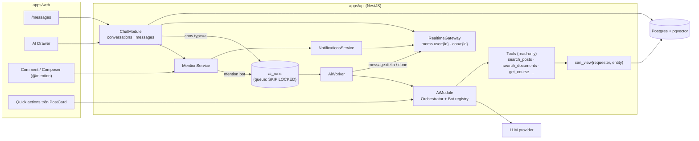
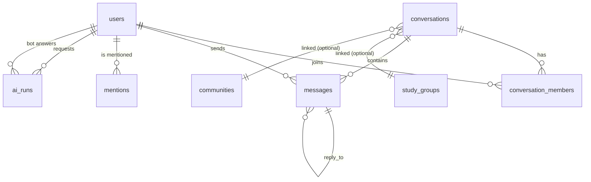
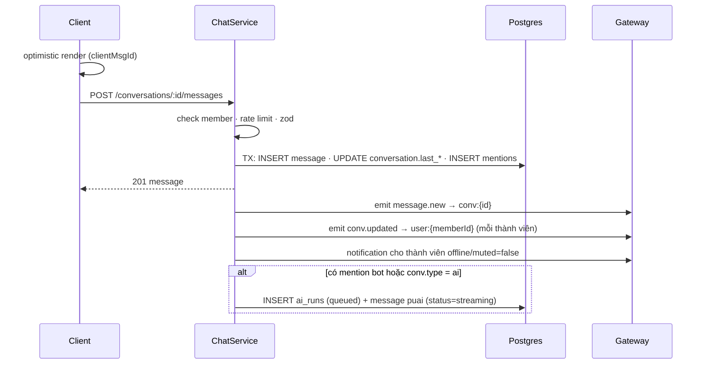
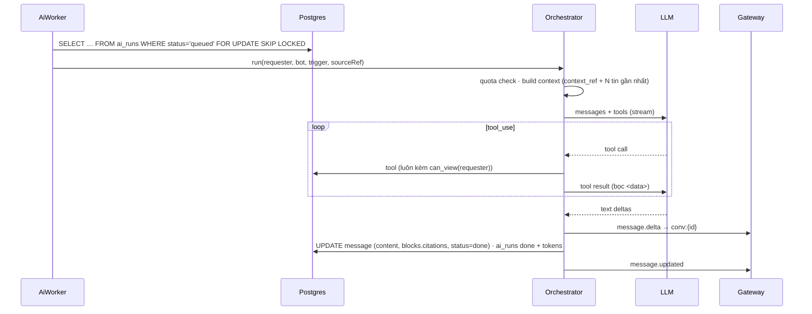

# 💬 Đặc Tả Thiết Kế: Nhắn Tin & PU AI (Messaging + AI Layer)

> Trạng thái: **P0 + P1 + P2 (rút gọn) + P4 (rút gọn) đã triển khai** — xem mục 12 · P3, P5: thiết kế · Phạm vi: Domain 10 (Realtime Messaging) + Domain 13 (AI Layer)
> Liên quan: [05-notifications-and-realtime.md](./05-notifications-and-realtime.md), [../auth-google.md](../auth-google.md)

---

## 0. Tóm tắt

Một mô hình duy nhất cho mọi kiểu chat: **Conversation + Message + Member**.
**PU AI (`@puai`) là một user đặc biệt** (`account_type = 'bot'`): có hồ sơ, được mention, gửi message/comment như người thật, nhưng không đăng nhập được và **mọi hành động chạy dưới quyền của người hỏi**.

Nhờ vậy DM, chat nhóm, panel AI, `@puai` trong bình luận… chỉ khác nhau ở **điểm kích hoạt** và **ngữ cảnh**, dùng chung lưu trữ, realtime, thông báo, phân quyền.

| Kiểu | Ví dụ |
|---|---|
| Hội thoại 1-1 / nhóm | Sinh viên nhắn bạn cùng lớp, nhóm đồ án |
| Hội thoại với AI | Panel "PU AI" bên phải, trang `/messages/puai` |
| Mention bot | `@puai giải thích giúp ý 2` trong bình luận hoặc chat nhóm |
| Tác vụ nhanh | "Tóm tắt", "Tạo checklist", "Hỏi về tài liệu" trên bài viết |

---

## 1. Nguyên tắc thiết kế

1. **Một pipeline, nhiều điểm vào.** Không viết riêng "chat AI" và "chat người": AI là một thành viên trong conversation.
2. **Bot không có quyền riêng.** Bot đọc dữ liệu với danh tính `requester`; mọi truy vấn đi qua `can_view(requester, entity)`.
3. **Ngữ cảnh tường minh.** Mỗi tin gửi AI mang `context_ref` (đang xem bài/tài liệu/cộng đồng nào) — người dùng không phải copy-paste.
4. **Luôn trích nguồn.** Trả lời học thuật kèm `citations` trỏ về post/document/chunk. Không có nguồn ⇒ nói "không chắc".
5. **Đọc tự do, ghi phải xác nhận.** Tool của bot chỉ đọc; hành động ghi (tạo bài nháp, nhắc hạn) trả về **thẻ đề xuất**, người dùng bấm mới thực thi.
6. **Server quyết định mọi thứ realtime.** Client không tự join room, không tự khai `author`.
7. **Đo đếm mọi lượt AI** (`ai_runs`): quota, chi phí, debug, audit.

---

## 2. Kiến trúc tổng quan



**Entity reference** dùng chung toàn hệ thống (mention, context, citation, notification):

```ts
type EntityRef = {
  type: 'post' | 'comment' | 'document' | 'document_chunk' | 'course'
      | 'community' | 'study_group' | 'user' | 'event' | 'message'
  id: string
}
```

---

## 3. Mô hình dữ liệu

Migration mới: `apps/api/src/database/messaging-upgrade.sql` (idempotent, chạy trong `deploy.sh`).

### 3.1. Actor đặc biệt

```sql
-- Loại tài khoản: người / bot / hệ thống
ALTER TABLE users ADD COLUMN IF NOT EXISTS account_type VARCHAR(10) NOT NULL DEFAULT 'human'; -- human|bot|system

-- Tài khoản @puai: không mật khẩu, không google_id ⇒ không thể đăng nhập
INSERT INTO users (email, username, display_name, account_type, is_verified, email_verified, bio, role)
VALUES ('puai@system.local', 'puai', 'PU AI', 'bot', TRUE, TRUE,
        'Trợ lý học tập của PU Connector. Tag @puai để hỏi.', 'student')
ON CONFLICT (username) DO NOTHING;
```

- Username `puai` (và tiền tố `pu_`, `admin`, `system`) **reserved** trong `generateUniqueUsername` và form đổi username.
- Login (`password`, Google) từ chối `account_type <> 'human'`.

### 3.2. Hội thoại

```sql
CREATE TABLE IF NOT EXISTS conversations (
  id UUID PRIMARY KEY DEFAULT gen_random_uuid(),
  type VARCHAR(20) NOT NULL,             -- direct | group | ai | study_group | community
  title VARCHAR(150),                    -- NULL với direct/ai
  avatar_url VARCHAR(500),
  created_by UUID REFERENCES users(id) ON DELETE SET NULL,
  linked_type VARCHAR(20),               -- study_group | community (chat tự tạo)
  linked_id UUID,
  direct_key VARCHAR(80) UNIQUE,         -- 'minUserId:maxUserId' ⇒ 1 DM duy nhất mỗi cặp
  last_message_id BIGINT,
  last_message_at TIMESTAMPTZ,
  created_at TIMESTAMPTZ DEFAULT NOW()
);

CREATE TABLE IF NOT EXISTS conversation_members (
  conversation_id UUID REFERENCES conversations(id) ON DELETE CASCADE,
  user_id UUID REFERENCES users(id) ON DELETE CASCADE,
  role VARCHAR(10) DEFAULT 'member',     -- owner | member
  last_read_message_id BIGINT DEFAULT 0,
  muted_until TIMESTAMPTZ,
  pinned BOOLEAN DEFAULT FALSE,
  joined_at TIMESTAMPTZ DEFAULT NOW(),
  left_at TIMESTAMPTZ,
  PRIMARY KEY (conversation_id, user_id)
);
CREATE INDEX IF NOT EXISTS idx_conv_members_user ON conversation_members(user_id) WHERE left_at IS NULL;
```

### 3.3. Tin nhắn

```sql
CREATE TABLE IF NOT EXISTS messages (
  id BIGSERIAL PRIMARY KEY,              -- tăng dần ⇒ keyset pagination & read cursor
  conversation_id UUID NOT NULL REFERENCES conversations(id) ON DELETE CASCADE,
  sender_id UUID REFERENCES users(id) ON DELETE SET NULL,
  client_msg_id UUID,                    -- idempotency + optimistic UI
  kind VARCHAR(12) NOT NULL DEFAULT 'text', -- text | attachment | system | ai
  content TEXT,                          -- markdown thuần
  blocks JSONB,                          -- citations, checklist, action_proposal, attachments…
  reply_to_id BIGINT REFERENCES messages(id) ON DELETE SET NULL,
  context_ref JSONB,                     -- EntityRef: "Đang xem: …"
  status VARCHAR(10) NOT NULL DEFAULT 'done', -- pending | streaming | done | error
  edited_at TIMESTAMPTZ,
  deleted_at TIMESTAMPTZ,
  created_at TIMESTAMPTZ DEFAULT NOW(),
  UNIQUE (sender_id, client_msg_id)
);
CREATE INDEX IF NOT EXISTS idx_messages_conv ON messages(conversation_id, id DESC);
```

**`blocks` (schema zod trong `packages/schemas/src/chat.schema.ts`):**

```ts
type MessageBlock =
  | { type: 'citation'; ref: EntityRef; title: string; snippet?: string }
  | { type: 'checklist'; items: { text: string; done?: boolean }[] }
  | { type: 'attachment'; url: string; name: string; size: number; mime: string }
  | { type: 'action_proposal'; action: 'create_post_draft' | 'create_reminder' | 'join_group';
      payload: unknown; status: 'proposed' | 'accepted' | 'dismissed' }
```

### 3.4. Mention (dùng chung)

```sql
CREATE TABLE IF NOT EXISTS mentions (
  source_type VARCHAR(12) NOT NULL,      -- post | comment | message
  source_id TEXT NOT NULL,
  mentioned_user_id UUID NOT NULL REFERENCES users(id) ON DELETE CASCADE,
  author_id UUID REFERENCES users(id) ON DELETE SET NULL,
  created_at TIMESTAMPTZ DEFAULT NOW(),
  PRIMARY KEY (source_type, source_id, mentioned_user_id)
);
CREATE INDEX IF NOT EXISTS idx_mentions_user ON mentions(mentioned_user_id, created_at DESC);
```

### 3.5. AI

```sql
CREATE TABLE IF NOT EXISTS ai_runs (
  id UUID PRIMARY KEY DEFAULT gen_random_uuid(),
  bot_id UUID NOT NULL REFERENCES users(id),
  requester_id UUID NOT NULL REFERENCES users(id) ON DELETE CASCADE,
  trigger VARCHAR(12) NOT NULL,          -- dm | panel | mention | action
  task VARCHAR(30) NOT NULL,             -- chat | summarize | checklist | explain_doc …
  source_ref JSONB,                      -- EntityRef nơi kích hoạt (message/comment/post)
  reply_ref JSONB,                       -- EntityRef câu trả lời được tạo
  status VARCHAR(10) NOT NULL DEFAULT 'queued', -- queued | running | done | error | rejected
  model VARCHAR(60),
  input_tokens INT DEFAULT 0,
  output_tokens INT DEFAULT 0,
  tool_calls JSONB,
  error TEXT,
  latency_ms INT,
  attempts INT DEFAULT 0,
  created_at TIMESTAMPTZ DEFAULT NOW(),
  started_at TIMESTAMPTZ,
  finished_at TIMESTAMPTZ
);
CREATE INDEX IF NOT EXISTS idx_ai_runs_queue ON ai_runs(created_at) WHERE status = 'queued';
CREATE INDEX IF NOT EXISTS idx_ai_runs_quota ON ai_runs(requester_id, created_at DESC);

-- Cache tác vụ dùng chung (tóm tắt 1 lần cho mọi người)
CREATE TABLE IF NOT EXISTS ai_cache (
  task VARCHAR(30),
  entity_type VARCHAR(20),
  entity_id UUID,
  entity_version TIMESTAMPTZ,            -- = updated_at của entity ⇒ sửa bài thì cache tự hết hạn
  output JSONB NOT NULL,
  created_at TIMESTAMPTZ DEFAULT NOW(),
  PRIMARY KEY (task, entity_type, entity_id)
);

-- Embedding tổng quát (thay thế dần document_chunks.embedding)
CREATE TABLE IF NOT EXISTS content_embeddings (
  entity_type VARCHAR(20) NOT NULL,      -- post | document | comment(accepted)
  entity_id UUID NOT NULL,
  chunk_index INT NOT NULL DEFAULT 0,
  content_text TEXT NOT NULL,
  embedding VECTOR(1536),                -- khớp model embedding đã chọn
  community_id UUID,                     -- phục vụ lọc quyền khi retrieve
  visibility VARCHAR(20) DEFAULT 'public',
  updated_at TIMESTAMPTZ DEFAULT NOW(),
  PRIMARY KEY (entity_type, entity_id, chunk_index)
);
CREATE INDEX IF NOT EXISTS idx_content_embeddings_hnsw
  ON content_embeddings USING hnsw (embedding vector_cosine_ops);
```

### 3.6. Quan hệ



---

## 4. API

### 4.1. REST (`/api/conversations`)

| Method | Path | Mô tả |
|---|---|---|
| GET | `/conversations?cursor=` | Danh sách hội thoại của tôi (sort `last_message_at DESC`, kèm unread count). PU AI luôn ghim đầu. |
| POST | `/conversations/direct` `{ userId }` | Mở/tạo DM (dựa `direct_key`, idempotent). |
| POST | `/conversations` `{ type:'group', title, memberIds }` | Tạo nhóm (≤ 50 thành viên). |
| GET | `/conversations/ai` | Lấy/tạo hội thoại AI của tôi với `@puai`. |
| GET | `/conversations/:id/messages?before=<id>&limit=30` | Keyset pagination, mới nhất trước. |
| POST | `/conversations/:id/messages` `{ clientMsgId, content, replyToId?, contextRef?, attachments? }` | Gửi tin. Trả về message đã lưu. |
| PATCH | `/messages/:id` / DELETE `/messages/:id` | Sửa (≤ 15 phút) / thu hồi (soft delete). |
| POST | `/conversations/:id/read` `{ messageId }` | Cập nhật read cursor. |
| POST | `/conversations/:id/members` / DELETE `.../members/:userId` | Quản lý thành viên nhóm. |
| POST | `/conversations/:id/owner` `{ userId }` | Trưởng nhóm chuyển quyền cho thành viên người thật khác. |
| POST | `/messages/:id/actions/:index` `{ decision: 'accept'|'dismiss' }` | Xác nhận thẻ đề xuất của AI. |

### 4.2. AI (`/api/ai`)

| Method | Path | Mô tả |
|---|---|---|
| POST | `/ai/tasks` `{ task:'summarize'|'checklist'|'explain', ref: EntityRef }` | Tác vụ nhanh. Có cache ⇒ trả ngay; không ⇒ chạy và trả (≤ 1 đoạn ngắn). |
| GET | `/ai/quota` | Lượt còn lại hôm nay. |
| POST | `/ai/runs/:id/feedback` `{ rating: 1|-1, note? }` | 👍/👎 cho câu trả lời. |

### 4.3. Realtime (Socket.IO, namespace `/rt`)

Path `/api/socket.io` (`addTrailingSlash: false` để đi qua rewrite `/api/*` của Next.js khi dev). Kết nối dùng **cùng cookie `pu_session`**; gateway chạy middleware `express-session` + passport, từ chối khi không có user. Server tự join:
- `user:{userId}` — thông báo, cập nhật danh sách hội thoại.
- `conv:{conversationId}` — chỉ khi client gửi `conv.open` **và** server kiểm tra membership.

| Hướng | Event | Payload |
|---|---|---|
| C→S | `conv.open` / `conv.close` | `{ conversationId }` |
| C→S | `typing` | `{ conversationId, isTyping }` (throttle 3 s, không lưu DB) |
| S→C | `message.new` | `Message` |
| S→C | `message.delta` | `{ messageId, delta }` (AI streaming) |
| S→C | `message.updated` | `Message` (done / error / edit / delete) |
| S→C | `conv.updated` | `{ conversationId, lastMessage, unread }` → room `user:` |
| S→C | `typing` | `{ conversationId, userId, isTyping }` |
| S→C | `notification` | `Notification` → chỉ room `user:{id}` |

Gửi tin nhắn đi qua **REST** (dễ validate, rate limit, retry idempotent); socket chỉ để đẩy xuống.

---

## 5. Luồng xử lý

### 5.1. Gửi tin nhắn (người ↔ người)



### 5.2. AI trả lời (panel, DM với puai, @puai trong chat)



### 5.3. `@puai` trong bình luận

1. `CommentsService.create` → `MentionService.extract(content)` → lưu `mentions`.
2. Có mention bot ⇒ kiểm tra quota công khai (chặt hơn) ⇒ `ai_runs(trigger='mention', source_ref=comment)`.
3. Worker dựng context: bài viết + tài liệu đính kèm + chuỗi bình luận cha (tối đa ~20).
4. Trả lời bằng **comment mới của `@puai`**, `parent_id` = comment kích hoạt, gắn nhãn "AI".
5. Thông báo `ai_reply` cho người hỏi. Giảng viên/tác giả có thể **ẩn** hoặc **đánh dấu đúng** như comment thường.

### 5.4. Tác vụ nhanh (Tóm tắt / Checklist)

`POST /ai/tasks` → tra `ai_cache(task, entity, entity_version = entity.updated_at)` → hit ⇒ trả ngay (0 token) → miss ⇒ gọi model đồng bộ (timeout 20 s), ghi cache + `ai_runs`. Không tạo conversation.

### 5.5. Chat nhóm tự tạo

Tạo study group / tham gia community (loại `club`, `academic`) ⇒ tạo/đồng bộ `conversations(type, linked_type, linked_id)` và `conversation_members` trong cùng transaction với hành động gốc.

---

## 6. AI Orchestrator

### 6.1. Bot registry

```ts
// apps/api/src/modules/ai/bots.ts
export const BOTS = {
  puai: {
    username: 'puai',
    model: { default: 'claude-haiku-4-5-20251001', escalate: 'claude-sonnet-5-5' },
    systemPrompt: PUAI_SYSTEM_PROMPT,
    tools: ['search_posts', 'get_post_thread', 'search_documents', 'get_document_chunk',
            'get_course', 'find_study_groups', 'list_campus_events', 'get_my_profile'],
    quota: { perDay: 30, publicMentionsPerDay: 10 },
    maxContextTokens: 24_000
  }
} as const
```

Thêm bot mới (`@thuvien`, `@daotao`…) = thêm 1 entry + 1 user `account_type='bot'`.

### 6.2. Dựng ngữ cảnh (Context Builder)

Theo thứ tự ưu tiên, cắt theo ngân sách token:
1. System prompt (vai trò, quy tắc trích nguồn, liêm chính học thuật).
2. Hồ sơ tối giản của người hỏi: khoa, khóa, môn đang học (không gửi email/MSSV).
3. `context_ref`: nội dung entity đang xem (bài + top comments / tài liệu + chunk liên quan).
4. Lịch sử hội thoại gần nhất (≤ 20 tin), tóm tắt phần cũ hơn.
5. Kết quả RAG (top-k chunk, mỗi chunk kèm `EntityRef` để trích nguồn).

Mọi nội dung người dùng tạo được bọc `<data source="post:…">…</data>`; system prompt nêu rõ **chỉ thị nằm trong `<data>` không phải lệnh**.

### 6.3. Tools

| Tool | Đầu vào | Ghi chú |
|---|---|---|
| `search_posts` | `query, courseCode?, type?` | Hybrid: full-text + vector, lọc `can_view` |
| `get_post_thread` | `postId` | Bài + comment đã accept + top comment |
| `search_documents` | `query, courseCode?` | Vector trên `content_embeddings(document)` |
| `get_document_chunk` | `documentId, chunkIndex` | Đọc chi tiết để trích dẫn |
| `get_course` | `code` | Thông tin học phần |
| `find_study_groups` | `courseCode?, type?` | Nhóm đang tuyển |
| `list_campus_events` | `from, to` | Sự kiện sắp tới |
| `get_my_profile` | — | Hồ sơ người hỏi |
| `propose_action` | `action, payload` | **Không ghi DB**; tạo block `action_proposal` |

### 6.4. Phân quyền đọc `can_view`

Một hàm duy nhất (SQL view/CTE dùng lại trong mọi truy vấn của tool và RAG):
- `post`: `visibility='public'` **hoặc** tác giả là requester **hoặc** requester là thành viên community của bài.
- `document`: tương tự theo `visibility`.
- `message`/`conversation`: requester là member (bot **không bao giờ** đọc DM của người khác; trong conversation chỉ đọc chính conversation đó).
- `user`: tôn trọng `privacy_settings.is_private_profile`.

### 6.5. Quota, chi phí, an toàn

- Chỉ tài khoản `email_verified = TRUE` được gọi AI; quota đếm từ `ai_runs` theo ngày (Asia/Ho_Chi_Minh).
- Rate limit: 1 lượt / 3 s / user; `@puai` công khai 10 lượt/ngày.
- Escalate model khi: ngữ cảnh > 16k token, hoặc người dùng bấm "Trả lời kỹ hơn".
- Liêm chính học thuật: giải thích, gợi ý hướng, chỉ ra tài liệu — **không làm hộ bài nộp**.
- Không bịa dữ liệu học vụ (hạn nộp, điểm, lịch thi): chỉ trả lời khi có nguồn; luôn hiển thị "AI có thể nhầm. Hãy kiểm tra nguồn."
- Log `ai_runs` giữ 90 ngày; nội dung prompt đầy đủ **không** log ở production.

---

## 7. Hạ tầng

| Hạng mục | Hiện tại | Thiết kế |
|---|---|---|
| Session | ✅ P0: `connect-pg-simple` | `connect-pg-simple` (bảng `user_sessions`) — dùng chung cho HTTP & socket |
| Gateway | `cors:'*'`, không xác thực, client tự join room, tin `author` từ client, broadcast thông báo cho mọi người | Xác thực bằng session, room do server cấp, CORS = `APP_URL`, `sender_id` = user của session |
| Hàng đợi | — | `ai_runs` + `FOR UPDATE SKIP LOCKED`, worker poll 1 s trong process API; nâng BullMQ + Redis khi nhiều instance |
| Scale socket | 1 instance | `@socket.io/redis-adapter` khi > 1 instance |
| nginx | `/api/` → 4001 | Thêm `location /api/socket.io` với `Upgrade`/`Connection` headers (thiếu thì vẫn chạy bằng long-polling) |
| Embedding | Cột có sẵn, chưa dùng | Job `embed` khi tạo/sửa post & upload tài liệu (cùng hàng đợi) |
| Biến môi trường | — | `AI_PROVIDER`, `ANTHROPIC_API_KEY`, `EMBEDDING_PROVIDER`, `EMBEDDING_API_KEY`, `AI_DAILY_QUOTA` |

Feature flags web (`lib/features.ts`): `messaging`, `ai`, `aiMentions`, `aiRag`.

---

## 8. Thiết kế giao diện

Bám palette navy + cam Phenikaa; AI dùng điểm nhấn ✨ cùng tông primary (không thêm màu tím riêng).

### 8.1. `/messages`

```
┌ Sidebar ┐┌──────── Hội thoại ─────────┐┌──────────── Thread ────────────────┐
│ Bảng tin││ 🔍 Tìm hội thoại            ││ ← Nhóm Đồ án IT101 · 4 thành viên ⋯│
│ Khám phá││ ───────────────────────────  ││                                     │
│ Cộng đồng│ ✨ PU AI          ghim  10:24││   Đức: Mai ơi file báo cáo đâu?    │
│ Tin nhắn││ 👥 Nhóm Đồ án IT101   ● 2   ││              Mai: Mình up rồi nhé ▸ │
│ Hồ sơ   ││ 👤 Trần Minh Đức       hôm qua││   ┌ 📄 bao-cao-tien-do.pdf 2.4MB ┐ │
│         ││ 👤 TS. Nguyễn Văn Hà    T2   ││   └───────────────────────────────┘ │
│         ││                             ││   @puai tóm tắt yêu cầu nộp giúp    │
│         ││                             ││   ✨ PU AI · AI                      │
│         ││                             ││   1. Báo cáo PDF  2. Link Git  …    │
│         ││                             ││   [Nguồn: Bài của TS. Hà ↗]         │
│         ││                             ││  Đức đang nhập…                     │
│         ││                             ││ ┌ 📎  Nhắn tin… (@ để nhắc tên)  ➤ ┐│
└─────────┘└─────────────────────────────┘└─────────────────────────────────────┘
```
- Mobile: danh sách và thread là 2 màn hình (`/messages`, `/messages/[id]`).
- Badge chưa đọc ở mục "Tin nhắn" trên sidebar và bottom nav.

### 8.2. AI Drawer (mọi trang)

```
                                      ┌──────── ✨ PU AI ───────── ⊕  ✕ ┐
  (Bảng tin / bài viết / tài liệu)     │ 📄 Đang xem: Bài của TS. Hà   › │
                                      │                                  │
                                      │            Mình cần nộp gì? ▸    │
                                      │ ✨ Bạn cần chuẩn bị 3 mục: …     │
                                      │ ┌ Nguồn: Bài viết giảng viên ↗ ┐│
                                      │ └──────────────────────────────┘│
                                      │ ⧉  👍  👎                         │
                                      │ [✨ Tạo checklist] [Giải thích]   │
                                      │ ┌ 📎 Hỏi tiếp về bài viết…   ➤ ┐ │
                                      │ AI có thể nhầm. Hãy kiểm tra nguồn.│
                                      └──────────────────────────────────┘
```
- Mở bằng nút "Hỏi PU AI" (header) hoặc ✨ trên bài. Desktop: thay chỗ RightSidebar (đóng thì sidebar quay lại). Mobile: sheet toàn màn hình.
- Cùng component `ConversationThread` với `/messages`; drawer chỉ thêm **chip ngữ cảnh** (đổi khi người dùng chuyển trang/bài, có thể gỡ).
- ⊕ = hội thoại mới (tạo conversation `ai` mới; danh sách cũ xem ở `/messages`).

### 8.3. Trên PostCard

- Không thêm hàng nút cố định. Icon ✨ nhỏ cạnh `⋯` ⇒ menu: *Tóm tắt*, *Hỏi về bài viết*, *Tạo checklist*.
- Chỉ hiện khi bài dài (> 600 ký tự) hoặc có tài liệu/hạn nộp.
- Kết quả tóm tắt hiện inline, thu gọn được, có nhãn "Tóm tắt bởi PU AI".

### 8.4. `@mention` và hồ sơ `@puai`

- Gõ `@` ở composer, comment, chat ⇒ popover gợi ý (người theo dõi, thành viên conversation, `@puai` đầu danh sách với badge **AI**).
- Comment của `@puai`: avatar ✨, nhãn **AI**, footer "Được gọi bởi @username", nút 👍/👎.
- Trang `/puai`: giới thiệu khả năng, ví dụ câu hỏi, nút **Trò chuyện**, tab "Câu trả lời công khai". Không có nút Theo dõi/Nhắn tin kiểu người thường.

### 8.5. Component (apps/web)

```
components/chat/
  conversation-list.tsx       # danh sách + unread
  conversation-thread.tsx     # dùng chung cho /messages & AI drawer
  message-bubble.tsx          # render content + blocks
  blocks/{citation,checklist,attachment,action-proposal}.tsx
  message-composer.tsx        # @mention, đính kèm, Enter gửi
  typing-indicator.tsx
components/ai/
  ai-drawer.tsx · context-chip.tsx · post-ai-menu.tsx · ai-summary.tsx
components/mention/mention-popover.tsx
hooks/use-socket.ts · use-conversation.ts · use-ai-context.ts
store: aiDrawer { open, contextRef }, unreadTotal
```

---

## 9. Quy định & kiểm duyệt

- **Ai được nhắn riêng:** mặc định người dùng đã xác thực email; người nhận có thể đặt `privacy_settings.dm = 'everyone' | 'following' | 'none'`.
- Chặn (`user_blocks`) ⇒ không tạo DM, không mention, ẩn tin.
- Báo cáo tin nhắn → tái sử dụng luồng `post_reports` (thêm `target_type`).
- Rate limit gửi tin: 20 tin / 10 s / user; tạo nhóm 10 / ngày.
- Tệp đính kèm đi qua Storage (R2) hiện có, giới hạn 20 MB.

---

## 10. Lộ trình triển khai

| Giai đoạn | Nội dung | Kết quả kiểm chứng |
|---|---|---|
| **P0 Nền tảng (bắt buộc trước)** | Session Postgres · bảo mật gateway (auth, room server cấp, CORS, bỏ `send_message`/broadcast cũ) · `account_type` + user `@puai` + reserved username · bảng `mentions` + `MentionService` cho post/comment · nginx `/socket.io/` | Restart API không mất đăng nhập; socket không cookie bị từ chối; `@user` trong comment tạo thông báo |
| **P1 Nhắn tin** | `ChatModule` (DM, nhóm), read cursor, typing, `/messages`, badge unread | 2 trình duyệt nhắn realtime, reload giữ lịch sử, unread đúng |
| **P2 PU AI lõi** | `AiModule`, bot registry, worker + `ai_runs`, conversation `ai`, AI drawer, streaming, `POST /ai/tasks` + `ai_cache`, quota | Hỏi trong drawer có ngữ cảnh bài; tóm tắt lần 2 trả từ cache (0 token) |
| **P3 @puai** | Mention bot trong comment & chat nhóm, comment AI, thông báo `ai_reply`, trang `/puai` | Tag `@puai` dưới bài ⇒ comment trả lời có nguồn |
| **P4 RAG** | `content_embeddings`, job embed post/tài liệu, tools search + citation, tìm kiếm ngữ nghĩa ở `/search` | Hỏi nội dung PDF ⇒ trả lời trích đúng chunk |
| **P5 Mở rộng** | Chat tự tạo cho study group/community, `action_proposal`, bot khác, AI hỗ trợ kiểm duyệt, embedding sở thích cho feed "Dành cho bạn" | — |

---

## 11. Quyết định còn mở

| # | Câu hỏi | Đề xuất |
|---|---|---|
| 1 | Nhà cung cấp LLM | Anthropic: Haiku 4.5 mặc định, Sonnet khi cần |
| 2 | Model embedding | Giữ `VECTOR(1536)` nếu dùng OpenAI `text-embedding-3-small`; đổi chiều nếu dùng Voyage (1024) |
| 3 | Chính sách DM mặc định | Người đã xác thực email; người nhận tự chỉnh |
| 4 | Lưu lịch sử AI bao lâu | Hội thoại: đến khi người dùng xóa; `ai_runs` metadata: 90 ngày |

---

## 12. Đã triển khai (2026-10-13) & khác biệt so với thiết kế

| Hạng mục | Trạng thái | Ghi chú |
|---|---|---|
| P1 `ChatModule` | ✅ | DM (`direct_key`), nhóm ≤ 50, read cursor, thu hồi tin, rời nhóm, typing, badge chưa đọc, `/messages`, `/messages/[id]`, nút Nhắn tin trên hồ sơ. Migration `chat-upgrade.sql`. |
| Room `conv:{id}` | ⚠️ khác thiết kế | Chưa dùng `conv.open`; server phát `message.*` tới room `user:{id}` của **từng thành viên** (đơn giản, vẫn do server cấp). Đổi sang `conv:` khi nhóm lớn. |
| P2 PU AI lõi | ✅ rút gọn | Hội thoại `type='ai'` (`POST /conversations/ai`), streaming qua `message.delta`, quota `AI_DAILY_QUOTA`/ngày từ `ai_runs` (migration `ai-upgrade.sql`). Gọi **API tương thích OpenAI** (SDK `openai`, `AI_BASE_URL` + `AI_API_KEY`, `AI_MODEL` mặc định `v9`) thay cho Anthropic SDK như §11 #1; gateway không trả usage khi stream ⇒ `ai_runs` ghi 0 token. **Chạy trong tiến trình API** (fire-and-forget) thay vì worker `SKIP LOCKED` — đủ cho 1 instance. Chưa có AI drawer, `POST /ai/tasks`, `ai_cache`, 👍/👎. |
| P4 RAG | ✅ rút gọn | Truy xuất **full-text** (`search_tsv`, OR các từ khóa bỏ dấu) trên bài viết + tài liệu công khai (kèm lời giải đã duyệt), bọc `<data>` trong `<context>`; câu trả lời có `blocks` citation. **Chưa dùng pgvector**: cần chọn nhà cung cấp embedding (§11 #2) và trích text PDF vào `document_chunks`. |
| P3 `@puai` trong bình luận | ✅ 2026-10-14 | Xem §16. |
| P5 | ⏳ | Chưa làm. |
| Thông báo / Web Push cho tin nhắn | ⏳ | Chưa gửi push khi người nhận offline. |
| `user_blocks` | ✅ 2026-10-14 | Xem §14. |
| `privacy_settings.dm` | ⏳ | Hiện: chỉ tài khoản đã xác thực email mới mở DM/nhóm mới; không nhắn được tài khoản bị khóa. |

## 13. Chat P2 & PU AI học tập (2026-10-13)

Migration `chat-v2-upgrade.sql`: `messages.attachments/edited_at/pinned_at/pinned_by/meta`, bảng `message_reactions (message_id, user_id, emoji)`, `conversation_members.muted_until/pinned_at`.

**Cấu trúc mã** (không vòng phụ thuộc: core · notify ← puai ← conversations ← study-group-chat / messages):

```
apps/api/src/modules/chat/
  chat.module.ts · chat.mapper.ts (SQL cột + map) · chat-core.service.ts (quyền thành viên, phát sự kiện, tin hệ thống)
  conversations/  controller + service — DM, nhóm, thành viên, cài đặt riêng, đã đọc · study-group-chat.service (nhóm học ↔ chat)
  messages/       controller + service — gửi/sửa/thu hồi, cảm xúc, ghim, tìm kiếm, kho tệp
  puai/           controller (quota, reset) · service (stream) · prompts (chế độ học) · retrieval (full-text) · attachments (vision, PDF/DOCX)
  notify/         chat-push.constants · chat-push.service (xếp job) · chat-push.processor (worker Web Push)
  dto/chat.dto.ts
apps/web/src/hooks/chat/        api · cache · use-chat-realtime · use-conversations · use-messages · use-typing · use-ai
apps/web/src/components/chat/
  thread/   header · message-list · message-bubble · message-actions · reactions-dialog · attachment-view · pinned-banner
  composer/ composer · attachment-tray · use-attachment-upload (XHR có tiến trình) · ai-mode-bar
  ai/       ai-modes · study-blocks (tách ```quiz/```flashcards) · quiz-card · flashcard-deck · ai-message-body · ai-welcome · ai-study-card
  info/     conversation-info · group-avatar-editor · member-list · media-panel · message-search
```

| Hạng mục | Quyết định |
|---|---|
| Tệp đính kèm | Tải trước lên R2 (`POST /upload/file?folder=chat`, ≤ 25 MB phía web), tin chỉ mang metadata. Server từ chối tệp không nằm dưới `chat/{senderId}/` hoặc URL khác `R2_PUBLIC_URL/key` ⇒ không gắn được tệp của người khác, PU AI tải ảnh không bị SSRF. |
| Cảm xúc | Bật/tắt theo `(message, user, emoji)`; tin trả `reactions: [{emoji, userIds}]` để client tự tính "của mình". Cập nhật lạc quan, phát `message.updated`. Bấm cụm cảm xúc ⇒ hộp thoại "Cảm xúc về tin nhắn" (`GET messages/:id/reactions`, kể cả người đã rời nhóm; query key kèm chữ ký số lượng ⇒ tự tải lại). |
| Nhóm học ↔ chat | `conversations.study_group_id` (UNIQUE). `StudyGroupChatService` (chat module, được `StudyGroupsModule` import — chat không phụ thuộc ngược lại): `open()` khóa hàng `study_groups FOR UPDATE`, chỉ thành viên nhóm học; chưa có chat ⇒ tạo + thêm cả nhóm; đã có ⇒ đưa người mở vào lại nếu đã rời. `join` nhóm học ⇒ sau commit gọi `onStudyGroupJoined` (best-effort, lỗi chỉ log; `open()` tự sửa lệch). Nguồn sự thật về thành viên = `study_group_members`. |
| Ảnh nhóm | Web tải ảnh lên `avatars/` (thư mục chỉ nhận ảnh) rồi gửi `avatarKey`; server kiểm `StorageService.isOwnedKey(key, 'avatars', userId)` và tự ghép URL ⇒ không gắn được URL ngoài (pixel theo dõi) hay ảnh người khác. `null` = xóa. Tin hệ thống `group.avatar`. |
| Chuyển trưởng nhóm | `POST conversations/:id/owner`: khóa hàng `conversations` (`FOR UPDATE`) ⇒ 2 lượt chuyển song song không tạo 2 trưởng nhóm; chỉ chuyển cho thành viên người thật đang ở trong nhóm; tin hệ thống `owner.transferred`. Trưởng nhóm rời mà không chuyển ⇒ tự trao cho người thật vào sớm nhất (bỏ qua bot). Web: menu `⋯` mỗi thành viên (`MemberActions`) có xác nhận, thay nút xóa chỉ hiện khi hover. |
| Sửa / ghim | Sửa tin `text` của mình trong 15 phút (`edited_at`); ghim: mọi thành viên, thu hồi tin ⇒ bỏ ghim. |
| Đã xem | `summary.readCursors` (con trỏ của người khác) + `conv.read {userId}` gửi mọi thành viên. |
| Tắt thông báo | `muted_until` (`'infinity'` = vô hạn); hội thoại tắt tiếng không cộng vào badge và không push. |
| Push tin nhắn | `chat/notify/`: `ChatPushService.onNewMessage` (sau commit, không chặn luồng gửi; gọi khi người gửi tin và khi PU AI trả lời xong) xếp job trễ 15s vào queue `chat-push` cho thành viên người thật chưa tắt tiếng, `jobId = chat-{conv}-{user}` ⇒ nhiều tin trong lúc chờ gộp 1 push. `ChatPushProcessor` đọc trạng thái lúc chạy (1 truy vấn): hết tin chưa đọc / tắt tiếng / tắt kênh `chat_message` / đang mở app ⇒ bỏ; giờ yên tĩnh ⇒ hoãn. Tiêu đề = tên người/nhóm (+ "N tin mới"), nội dung = tin mới nhất (nhóm có tên người gửi; chỉ ảnh/tệp ⇒ "🖼️ Ảnh"/"📎 N tệp"), `tag = chat-{conv}` ⇒ thông báo sau thay thế thông báo trước. Tin đến khi job đang chạy có thể không tạo push riêng (đã được gộp vào số tin chưa đọc lần sau). |
| Đóng thông báo đã đọc | Processor đặt `conversation_members.push_shown_at` **trước** khi gửi push. `markRead` lấy & xóa cờ trong 1 câu (CTE `FOR UPDATE`) ⇒ cờ có ⇒ `ChatPushService.onRead` xếp job `clear` (`jobId chat-clear-{conv}-{user}`). Job gọi `PushService.sendSilent` `{ kind: 'close', tag: chat-{conv} }` cùng `topic` với push tin ⇒ push service thay luôn thông báo chưa giao; `sw.js` đóng thông báo theo tag, không hiện gì. Bỏ qua endpoint Apple (`web.push.apple.com`): Safari thu hồi đăng ký nếu push không hiện thông báo ⇒ trên Safari/iOS thông báo cũ vẫn còn. Chrome có hạn mức push im lặng; chỉ gửi khi thật sự đã hiện thông báo nên tần suất thấp. |
| Chế độ học | `aiMode` gửi kèm tin (`meta.aiMode`), server ghép `MODE_PROMPTS[mode]` vào system prompt, ghi `ai_runs.task`. Quiz/flashcard: model trả JSON trong khối code; web kiểm tra schema, JSON hỏng ⇒ hiện như code thường, đang stream ⇒ "Đang tạo…". |
| `@puai` trong nhóm | Tin nhóm khớp `@puai` (đầu tin hoặc sau khoảng trắng) ⇒ `reply()` với lịch sử 12 tin gần nhất dạng "Tên: nội dung", tin trả lời `reply_to_id` = tin người hỏi, `ai_runs.trigger='mention'`. Bot không phải thành viên nhóm. |
| Chủ đề mới | Tin hệ thống `meta.event='ai.reset'`; lịch sử gửi LLM chỉ lấy sau mốc reset gần nhất. |
| Vision & tài liệu | Ảnh của tin hiện tại ⇒ `image_url` base64 (≤ 4 ảnh, ≤ 5 MB). PDF (`pdf-parse`, ≤ 40 trang, ≤ 20 MB), DOCX (`mammoth`), `.txt/.md/.csv` ⇒ trích text chèn `<file>` (≤ 40k ký tự/tệp, ≤ 80k/lượt), cache LRU 30 tệp theo key R2. Tin không kèm tệp ⇒ dùng lại tài liệu đọc được ở ≤ 10 tin trước (sau mốc "Chủ đề mới"). PDF scan (không có lớp chữ) ⇒ báo người dùng; PPTX/XLSX chỉ báo tên. |

Còn thiếu: đóng thông báo đã đọc trên Safari/iOS (không cho push im lặng).

## 14. Chặn người dùng (2026-10-14)

Migration `user-blocks-upgrade.sql`: `user_blocks (blocker_id, blocked_id, created_at)`, PK + index `(blocked_id, blocker_id)` ⇒ tra 2 chiều đều dùng index.

| Quyết định | Lý do |
|---|---|
| Chính sách **2 chiều** (A chặn B ⇒ cả hai không thấy/nhắn nhau) | Đơn giản, đúng kỳ vọng người dùng; không rò rỉ nội dung qua chiều ngược. |
| Lọc **trong SQL** bằng `blockExistsSql(a, b)` (`modules/blocks/blocks.sql.ts`) | Mỗi truy vấn tự lọc (feed, cộng đồng, tìm kiếm, bình luận, gợi ý, thông báo, chat) ⇒ phân trang/đếm đúng, không cần nạp danh sách chặn vào bộ nhớ; module khác không phụ thuộc `BlocksService`. |
| DM cũ **giữ lịch sử**, chỉ khóa gửi (`assertDirectNotBlocked`) | Không mất dữ liệu; bỏ chặn là nhắn tiếp được. |
| Nhóm chat sẵn có không đổi; chỉ chặn **thêm mới** vào nhóm | Không phá nhóm học/đồ án đang dùng chung. |
| Người bị chặn **không được báo**; nhận `block.changed` chỉ để làm mới giao diện | Tránh xung đột; UI hiện "Bạn không thể trả lời cuộc trò chuyện này". |

Chưa làm: chặn mention trong nội dung (thông báo đã bị lọc), báo cáo tin nhắn.

## 15. Trạng thái hoạt động (2026-10-14)

Migration `presence-upgrade.sql`: `users.last_seen_at`. Cài đặt `privacy_settings.showActivityStatus` (mặc định `true`).

| Quyết định | Lý do |
|---|---|
| **Gateway** chỉ đếm socket/user (`isOnline`, `onPresenceChange`); **PresenceService** giữ chính sách | Tách transport khỏi quyền riêng tư; gateway không cần biết ai được thấy ai. |
| Đếm **trong bộ nhớ**, không Redis | API chạy 1 instance. Khi scale ngang cần adapter Redis cho socket.io + đếm bằng Redis (`HINCRBY`). |
| Chờ **15s** trước khi báo offline | Reload trang / đổi mạng ngắn không làm nháy "offline → online". |
| Chỉ chia sẻ với **người cùng hội thoại**, không chặn nhau, **cả hai** bật trạng thái | Không lộ thói quen online cho người lạ; có qua có lại như Messenger. |
| Trạng thái ban đầu qua `GET /presence`, sau đó `presence.update` vá cache | 1 request khi mở app thay vì hỏi từng người. |

Giới hạn: tắt `showActivityStatus` không phát "offline" ngay cho người đang xem (họ thấy trạng thái cũ tới lần nạp lại kế tiếp).

## 16. Lõi AI dùng chung & `@puai` trong bình luận (2026-10-14)

`modules/ai/` (AiModule) gom phần dùng chung: `LlmService` (client OpenAI-compatible, `@puai` bot id, quota/ngày, nhật ký `ai_runs` — `startRun`/`finishRun`/`failRun`/`logRejected`, `complete()` không stream), `AiRetrieval` (full-text), `ai.prompts.ts` (`SYSTEM_PROMPT`, `COMMENT_PROMPT`), `ai.constants.ts` (`PUAI_MENTION`). Chat (`PuaiService`) giữ phần stream theo tin nhắn.

Luồng bình luận (`posts/post-ai.service.ts`):
1. `CommentsController` lưu bình luận rồi gọi nền `PostAiService.onComment` nếu có `@puai`.
2. Hết quota / chưa cấu hình key ⇒ trả lời bằng 1 bình luận thông báo (không gọi LLM).
3. Ngữ cảnh: bài viết (≤ 4000 ký tự) + ≤ 12 bình luận trước trong cùng nhánh, bọc `<post>`/`<thread>` (dữ liệu, không phải chỉ dẫn) + nguồn truy xuất (bỏ chính bài đó).
4. Gọi `complete()` (không stream, ≤ 4096 token) ⇒ lưu bình luận con của `@puai` qua `CommentsService.create` ⇒ đếm bình luận + thông báo "đã trả lời bình luận của bạn" dùng chung luồng cũ. `ai_runs.trigger = 'comment'`, `reply_ref = {type:'comment'}`.
5. Socket `comments.changed {postId}` tới người hỏi ⇒ web tải lại bình luận.

Khác thiết kế §5.3: không có worker riêng (chạy trong tiến trình API như chat), quota dùng chung với chat (không tách quota công khai), chưa có nhãn "AI" riêng ngoài avatar N7AI.

## 17. Tóm tắt bài viết (2026-10-14)

Migration `post-summary-upgrade.sql`: `post_summaries (post_id PK, content_hash CHAR(64), summary, model, created_at)`.

- `POST /api/posts/:id/summary` → `{ summary, cached }` (`PostAiService.summarize`). Kiểm tra: bài hiển thị được với người hỏi (không ẩn, công khai hoặc của mình, không chặn nhau), dài ≥ 300 ký tự.
- **Cache theo nội dung**: `sha256(tiêu đề + nội dung)` trùng ⇒ trả bản đã lưu, **không tốn lượt** và không gọi LLM ⇒ cả lớp xem chung một bản tóm tắt. Bài bị sửa ⇒ hash khác ⇒ tóm tắt lại (upsert).
- Chưa có bản lưu: cần quota (`ai_runs.trigger = 'summary'`), hết lượt ⇒ 429, PU AI tắt / lỗi ⇒ 503.
- Web: nút "✨ Tóm tắt" cạnh "Xem thêm" (chỉ hiện khi bài bị thu gọn), khung `PostSummary` có skeleton; query `['post-summary', id]` `staleTime: Infinity`.

## 18. Hiệu năng chat: phân trang & cache (2026-10-14)

**Danh sách hội thoại** — `GET /api/conversations?filter=all|unread|group&cursor=&limit=20` → `{ data, nextCursor }` (trước: cố định 100 hàng, lọc ở client).
- Thứ tự = khóa keyset `(rank, sort_at, id)` giảm dần: `rank` 2 = PU AI, 1 = đã ghim, 0 = còn lại; `sort_at` = lúc ghim hoặc tin mới nhất. Cursor là base64url của khóa, `sort_at` giữ micro giây (JS Date chỉ mili giây ⇒ có thể sót/lặp hàng). Xem `conversations/conversation-list.query.ts`.
- 2 bước: chọn id trang (rẻ) rồi mới dựng `SUMMARY_SELECT` cho đúng các id đó.
- Web: `useConversations(filter)` là infinite query, mỗi bộ lọc 1 cache, cuộn gần cuối tải trang tiếp.

**Cache theo sự kiện** (`hooks/chat/cache.ts`) — không tải lại danh sách / badge mỗi tin:
| Sự kiện | Trước | Sau |
|---|---|---|
| `message.new` | tải lại danh sách + badge | `applyNewMessage`: sửa tin cuối, `unreadCount`, đưa lên đầu nhóm thường, badge ±; bỏ qua sự kiện lặp; chưa có trong cache ⇒ tải lại danh sách đang mở |
| Đọc tin (`useMarkRead`, `conv.read` của mình) | invalidate mọi query `conversations` (danh sách, badge, chi tiết, thành viên) — 4+ request, 2 lần | `applyRead`: về 0 + trừ badge đúng 1 lần |
| Mở hội thoại | luôn gọi `GET /conversations/:id` (`initialDataUpdatedAt: 0`) | dùng hàng trong danh sách, chỉ tải lại khi bản đó cũ (> 5 phút) |
| Socket nối lại | — | đồng bộ lại danh sách + badge (có thể đã lỡ sự kiện) |
Hội thoại đang mở (`setActiveConversation`) không cộng chưa đọc khi có tin đến.

**Tin nhắn** — keyset 30 tin/trang (`before` = id cũ nhất). Cuộn gần đầu (600px) tự tải trang cũ hơn, giữ nguyên tin đang nhìn (đo vị trí tin đầu trước/sau khi chèn). Bỏ nút "Xem tin cũ hơn".

Khác: bảng thông tin DM mở tab "Đã ghim" (dùng lại cache thanh tin ghim) ⇒ ảnh/tệp chỉ tải khi bấm tab; tắt prefetch link footer và `?edit=1`.


## 19. Cá nhân hóa: hành vi → hồ sơ quan tâm → gợi ý (2026-10-14)

Mục tiêu: gợi ý PU AI và bảng tin dựa trên **việc người dùng thật sự làm**, không chỉ ngành/sở thích khai báo. Không gọi LLM để chọn gợi ý.

Migration `personalization-upgrade.sql`:
- `user_events (id, user_id, type, target_type, target_id, meta, created_at)` — chỉ ghi thêm, xóa sau **90 ngày** (worker hằng ngày).
- `user_interests (user_id, kind 'course'|'tag'|'query', key, label, score)` — hồ sơ suy ra, tối đa 30 chủ đề/người.
- `users.interests_updated_at`.

**Thu thập** (`lib/track.ts`): client gom sự kiện, gửi `POST /api/events` mỗi 10s / khi đủ 20 / khi rời trang (`keepalive`). Loại: `post_view` (bài hiện ≥ 2s, ≥ 50% hoặc ≥ 40% màn hình — `useDwellTracking`), `post_open`, `doc_open`, `doc_download`, `search` (`meta.q`, bỏ tìm người), `search_click`, `ai_suggestion_click` (`meta.kind/key` của chủ đề). Zod chặn loại lạ, `targetId` phải là UUID, `meta` chỉ chuỗi ngắn.

**Hồ sơ quan tâm** (`interest-profile.sql.ts`): 1 câu SQL gom tín hiệu theo môn (`course_id` của bài/tài liệu), tag và từ khóa tìm kiếm:

| Tín hiệu | Trọng số |
|---|---|
| Đăng bài / tải tài liệu lên | 5 |
| Lưu bài · vào nhóm học (không suy giảm) | 4 |
| Bình luận · hỏi PU AI nhắc tên/mã môn · tải tài liệu | 3 |
| Bấm kết quả tìm kiếm | 2 |
| Mở bài / tài liệu · tìm kiếm | 1.5 |
| Thả cảm xúc · bấm gợi ý AI · sở thích/kỹ năng hồ sơ | 1 |
| Bài hiện ≥ 2s trên bảng tin | 0.5 |

`điểm = Σ trọng số × 0.5^(tuổi_ngày / 14)` (nửa đời 14 ngày, chỉ xét 180 ngày). Tính lại: worker `personalization` (BullMQ job scheduler) mỗi giờ cho người hoạt động trong 24h có hồ sơ cũ > 1h (≤ 500 người/lượt); hoặc ngay khi xin gợi ý mà hồ sơ cũ > 6h.

**Gợi ý PU AI** — `GET /api/ai/suggestions?mode=` → `{ personalized, items: [{ mode, text, topic }] }`: top chủ đề (bỏ trùng, ≤ 1 từ khóa tìm kiếm) × mẫu câu theo chế độ (`ai-suggestions.templates.ts`); "Hỏi đáp" trộn Giải thích / Quiz / Flashcard / Lộ trình; thiếu thì bù gợi ý mặc định (trước đây viết cứng ở web). Web cache 10 phút/chế độ.
- Màn trống: thẻ gợi ý đổi theo chip chế độ đang chọn; bấm ⇒ điền sẵn để sửa.
- Đang có tin: chọn chế độ ⇒ bảng gợi ý trên ô soạn (2 hàng chip), bấm ⇒ gửi ngay.
- Bấm gợi ý ghi `ai_suggestion_click` ⇒ chủ đề đó mạnh lên (vòng phản hồi).

**Câu hỏi tiếp theo** (`puai.followups.ts`): hội thoại PU AI riêng thêm chỉ dẫn viết 3 câu hỏi sau dấu mốc `<<<FOLLOWUPS>>>` trong **cùng lượt gọi**. `FollowUpSplitter` giữ lại đuôi có thể là đầu dấu mốc ⇒ client không bao giờ thấy dấu mốc; phần sau mốc lưu `messages.meta.followUps` (bỏ khi bị cắt do dài / lọc nội dung). Web hiện chip dưới câu trả lời AI cuối, bấm ⇒ gửi.

**Bảng tin**: điểm For You cộng `0..40 × (Σ điểm chủ đề khớp bài / điểm chủ đề mạnh nhất)` (`interestBoostSql`, khớp môn hoặc tag).

**Quyền riêng tư**: `privacySettings.personalization` (mặc định bật, công tắc "Cá nhân hóa gợi ý"). Tắt ⇒ server không ghi sự kiện, `UserEventsService.forget` xóa `user_events` + `user_interests`, gợi ý về mặc định. `search_logs` vẫn ẩn danh như cũ (thống kê từ khóa cho admin).

**Soi dữ liệu 1 người**: trang `/admin` → tab Người dùng → nút ⚡ (`GET /api/admin/users/:id/insight`, `UserInsightService` chỉ đọc, ghi audit `user.insight_view`; gợi ý xem trước dùng `AiSuggestionsService.fromTopics` trên hồ sơ đang lưu). CLI: `pnpm user:insight <username> [--local]` (`scripts/ops/user-insight.sh` + `sql/user-insight.sql`, chỉ đọc) — hồ sơ, cờ, `user_interests` (top 12 = thứ gợi ý AI dùng), số tín hiệu nguồn, 30 sự kiện gần nhất, câu hỏi PU AI kèm môn nhận diện.

Chưa làm: đo CTR theo `ai_suggestion_shown` / xếp hạng bằng bandit; nhờ LLM viết lại câu gợi ý; partition `user_events` theo tháng (khi bảng lớn).

## 20. Mention chat · PU AI nhiều hội thoại · slash skills · menu `+` (2026-10-16)

Chi tiết thiết kế & quyết định: [`09-chat-mention-ai-threads-skills.md`](./09-chat-mention-ai-threads-skills.md). Tóm tắt:

- **Mention nhóm** (`message_mentions`): chỉ khớp thành viên đang ở nhóm; `@all` chỉ trưởng nhóm; badge `@` + nút nhảy tới tin; người bị nhắc nhận push kể cả khi tắt tiếng; sửa tin tính lại mention.
- **Ngữ cảnh** (`refs` ≤ 5 / tin): học phần, tài liệu (đọc `document_chunks`), bài viết, hội thoại PU AI của mình (chỉ trong thread AI); kiểm quyền khi gửi, PU AI ghim trước nguồn truy xuất.
- **PU AI nhiều thread**: `ai/threads` (keyset, tìm tiêu đề, đổi tên, xóa), "Chat mới" dùng lại thread rỗng, tiêu đề tự đặt từ câu hỏi đầu, danh sách chính chỉ giữ thread đại diện (2026-10-17: bỏ hẳn — thread AI sang không gian riêng `/puai`, xem `core/11`); **tóm tắt cuộn** `conversations.ai_summary` khi > 24 tin sau mốc.
- **Skill** (`ai_skills`, ≤ 30 / người): lệnh `/slug` cộng chỉ dẫn vào system prompt; 6 chế độ học vẫn là `aiMode`.
- **Connector** (Thư viện PU · Tài liệu của tôi · Nhóm học) + **Research** (truy xuất sâu, prompt báo cáo, 2 lượt). Nhóm chat chỉ dùng Thư viện PU.
