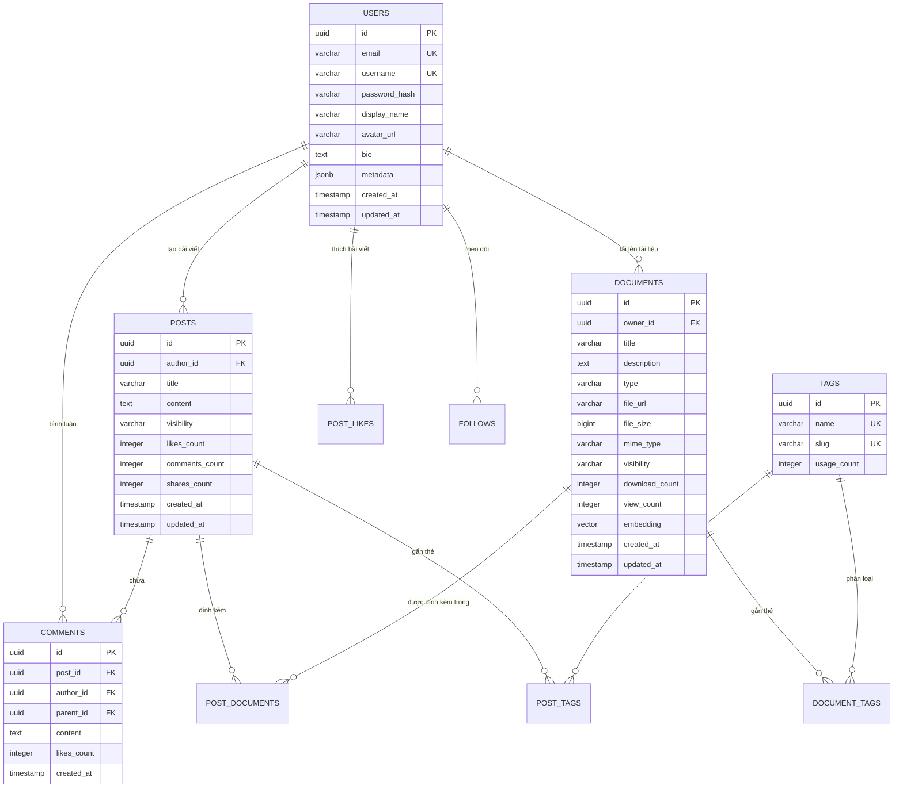

# 🗄️ Thiết kế Cơ sở Dữ liệu — PostgreSQL Database Schema

Tài liệu này mô tả mô hình thực thể quan hệ, bảng biểu và cấu trúc dữ liệu chính của **PU Connector** sử dụng **PostgreSQL** và tiện ích mở rộng **pgvector** cho tìm kiếm tài liệu AI.

---

## 1. Sơ đồ Thực thể Quan hệ (ER Diagram)



---

## 2. Đặc tả Chi tiết các Bảng (Tables Detail)

### 2.1. Bảng `users`
| Cột | Kiểu dữ liệu | Ràng buộc | Mô tả |
| :--- | :--- | :--- | :--- |
| `id` | `UUID` | `PRIMARY KEY, DEFAULT gen_random_uuid()` | Khóa chính duy nhất |
| `email` | `VARCHAR(255)` | `UNIQUE, NOT NULL` | Email đăng nhập |
| `username` | `VARCHAR(50)` | `UNIQUE, NOT NULL` | Tên định danh (handle @username) |
| `password_hash` | `VARCHAR(255)` | `NOT NULL` | Mật khẩu mã hóa Bcrypt |
| `display_name` | `VARCHAR(100)` | `NOT NULL` | Tên hiển thị công khai |
| `avatar_url` | `VARCHAR(500)` | `NULL` | Link ảnh đại diện |
| `bio` | `TEXT` | `NULL` | Giới thiệu ngắn |
| `created_at` | `TIMESTAMPTZ` | `DEFAULT NOW()` | Ngày tạo |

### 2.2. Bảng `posts`
| Cột | Kiểu dữ liệu | Ràng buộc | Mô tả |
| :--- | :--- | :--- | :--- |
| `id` | `UUID` | `PRIMARY KEY, DEFAULT gen_random_uuid()` | Khóa chính |
| `author_id` | `UUID` | `REFERENCES users(id) ON DELETE CASCADE` | Tác giả bài viết |
| `title` | `VARCHAR(255)` | `NULL` | Tiêu đề bài viết |
| `content` | `TEXT` | `NOT NULL` | Nội dung Markdown, LaTeX, Mermaid |
| `visibility` | `VARCHAR(20)` | `DEFAULT 'public'` | `public`, `followers`, `private` |
| `likes_count` | `INTEGER` | `DEFAULT 0` | Số lượt thích (cache counter) |
| `comments_count`| `INTEGER` | `DEFAULT 0` | Số lượt bình luận (cache counter) |
| `created_at` | `TIMESTAMPTZ` | `DEFAULT NOW()` | Thời gian đăng |

### 2.3. Bảng `documents`
| Cột | Kiểu dữ liệu | Ràng buộc | Mô tả |
| :--- | :--- | :--- | :--- |
| `id` | `UUID` | `PRIMARY KEY, DEFAULT gen_random_uuid()` | Khóa chính |
| `owner_id` | `UUID` | `REFERENCES users(id) ON DELETE CASCADE` | Người tải lên |
| `title` | `VARCHAR(255)` | `NOT NULL` | Tên tài liệu |
| `description` | `TEXT` | `NULL` | Mô tả tóm tắt tài liệu |
| `type` | `VARCHAR(50)` | `NOT NULL` | `pdf`, `code`, `sheet`, `markdown`... |
| `file_url` | `VARCHAR(1000)` | `NOT NULL` | Đường dẫn tệp trên Cloudflare R2 / S3 |
| `file_size` | `BIGINT` | `NOT NULL` | Dung lượng tệp (bytes) |
| `mime_type` | `VARCHAR(100)` | `NOT NULL` | Mime type (VD: `application/pdf`) |
| `embedding` | `VECTOR(1536)` | `NULL` | Vector embedding cho Semantic Search AI |
| `download_count`| `INTEGER` | `DEFAULT 0` | Số lượt tải |
| `view_count` | `INTEGER` | `DEFAULT 0` | Số lượt xem |

---

## 3. Chiến lược Indexing & Tối ưu Hiệu năng

```sql
-- 1. Tối ưu Feed cuộn nhanh theo thời gian
CREATE INDEX idx_posts_created_at ON posts (created_at DESC);
CREATE INDEX idx_posts_author_id ON posts (author_id);

-- 2. Tìm kiếm toàn văn (Full-text Search) cho bài viết và tài liệu
CREATE INDEX idx_documents_title_search ON documents USING gin(to_tsvector('vietnamese', title));
CREATE INDEX idx_posts_content_search ON posts USING gin(to_tsvector('vietnamese', content));

-- 3. Chỉ mục HNSW cho Vector Search AI (pgvector)
CREATE INDEX idx_documents_embedding_hnsw 
ON documents USING hnsw (embedding vector_cosine_ops)
WITH (m = 16, ef_construction = 64);
```
