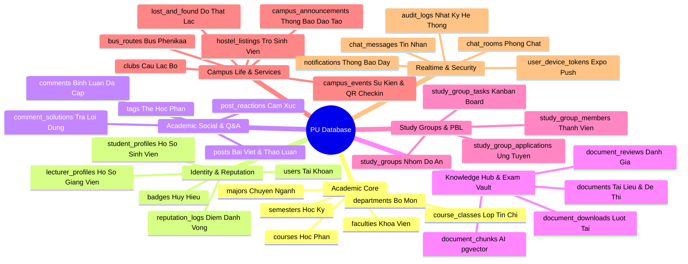

# 🗄️ Thiết kế Toàn diện Cơ sở Dữ liệu — PU Connect Master Database Schema

Tài liệu này chứa đặc tả kỹ thuật thiết kế Cơ sở dữ liệu quan hệ **PostgreSQL 16+** kết hợp **pgvector** cho toàn bộ các phân hệ của nền tảng **PU Connect (Phenikaa University Connection)**.

---

## 1. Bản đồ Phân hệ Dữ liệu (Domain Architecture)



---

## 2. Sơ đồ Thực thể Quan hệ Tổng thể (Master ERD)

```mermaid
erDiagram
    FACULTIES ||--o{ DEPARTMENTS : "chứa"
    FACULTIES ||--o{ MAJORS : "quản lý"
    FACULTIES ||--o{ COURSES : "phụ trách"
    COURSES ||--o{ COURSE_CLASSES : "mở lớp"
    SEMESTERS ||--o{ COURSE_CLASSES : "thuộc kỳ"

    USERS ||--o| STUDENT_PROFILES : "là sinh viên"
    USERS ||--o| LECTURER_PROFILES : "là giảng viên"
    USERS ||--o{ REPUTATION_LOGS : "nhận điểm"
    USERS ||--o{ USER_BADGES : "sở hữu"
    BADGES ||--o{ USER_BADGES : "trao cho"

    USERS ||--o{ POSTS : "đăng"
    COURSES ||--o{ POSTS : "chủ đề học phần"
    POSTS ||--o{ POST_REACTIONS : "nhận tương tác"
    POSTS ||--o{ COMMENTS : "có phản hồi"
    USERS ||--o{ COMMENTS : "viết"
    COMMENTS ||--o| COMMENT_SOLUTIONS : "được chọn làm đáp án"

    COURSES ||--o{ DOCUMENTS : "tài liệu thuộc môn"
    USERS ||--o{ DOCUMENTS : "tải lên"
    DOCUMENTS ||--o{ DOCUMENT_CHUNKS : "chia đoạn vector"
    DOCUMENTS ||--o{ DOCUMENT_REVIEWS : "được đánh giá"
    DOCUMENTS ||--o{ DOCUMENT_DOWNLOADS : "lưu vết tải"

    COURSES ||--o{ STUDY_GROUPS : "nhóm môn học"
    USERS ||--o{ STUDY_GROUPS : "làm trưởng nhóm"
    STUDY_GROUPS ||--o{ STUDY_GROUP_MEMBERS : "gồm thành viên"
    STUDY_GROUPS ||--o{ STUDY_GROUP_TASKS : "quản lý task"
    STUDY_GROUPS ||--o{ STUDY_GROUP_APPLICATIONS : "nhận đơn"

    CLUBS ||--o{ CLUB_MEMBERS : "thành viên CLB"
    USERS ||--o{ CAMPUS_EVENTS : "tạo sự kiện"
    CAMPUS_EVENTS ||--o{ EVENT_REGISTRATIONS : "sinh viên đăng ký"
    
    USERS ||--o{ CHAT_ROOM_MEMBERS : "tham gia chat"
    CHAT_ROOMS ||--o{ CHAT_ROOM_MEMBERS : "chứa"
    CHAT_ROOMS ||--o{ CHAT_MESSAGES : "chứa tin nhắn"
    USERS ||--o{ NOTIFICATIONS : "nhận thông báo"
```



---

## 3. Đặc tả Chi tiết các Bảng theo từng Phân hệ (DDL Specification)

### 📌 Phân hệ 1: Academic & University Structure (Học thuật & Khoa Viện)

```sql
-- 1.1. Bảng Khoa / Viện Đào tạo
CREATE TABLE faculties (
    id UUID PRIMARY KEY DEFAULT gen_random_uuid(),
    code VARCHAR(20) UNIQUE NOT NULL, -- e.g. 'FIT', 'FEE', 'FBA', 'FAE'
    name VARCHAR(255) NOT NULL, -- e.g. 'Khoa Công nghệ Thông tin'
    short_name VARCHAR(50),
    description TEXT,
    logo_url VARCHAR(500),
    dean_name VARCHAR(100),
    office_location VARCHAR(100), -- e.g. 'Phòng 402, Tòa A2'
    website VARCHAR(255),
    created_at TIMESTAMPTZ DEFAULT NOW(),
    updated_at TIMESTAMPTZ DEFAULT NOW()
);

-- 1.2. Bảng Bộ môn trực thuộc Khoa
CREATE TABLE departments (
    id UUID PRIMARY KEY DEFAULT gen_random_uuid(),
    faculty_id UUID NOT NULL REFERENCES faculties(id) ON DELETE CASCADE,
    code VARCHAR(20) NOT NULL, -- e.g. 'SE', 'IS', 'AI', 'CS'
    name VARCHAR(255) NOT NULL, -- e.g. 'Bộ môn Kỹ thuật Phần mềm'
    head_of_department VARCHAR(100),
    created_at TIMESTAMPTZ DEFAULT NOW(),
    UNIQUE(faculty_id, code)
);

-- 1.3. Bảng Chuyên ngành Đào tạo
CREATE TABLE majors (
    id UUID PRIMARY KEY DEFAULT gen_random_uuid(),
    faculty_id UUID NOT NULL REFERENCES faculties(id) ON DELETE CASCADE,
    code VARCHAR(20) UNIQUE NOT NULL, -- e.g. '7480201' (CNTT)
    name VARCHAR(255) NOT NULL, -- e.g. 'Công nghệ Thông tin'
    degree_type VARCHAR(50) DEFAULT 'Bachelor', -- 'Bachelor', 'Engineer', 'Master'
    standard_credits INT DEFAULT 150,
    created_at TIMESTAMPTZ DEFAULT NOW()
);

-- 1.4. Bảng Học kỳ & Năm học
CREATE TABLE academic_years (
    id UUID PRIMARY KEY DEFAULT gen_random_uuid(),
    code VARCHAR(20) UNIQUE NOT NULL, -- e.g. 'K16', 'K17', 'K18'
    start_year INT NOT NULL, -- 2022
    end_year INT NOT NULL -- 2026
);

CREATE TABLE semesters (
    id UUID PRIMARY KEY DEFAULT gen_random_uuid(),
    code VARCHAR(20) UNIQUE NOT NULL, -- e.g. '2025-2026.1'
    name VARCHAR(100) NOT NULL, -- e.g. 'Học kỳ 1 năm học 2025-2026'
    start_date DATE NOT NULL,
    end_date DATE NOT NULL,
    is_current BOOLEAN DEFAULT FALSE
);

-- 1.5. Bảng Học phần / Môn học
CREATE TABLE courses (
    id UUID PRIMARY KEY DEFAULT gen_random_uuid(),
    code VARCHAR(20) UNIQUE NOT NULL, -- e.g. 'IT101', 'MATH201', 'PHY102'
    name VARCHAR(255) NOT NULL, -- e.g. 'Cấu trúc dữ liệu và Giải thuật'
    credits INT NOT NULL CHECK (credits > 0 AND credits <= 10),
    faculty_id UUID NOT NULL REFERENCES faculties(id) ON DELETE RESTRICT,
    department_id UUID REFERENCES departments(id) ON DELETE SET NULL,
    description TEXT,
    syllabus_url VARCHAR(500),
    rating_avg NUMERIC(3,2) DEFAULT 5.00,
    document_count INT DEFAULT 0,
    post_count INT DEFAULT 0,
    created_at TIMESTAMPTZ DEFAULT NOW(),
    updated_at TIMESTAMPTZ DEFAULT NOW()
);

-- 1.6. Bảng Môn học Tiên quyết / Song hành
CREATE TABLE course_prerequisites (
    course_id UUID NOT NULL REFERENCES courses(id) ON DELETE CASCADE,
    prerequisite_course_id UUID NOT NULL REFERENCES courses(id) ON DELETE CASCADE,
    type VARCHAR(20) DEFAULT 'prerequisite', -- 'prerequisite', 'corequisite', 'recommended'
    PRIMARY KEY (course_id, prerequisite_course_id)
);

-- 1.7. Bảng Lớp học phần (Lớp tín chỉ theo kỳ)
CREATE TABLE course_classes (
    id UUID PRIMARY KEY DEFAULT gen_random_uuid(),
    course_id UUID NOT NULL REFERENCES courses(id) ON DELETE CASCADE,
    semester_id UUID NOT NULL REFERENCES semesters(id) ON DELETE CASCADE,
    class_code VARCHAR(50) NOT NULL, -- e.g. 'IT101.02_K16'
    lecturer_name VARCHAR(100),
    schedule_text VARCHAR(255), -- e.g. 'Thứ 2 (1-3), Phòng A2-301'
    max_students INT DEFAULT 60,
    current_students INT DEFAULT 0,
    created_at TIMESTAMPTZ DEFAULT NOW(),
    UNIQUE(semester_id, class_code)
);
```

---

### 📌 Phân hệ 2: User Identity, Profiles & Reputation (Định danh & Điểm danh vọng)

```sql
-- 2.1. Bảng Tài khoản Người dùng
CREATE TYPE user_role_enum AS ENUM ('student', 'lecturer', 'ta', 'club_lead', 'admin');
CREATE TYPE account_status_enum AS ENUM ('active', 'suspended', 'pending_verification');

CREATE TABLE users (
    id UUID PRIMARY KEY DEFAULT gen_random_uuid(),
    email VARCHAR(255) UNIQUE NOT NULL, -- @phenikaa-uni.edu.vn
    username VARCHAR(50) UNIQUE NOT NULL,
    password_hash VARCHAR(255) NOT NULL,
    display_name VARCHAR(100) NOT NULL,
    avatar_url VARCHAR(500),
    bio VARCHAR(250),
    role user_role_enum DEFAULT 'student',
    status account_status_enum DEFAULT 'active',
    is_email_verified BOOLEAN DEFAULT TRUE,
    reputation_points INT DEFAULT 100,
    last_login_at TIMESTAMPTZ,
    created_at TIMESTAMPTZ DEFAULT NOW(),
    updated_at TIMESTAMPTZ DEFAULT NOW()
);

-- 2.2. Hồ sơ Chi tiết Sinh viên
CREATE TABLE student_profiles (
    user_id UUID PRIMARY KEY REFERENCES users(id) ON DELETE CASCADE,
    student_id VARCHAR(20) UNIQUE NOT NULL, -- Mã SV: e.g. '22010142'
    faculty_id UUID REFERENCES faculties(id) ON DELETE SET NULL,
    major_id UUID REFERENCES majors(id) ON DELETE SET NULL,
    academic_year_id UUID REFERENCES academic_years(id) ON DELETE SET NULL,
    class_name VARCHAR(50), -- e.g. 'K16-CNTT1'
    gpa NUMERIC(3,2) CHECK (gpa >= 0.00 AND gpa <= 4.00),
    accumulated_credits INT DEFAULT 0,
    github_url VARCHAR(255),
    linkedin_url VARCHAR(255),
    skills JSONB DEFAULT '[]'::jsonb -- ['React Native', 'NestJS', 'Python']
);

-- 2.3. Hồ sơ Giảng viên
CREATE TABLE lecturer_profiles (
    user_id UUID PRIMARY KEY REFERENCES users(id) ON DELETE CASCADE,
    lecturer_code VARCHAR(20) UNIQUE NOT NULL,
    faculty_id UUID REFERENCES faculties(id) ON DELETE SET NULL,
    department_id UUID REFERENCES departments(id) ON DELETE SET NULL,
    academic_title VARCHAR(50), -- 'PGS.TS', 'TS', 'ThS'
    research_interests JSONB DEFAULT '[]'::jsonb,
    office_room VARCHAR(100)
);

-- 2.4. Bảng Huy hiệu & Danh vọng (Badges)
CREATE TABLE badges (
    id UUID PRIMARY KEY DEFAULT gen_random_uuid(),
    code VARCHAR(50) UNIQUE NOT NULL, -- 'top_contributor', 'ta_verified', 'pbl_leader'
    name VARCHAR(100) NOT NULL,
    description TEXT,
    icon_url VARCHAR(500),
    tier VARCHAR(20) DEFAULT 'bronze' -- 'bronze', 'silver', 'gold', 'diamond'
);

CREATE TABLE user_badges (
    user_id UUID REFERENCES users(id) ON DELETE CASCADE,
    badge_id UUID REFERENCES badges(id) ON DELETE CASCADE,
    awarded_at TIMESTAMPTZ DEFAULT NOW(),
    PRIMARY KEY (user_id, badge_id)
);

-- 2.5. Lịch sử Điểm Danh vọng (Reputation Audit Log)
CREATE TABLE reputation_logs (
    id UUID PRIMARY KEY DEFAULT gen_random_uuid(),
    user_id UUID NOT NULL REFERENCES users(id) ON DELETE CASCADE,
    points_change INT NOT NULL, -- e.g. +15, -5
    reason VARCHAR(255) NOT NULL, -- e.g. 'Answer verified as solution', 'Uploaded 5-star exam'
    reference_type VARCHAR(50), -- 'post', 'comment', 'document'
    reference_id UUID,
    created_at TIMESTAMPTZ DEFAULT NOW()
);

-- 2.6. Bảng Theo dõi (Follows)
CREATE TABLE user_follows (
    follower_id UUID REFERENCES users(id) ON DELETE CASCADE,
    following_id UUID REFERENCES users(id) ON DELETE CASCADE,
    created_at TIMESTAMPTZ DEFAULT NOW(),
    PRIMARY KEY (follower_id, following_id)
);
```

---

### 📌 Phân hệ 3: Academic Social Feed & Q&A Forum (Mạng xã hội & Hỏi đáp)

```sql
-- 3.1. Phân loại bài viết
CREATE TYPE post_type_enum AS ENUM (
    'general',          -- Thảo luận chung
    'question',         -- Câu hỏi học thuật cần giải đáp
    'resource_share',   -- Chia sẻ tài liệu, đề thi
    'pbl_recruitment',  -- Tuyển thành viên đồ án/nhóm
    'announcement'      -- Thông báo từ trường/khoa/CLB
);

-- 3.2. Bảng Bài viết
CREATE TABLE posts (
    id UUID PRIMARY KEY DEFAULT gen_random_uuid(),
    author_id UUID NOT NULL REFERENCES users(id) ON DELETE CASCADE,
    course_id UUID REFERENCES courses(id) ON DELETE SET NULL,
    faculty_id UUID REFERENCES faculties(id) ON DELETE SET NULL,
    post_type post_type_enum DEFAULT 'general',
    title VARCHAR(255) NOT NULL,
    slug VARCHAR(300) UNIQUE,
    content TEXT NOT NULL, -- Chứa Markdown, LaTeX ($$), Mermaid
    visibility VARCHAR(20) DEFAULT 'public', -- 'public', 'faculty_only', 'course_only'
    is_pinned BOOLEAN DEFAULT FALSE,
    is_resolved BOOLEAN DEFAULT FALSE, -- Dành cho bài Q&A
    likes_count INT DEFAULT 0,
    comments_count INT DEFAULT 0,
    shares_count INT DEFAULT 0,
    views_count INT DEFAULT 0,
    created_at TIMESTAMPTZ DEFAULT NOW(),
    updated_at TIMESTAMPTZ DEFAULT NOW()
);

-- 3.3. Bảng Thẻ Tag & Liên kết
CREATE TABLE tags (
    id UUID PRIMARY KEY DEFAULT gen_random_uuid(),
    name VARCHAR(50) UNIQUE NOT NULL, -- e.g. 'it101', 'katex', 'pbl3', 'cntt-k16'
    slug VARCHAR(60) UNIQUE NOT NULL,
    category VARCHAR(50) DEFAULT 'academic',
    usage_count INT DEFAULT 0
);

CREATE TABLE post_tags (
    post_id UUID REFERENCES posts(id) ON DELETE CASCADE,
    tag_id UUID REFERENCES tags(id) ON DELETE CASCADE,
    PRIMARY KEY (post_id, tag_id)
);

-- 3.4. Bảng File / Media đính kèm Bài viết
CREATE TABLE post_media (
    id UUID PRIMARY KEY DEFAULT gen_random_uuid(),
    post_id UUID NOT NULL REFERENCES posts(id) ON DELETE CASCADE,
    media_url VARCHAR(1000) NOT NULL,
    media_type VARCHAR(50) NOT NULL, -- 'image', 'video', 'attachment'
    file_size BIGINT,
    position INT DEFAULT 0
);

-- 3.5. Bảng Cảm xúc (Reactions)
CREATE TYPE reaction_type_enum AS ENUM ('like', 'helpful', 'insightful', 'celebrate');

CREATE TABLE post_reactions (
    post_id UUID REFERENCES posts(id) ON DELETE CASCADE,
    user_id UUID REFERENCES users(id) ON DELETE CASCADE,
    reaction reaction_type_enum DEFAULT 'like',
    created_at TIMESTAMPTZ DEFAULT NOW(),
    PRIMARY KEY (post_id, user_id)
);

-- 3.6. Cây Bình luận Đa cấp (Nested Comments)
CREATE TABLE comments (
    id UUID PRIMARY KEY DEFAULT gen_random_uuid(),
    post_id UUID NOT NULL REFERENCES posts(id) ON DELETE CASCADE,
    author_id UUID NOT NULL REFERENCES users(id) ON DELETE CASCADE,
    parent_id UUID REFERENCES comments(id) ON DELETE CASCADE,
    content TEXT NOT NULL,
    likes_count INT DEFAULT 0,
    is_solution BOOLEAN DEFAULT FALSE, -- Câu trả lời đúng
    created_at TIMESTAMPTZ DEFAULT NOW(),
    updated_at TIMESTAMPTZ DEFAULT NOW()
);

-- 3.7. Đánh dấu Câu trả lời Chính xác (Verified Solutions)
CREATE TABLE comment_solutions (
    post_id UUID PRIMARY KEY REFERENCES posts(id) ON DELETE CASCADE,
    comment_id UUID NOT NULL REFERENCES comments(id) ON DELETE CASCADE,
    verified_by_user_id UUID NOT NULL REFERENCES users(id) ON DELETE RESTRICT,
    verified_at TIMESTAMPTZ DEFAULT NOW()
);

-- 3.8. Bài viết & Tài liệu Đã lưu (Bookmarks)
CREATE TABLE saved_posts (
    user_id UUID REFERENCES users(id) ON DELETE CASCADE,
    post_id UUID REFERENCES posts(id) ON DELETE CASCADE,
    collection_name VARCHAR(100) DEFAULT 'Mặc định',
    saved_at TIMESTAMPTZ DEFAULT NOW(),
    PRIMARY KEY (user_id, post_id)
);
```

---

### 📌 Phân hệ 4: Knowledge Hub, Exam Vault & AI Semantic Embeddings

```sql
-- Cài đặt Extension pgvector cho tìm kiếm ngữ nghĩa AI
CREATE EXTENSION IF NOT EXISTS vector;

-- 4.1. Định dạng Tài liệu
CREATE TYPE doc_type_enum AS ENUM (
    'midterm_exam',      -- Đề thi Giữa kỳ
    'final_exam',        -- Đề thi Cuối kỳ
    'lecture_slide',     -- Slide Bài giảng
    'syllabus',          -- Đề cương môn học
    'sample_project',    -- Đồ án mẫu / Source code
    'internship_report', -- Báo cáo thực tập
    'scientific_paper'   -- Bài báo NCKH
);

-- 4.2. Bảng Tài liệu & Đề thi
CREATE TABLE documents (
    id UUID PRIMARY KEY DEFAULT gen_random_uuid(),
    owner_id UUID NOT NULL REFERENCES users(id) ON DELETE CASCADE,
    course_id UUID REFERENCES courses(id) ON DELETE SET NULL,
    faculty_id UUID REFERENCES faculties(id) ON DELETE SET NULL,
    semester_id UUID REFERENCES semesters(id) ON DELETE SET NULL,
    doc_type doc_type_enum NOT NULL,
    title VARCHAR(255) NOT NULL,
    slug VARCHAR(300) UNIQUE,
    description TEXT,
    file_url VARCHAR(1000) NOT NULL, -- Cloudflare R2 / S3
    storage_key VARCHAR(500) NOT NULL,
    file_size BIGINT NOT NULL,
    mime_type VARCHAR(100) NOT NULL,
    page_count INT,
    preview_image_url VARCHAR(1000),
    checksum_md5 VARCHAR(32),
    visibility VARCHAR(20) DEFAULT 'public',
    download_count INT DEFAULT 0,
    view_count INT DEFAULT 0,
    rating_avg NUMERIC(3,2) DEFAULT 5.00,
    review_count INT DEFAULT 0,
    is_verified BOOLEAN DEFAULT FALSE, -- Được Giảng viên xác thực độ chuẩn
    created_at TIMESTAMPTZ DEFAULT NOW(),
    updated_at TIMESTAMPTZ DEFAULT NOW()
);

-- 4.3. Bảng Phân đoạn Văn bản & Vector Embedding (pgvector RAG)
CREATE TABLE document_chunks (
    id UUID PRIMARY KEY DEFAULT gen_random_uuid(),
    document_id UUID NOT NULL REFERENCES documents(id) ON DELETE CASCADE,
    chunk_index INT NOT NULL,
    content_text TEXT NOT NULL,
    token_count INT NOT NULL,
    embedding VECTOR(1536), -- Vector OpenAI text-embedding-3 hoặc Gecko
    created_at TIMESTAMPTZ DEFAULT NOW(),
    UNIQUE(document_id, chunk_index)
);

-- 4.4. Đánh giá & Nhận xét Tài liệu
CREATE TABLE document_reviews (
    id UUID PRIMARY KEY DEFAULT gen_random_uuid(),
    document_id UUID NOT NULL REFERENCES documents(id) ON DELETE CASCADE,
    user_id UUID NOT NULL REFERENCES users(id) ON DELETE CASCADE,
    rating INT NOT NULL CHECK (rating >= 1 AND rating <= 5),
    comment TEXT,
    created_at TIMESTAMPTZ DEFAULT NOW(),
    UNIQUE(document_id, user_id)
);

-- 4.5. Nhật ký Lượt tải Tài liệu
CREATE TABLE document_downloads (
    id UUID PRIMARY KEY DEFAULT gen_random_uuid(),
    document_id UUID NOT NULL REFERENCES documents(id) ON DELETE CASCADE,
    user_id UUID REFERENCES users(id) ON DELETE SET NULL,
    ip_address INET,
    downloaded_at TIMESTAMPTZ DEFAULT NOW()
);
```

---

### 📌 Phân hệ 5: Study Groups & PBL Capstone Matchmaking (Ghép nhóm Đồ án)

```sql
-- 5.1. Bảng Nhóm Học tập / Đồ án
CREATE TYPE group_status_enum AS ENUM ('recruiting', 'active', 'completed', 'disbanded');
CREATE TYPE group_type_enum AS ENUM ('pbl_project', 'capstone', 'exam_prep', 'hackathon', 'research');

CREATE TABLE study_groups (
    id UUID PRIMARY KEY DEFAULT gen_random_uuid(),
    leader_id UUID NOT NULL REFERENCES users(id) ON DELETE RESTRICT,
    course_id UUID REFERENCES courses(id) ON DELETE SET NULL,
    faculty_id UUID REFERENCES faculties(id) ON DELETE SET NULL,
    name VARCHAR(150) NOT NULL,
    slug VARCHAR(200) UNIQUE,
    topic VARCHAR(255) NOT NULL, -- e.g. 'PBL3: App Quản lý KTX Phenikaa'
    group_type group_type_enum DEFAULT 'pbl_project',
    description TEXT NOT NULL,
    tech_stack JSONB DEFAULT '[]'::jsonb, -- ['React Native', 'NestJS', 'PostgreSQL']
    max_members INT DEFAULT 5 CHECK (max_members >= 2 AND max_members <= 15),
    current_members INT DEFAULT 1,
    status group_status_enum DEFAULT 'recruiting',
    created_at TIMESTAMPTZ DEFAULT NOW(),
    updated_at TIMESTAMPTZ DEFAULT NOW()
);

-- 5.2. Thành viên trong Nhóm
CREATE TYPE group_member_role_enum AS ENUM ('leader', 'sub_leader', 'member');

CREATE TABLE study_group_members (
    group_id UUID REFERENCES study_groups(id) ON DELETE CASCADE,
    user_id UUID REFERENCES users(id) ON DELETE CASCADE,
    role group_member_role_enum DEFAULT 'member',
    assigned_role_title VARCHAR(100), -- 'Frontend Dev', 'Backend Lead', 'Designer'
    joined_at TIMESTAMPTZ DEFAULT NOW(),
    PRIMARY KEY (group_id, user_id)
);

-- 5.3. Đơn xin Gia nhập Nhóm (Matchmaking Applications)
CREATE TYPE application_status_enum AS ENUM ('pending', 'accepted', 'rejected');

CREATE TABLE study_group_applications (
    id UUID PRIMARY KEY DEFAULT gen_random_uuid(),
    group_id UUID NOT NULL REFERENCES study_groups(id) ON DELETE CASCADE,
    applicant_id UUID NOT NULL REFERENCES users(id) ON DELETE CASCADE,
    applied_role VARCHAR(100),
    message TEXT NOT NULL,
    portfolio_url VARCHAR(500),
    status application_status_enum DEFAULT 'pending',
    responded_at TIMESTAMPTZ,
    created_at TIMESTAMPTZ DEFAULT NOW(),
    UNIQUE(group_id, applicant_id)
);

-- 5.4. Không gian Task / Kanban Nhóm
CREATE TYPE task_status_enum AS ENUM ('todo', 'in_progress', 'review', 'done');
CREATE TYPE task_priority_enum AS ENUM ('low', 'medium', 'high', 'urgent');

CREATE TABLE study_group_tasks (
    id UUID PRIMARY KEY DEFAULT gen_random_uuid(),
    group_id UUID NOT NULL REFERENCES study_groups(id) ON DELETE CASCADE,
    assignee_id UUID REFERENCES users(id) ON DELETE SET NULL,
    created_by_id UUID NOT NULL REFERENCES users(id) ON DELETE RESTRICT,
    title VARCHAR(255) NOT NULL,
    description TEXT,
    status task_status_enum DEFAULT 'todo',
    priority task_priority_enum DEFAULT 'medium',
    due_date TIMESTAMPTZ,
    created_at TIMESTAMPTZ DEFAULT NOW(),
    updated_at TIMESTAMPTZ DEFAULT NOW()
);
```

---

### 📌 Phân hệ 6: Campus Life, Clubs & Student Services (Nhịp sống & CLB Phenikaa)

```sql
-- 6.1. Bảng Câu lạc bộ Sinh viên (Clubs)
CREATE TABLE clubs (
    id UUID PRIMARY KEY DEFAULT gen_random_uuid(),
    faculty_id UUID REFERENCES faculties(id) ON DELETE SET NULL,
    code VARCHAR(50) UNIQUE NOT NULL, -- e.g. 'PU_TECH', 'PU_ROBOTICS', 'PU_MUSIC'
    name VARCHAR(255) NOT NULL,
    description TEXT,
    logo_url VARCHAR(500),
    banner_url VARCHAR(1000),
    fanpage_url VARCHAR(500),
    president_id UUID REFERENCES users(id) ON DELETE SET NULL,
    member_count INT DEFAULT 0,
    is_recruiting BOOLEAN DEFAULT FALSE,
    created_at TIMESTAMPTZ DEFAULT NOW()
);

CREATE TABLE club_members (
    club_id UUID REFERENCES clubs(id) ON DELETE CASCADE,
    user_id UUID REFERENCES users(id) ON DELETE CASCADE,
    department_name VARCHAR(100), -- 'Ban Chuyên môn', 'Ban Truyền thông'
    role VARCHAR(50) DEFAULT 'member', -- 'president', 'vice_president', 'lead', 'member'
    joined_at TIMESTAMPTZ DEFAULT NOW(),
    PRIMARY KEY (club_id, user_id)
);

-- 6.2. Sự kiện Trường học & Hội thảo (Campus Events)
CREATE TABLE campus_events (
    id UUID PRIMARY KEY DEFAULT gen_random_uuid(),
    organizer_id UUID REFERENCES users(id) ON DELETE SET NULL,
    club_id UUID REFERENCES clubs(id) ON DELETE SET NULL,
    faculty_id UUID REFERENCES faculties(id) ON DELETE SET NULL,
    title VARCHAR(255) NOT NULL,
    description TEXT NOT NULL,
    location VARCHAR(255) NOT NULL, -- e.g. 'Hội trường A2', 'Sân bóng Phenikaa'
    banner_url VARCHAR(1000),
    start_time TIMESTAMPTZ NOT NULL,
    end_time TIMESTAMPTZ,
    registration_limit INT,
    registered_count INT DEFAULT 0,
    checkin_qr_secret VARCHAR(100),
    created_at TIMESTAMPTZ DEFAULT NOW()
);

-- 6.3. Đăng ký & Check-in Sự kiện
CREATE TABLE event_registrations (
    id UUID PRIMARY KEY DEFAULT gen_random_uuid(),
    event_id UUID NOT NULL REFERENCES campus_events(id) ON DELETE CASCADE,
    user_id UUID NOT NULL REFERENCES users(id) ON DELETE CASCADE,
    ticket_code VARCHAR(50) UNIQUE NOT NULL,
    is_checked_in BOOLEAN DEFAULT FALSE,
    checked_in_at TIMESTAMPTZ,
    created_at TIMESTAMPTZ DEFAULT NOW(),
    UNIQUE(event_id, user_id)
);

-- 6.4. Bảng Thông báo Nhà trường (Announcements)
CREATE TABLE campus_announcements (
    id UUID PRIMARY KEY DEFAULT gen_random_uuid(),
    author_id UUID NOT NULL REFERENCES users(id) ON DELETE RESTRICT,
    title VARCHAR(255) NOT NULL,
    category VARCHAR(50) NOT NULL, -- 'academic', 'scholarship', 'tuition', 'activity'
    content TEXT NOT NULL,
    is_urgent BOOLEAN DEFAULT FALSE,
    is_pinned BOOLEAN DEFAULT FALSE,
    target_faculty_id UUID REFERENCES faculties(id) ON DELETE CASCADE,
    target_academic_year_id UUID REFERENCES academic_years(id) ON DELETE CASCADE,
    published_at TIMESTAMPTZ DEFAULT NOW()
);

-- 6.5. Góc Trọ Sinh viên (Hostels near Phenikaa)
CREATE TABLE hostel_listings (
    id UUID PRIMARY KEY DEFAULT gen_random_uuid(),
    user_id UUID NOT NULL REFERENCES users(id) ON DELETE CASCADE,
    title VARCHAR(255) NOT NULL,
    address VARCHAR(255) NOT NULL, -- e.g. 'Ngõ 20 Yên Nghĩa, Hà Đông'
    distance_to_pu_km NUMERIC(3,1), -- e.g. 0.8 km
    price_monthly INT NOT NULL, -- e.g. 2500000 VNĐ
    area_sqm INT,
    amenities JSONB DEFAULT '[]'::jsonb, -- ['Điều hòa', 'Bình nóng lạnh', 'Gác xép', 'Không chung chủ']
    photos JSONB DEFAULT '[]'::jsonb,
    contact_phone VARCHAR(20) NOT NULL,
    is_verified BOOLEAN DEFAULT FALSE,
    status VARCHAR(20) DEFAULT 'available',
    created_at TIMESTAMPTZ DEFAULT NOW()
);

-- 6.6. Tìm Đồ Thất Lạc (Lost & Found)
CREATE TABLE lost_and_found_items (
    id UUID PRIMARY KEY DEFAULT gen_random_uuid(),
    user_id UUID NOT NULL REFERENCES users(id) ON DELETE CASCADE,
    type VARCHAR(10) NOT NULL, -- 'lost' (mất đồ), 'found' (nhặt được đồ)
    item_name VARCHAR(150) NOT NULL, -- e.g. 'Ví tiền kèm Thẻ sinh viên'
    location VARCHAR(255) NOT NULL, -- e.g. 'Bàn 12 Tầng 3 Thư viện A2'
    description TEXT,
    photos JSONB DEFAULT '[]'::jsonb,
    contact_info VARCHAR(255) NOT NULL,
    status VARCHAR(20) DEFAULT 'open', -- 'open', 'returned', 'closed'
    created_at TIMESTAMPTZ DEFAULT NOW()
);
```

---

### 📌 Phân hệ 7: Realtime Chat, Push Notifications & Security Audit

```sql
-- 7.1. Phòng Chat Thời gian thực (Chat Rooms)
CREATE TYPE chat_room_type_enum AS ENUM ('direct', 'study_group', 'course_channel', 'club_channel');

CREATE TABLE chat_rooms (
    id UUID PRIMARY KEY DEFAULT gen_random_uuid(),
    type chat_room_type_enum DEFAULT 'direct',
    title VARCHAR(150),
    course_id UUID REFERENCES courses(id) ON DELETE CASCADE,
    study_group_id UUID REFERENCES study_groups(id) ON DELETE CASCADE,
    created_at TIMESTAMPTZ DEFAULT NOW()
);

CREATE TABLE chat_room_members (
    room_id UUID REFERENCES chat_rooms(id) ON DELETE CASCADE,
    user_id UUID REFERENCES users(id) ON DELETE CASCADE,
    last_read_message_id UUID,
    is_muted BOOLEAN DEFAULT FALSE,
    joined_at TIMESTAMPTZ DEFAULT NOW(),
    PRIMARY KEY (room_id, user_id)
);

-- 7.2. Tin nhắn Chat
CREATE TYPE message_type_enum AS ENUM ('text', 'image', 'file', 'code', 'latex');

CREATE TABLE chat_messages (
    id UUID PRIMARY KEY DEFAULT gen_random_uuid(),
    room_id UUID NOT NULL REFERENCES chat_rooms(id) ON DELETE CASCADE,
    sender_id UUID NOT NULL REFERENCES users(id) ON DELETE CASCADE,
    message_type message_type_enum DEFAULT 'text',
    content TEXT NOT NULL,
    reply_to_id UUID REFERENCES chat_messages(id) ON DELETE SET NULL,
    is_deleted BOOLEAN DEFAULT FALSE,
    created_at TIMESTAMPTZ DEFAULT NOW()
);

-- 7.3. Thông báo Đẩy (Notifications)
CREATE TABLE notifications (
    id UUID PRIMARY KEY DEFAULT gen_random_uuid(),
    recipient_id UUID NOT NULL REFERENCES users(id) ON DELETE CASCADE,
    sender_id UUID REFERENCES users(id) ON DELETE SET NULL,
    event_type VARCHAR(50) NOT NULL, -- 'comment', 'solution_accepted', 'group_invite', 'exam_uploaded'
    target_type VARCHAR(50) NOT NULL, -- 'post', 'comment', 'document', 'study_group'
    target_id UUID NOT NULL,
    title VARCHAR(255) NOT NULL,
    body TEXT NOT NULL,
    is_read BOOLEAN DEFAULT FALSE,
    read_at TIMESTAMPTZ,
    created_at TIMESTAMPTZ DEFAULT NOW()
);

-- 7.4. Device Push Tokens (Expo Mobile & Web Push)
CREATE TABLE user_device_tokens (
    id UUID PRIMARY KEY DEFAULT gen_random_uuid(),
    user_id UUID NOT NULL REFERENCES users(id) ON DELETE CASCADE,
    push_token VARCHAR(500) NOT NULL,
    device_type VARCHAR(20) NOT NULL, -- 'ios', 'android', 'web'
    is_active BOOLEAN DEFAULT TRUE,
    last_used_at TIMESTAMPTZ DEFAULT NOW(),
    UNIQUE(user_id, push_token)
);

-- 7.5. Nhật ký An ninh & Truy vết (Audit Logs)
CREATE TABLE audit_logs (
    id UUID PRIMARY KEY DEFAULT gen_random_uuid(),
    user_id UUID REFERENCES users(id) ON DELETE SET NULL,
    action VARCHAR(100) NOT NULL, -- 'login_success', 'password_changed', 'document_deleted'
    ip_address INET,
    user_agent TEXT,
    payload JSONB,
    created_at TIMESTAMPTZ DEFAULT NOW()
);
```

---

## 4. Chiến lược Đánh Chỉ mục & Tối ưu Hiệu năng (Indexes & Optimization)

```sql
-- 1. Tối ưu Feed mạng xã hội và Truy vấn Phân trang
CREATE INDEX idx_posts_created_at ON posts (created_at DESC);
CREATE INDEX idx_posts_course_id ON posts (course_id) WHERE course_id IS NOT NULL;
CREATE INDEX idx_posts_faculty_id ON posts (faculty_id) WHERE faculty_id IS NOT NULL;
CREATE INDEX idx_posts_author_id ON posts (author_id);

-- 2. Tối ưu Tra cứu Bình luận Đa cấp
CREATE INDEX idx_comments_post_id ON comments (post_id, created_at ASC);
CREATE INDEX idx_comments_parent_id ON comments (parent_id) WHERE parent_id IS NOT NULL;

-- 3. Tối ưu Kho Tài liệu & Đề thi
CREATE INDEX idx_documents_course_id ON documents (course_id);
CREATE INDEX idx_documents_doc_type ON documents (doc_type);
CREATE INDEX idx_documents_downloads ON documents (download_count DESC);

-- 4. Tìm kiếm Toàn văn (Full-Text Search với GIN Index tiếng Việt)
CREATE INDEX idx_posts_fts ON posts USING gin(to_tsvector('simple', title || ' ' || content));
CREATE INDEX idx_documents_fts ON documents USING gin(to_tsvector('simple', title || ' ' || coalesce(description, '')));
CREATE INDEX idx_courses_fts ON courses USING gin(to_tsvector('simple', code || ' ' || name));

-- 5. Chỉ mục HNSW cho Vector Search AI (Semantic Similarity)
CREATE INDEX idx_document_chunks_embedding_hnsw 
ON document_chunks USING hnsw (embedding vector_cosine_ops)
WITH (m = 16, ef_construction = 64);

-- 6. Tối ưu Tin nhắn Chat thời gian thực
CREATE INDEX idx_chat_messages_room_created ON chat_messages (room_id, created_at DESC);

-- 7. Tối ưu Thông báo
CREATE INDEX idx_notifications_recipient_unread ON notifications (recipient_id) WHERE is_read = FALSE;
```

---

## 5. Triggers Tự động Cập nhật Chỉ số (Automated Counters & Reputation)

```sql
-- Trigger 1: Tự động cập nhật likes_count khi người dùng thả cảm xúc
CREATE OR REPLACE FUNCTION update_post_likes_count()
RETURNS TRIGGER AS $$
BEGIN
    IF (TG_OP = 'INSERT') THEN
        UPDATE posts SET likes_count = likes_count + 1 WHERE id = NEW.post_id;
    ELSIF (TG_OP = 'DELETE') THEN
        UPDATE posts SET likes_count = GREATEST(0, likes_count - 1) WHERE id = OLD.post_id;
    END IF;
    RETURN NULL;
END;
$$ LANGUAGE plpgsql;

CREATE TRIGGER trg_post_reactions_count
AFTER INSERT OR DELETE ON post_reactions
FOR EACH ROW EXECUTE FUNCTION update_post_likes_count();

-- Trigger 2: Tự động cộng điểm Danh vọng khi câu trả lời được xác nhận là Solution (+15 điểm)
CREATE OR REPLACE FUNCTION reward_solution_author()
RETURNS TRIGGER AS $$
DECLARE
    v_author_id UUID;
BEGIN
    SELECT author_id INTO v_author_id FROM comments WHERE id = NEW.comment_id;
    
    -- Cộng 15 điểm danh vọng cho tác giả bình luận
    UPDATE users SET reputation_points = reputation_points + 15 WHERE id = v_author_id;
    
    -- Ghi nhật ký audit
    INSERT INTO reputation_logs (user_id, points_change, reason, reference_type, reference_id)
    VALUES (v_author_id, 15, 'Câu trả lời được chọn làm đáp án chính xác', 'comment', NEW.comment_id);
    
    -- Đánh dấu bài viết đã được giải quyết
    UPDATE posts SET is_resolved = TRUE WHERE id = NEW.post_id;
    
    RETURN NEW;
END;
$$ LANGUAGE plpgsql;

CREATE TRIGGER trg_reward_solution
AFTER INSERT ON comment_solutions
FOR EACH ROW EXECUTE FUNCTION reward_solution_author();
```
