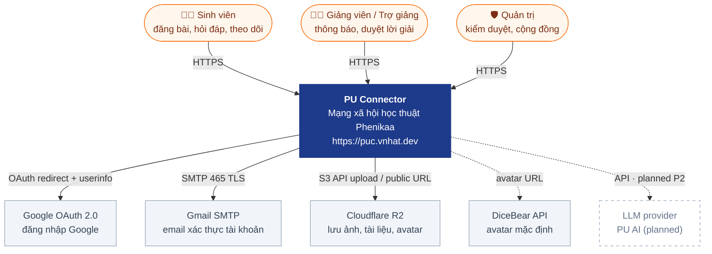

# 01 · System Context (C4 Level 1)

> Hệ thống nhìn từ bên ngoài: ai dùng, phụ thuộc dịch vụ ngoài nào. Cập nhật lần cuối: **2026-10-04**.

| Phụ thuộc ngoài | Dùng cho | Cấu hình | Khi lỗi |
|---|---|---|---|
| Google OAuth | Đăng nhập Google | `GOOGLE_CLIENT_ID/SECRET/CALLBACK_URL` | Nút Google tự ẩn nếu chưa cấu hình |
| Gmail SMTP | Email xác thực | `SMTP_HOST/PORT/USER/PASS`, `MAIL_FROM` | Không có `SMTP_HOST` ⇒ chỉ log link |
| Cloudflare R2 | Upload file | `R2_*` | Upload lỗi, phần còn lại vẫn chạy |
| DiceBear | Avatar mặc định | — | Ảnh không hiện, fallback chữ cái |
| LLM (planned) | PU AI | `AI_PROVIDER`, `ANTHROPIC_API_KEY` | — · xem [06-messaging-and-ai](../core/06-messaging-and-ai.md) |

**Changelog:** 2026-10-04 — tạo mới (Google OAuth, Gmail SMTP, R2; LLM planned).
