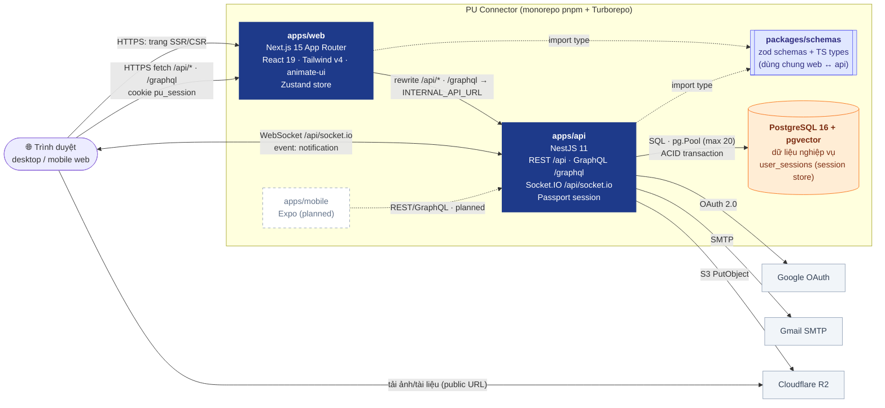

# 02 · Containers (C4 Level 2)

> Các ứng dụng/tiến trình và giao thức giữa chúng. Cập nhật lần cuối: **2026-10-04**.

## Giao thức theo mục đích

| Giao thức | Đường dẫn | Dùng cho | Xác thực |
|---|---|---|---|
| REST | `/api/*` | Auth, posts, comments, communities, upload, notifications, search | Cookie `pu_session` (Passport) |
| GraphQL (Apollo) | `/graphql` | Hồ sơ, follow, gợi ý theo dõi, feed/document lồng nhau | Cookie `pu_session` |
| WebSocket (Socket.IO) | `/api/socket.io` | Đẩy thông báo realtime (`notification`) | Cookie ở handshake; room `user:{id}` do server cấp |
| SQL | `pg.Pool` | Toàn bộ dữ liệu, session store `user_sessions` | `DATABASE_URL` |

## Ghi chú kiến trúc

- **Web gọi API cùng origin** qua rewrite của Next.js (`/api/*`, `/graphql`) ⇒ cookie first-party, không cần CORS ở trình duyệt. Production: nginx route `/api/` và `/graphql` thẳng vào API (xem [06](./06-deployment.md)).
- **`packages/schemas` là mã TS nguồn**: API chỉ được `import type` lúc runtime (validate phía server khai báo lại trong `dto/`).
- **Session lưu Postgres** (`connect-pg-simple`) ⇒ restart/deploy không đăng xuất; dùng chung cho HTTP và Socket.IO.

**Changelog:**
- 2026-10-04 — tạo mới; Socket.IO chuyển sang `/api/socket.io` có xác thực; session store Postgres.
