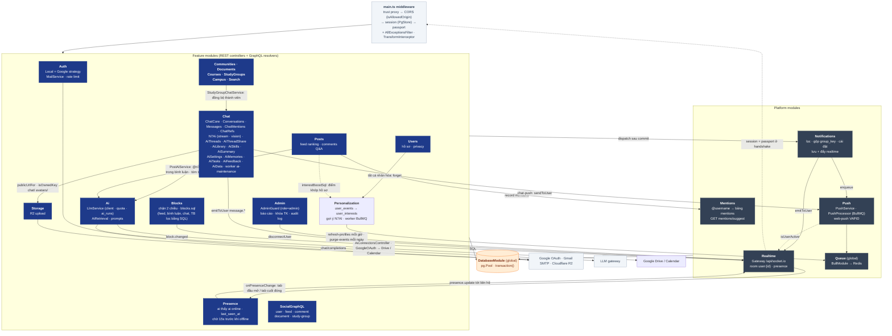

# 03 · API Components (C4 Level 3 — `apps/api`)

> Module NestJS, phụ thuộc giữa chúng và endpoint. Cập nhật lần cuối: **2026-10-16**.

## Module & phụ thuộc

> Quy tắc phụ thuộc: feature module → platform module → `DatabaseModule`. Platform module **không** import feature module (tránh vòng lặp). Token dùng chung đặt trong `*.constants.ts`.

## Endpoint

### REST (`/api`)

| Module | Endpoint |
|---|---|
| Auth | `GET auth/providers` · `POST auth/check-email` · `POST auth/register` · `POST auth/login` · `GET auth/me` · `POST auth/logout` · `GET auth/google` · `GET auth/google/callback` · `POST auth/verify-email` · `POST auth/forgot-password` · `POST auth/reset-password` · `POST auth/resend-verification` · `POST auth/onboarding` |
| Users | `GET users/suggestions` · `GET users/:username/activity/:type` · `GET users/:username` · `PATCH users/profile` · `PATCH users/privacy` · `PATCH users/preferences` (feature plugs) · `POST users/verify-university` |
| Posts | `GET posts` (feedType `for_you`/`following`/`qa`/`courses`/`bookmarks`, `course=<mã>`, `before`/`after` = cửa sổ snapshot; mỗi bài kèm `featuredComment`) · `GET posts/new-since?since=` (pill "bài mới") · `GET/PATCH/DELETE posts/:id` · `POST posts` · `POST posts/:id/{like,bookmark,vote-poll,pin,resolve,report}` · `POST posts/:id/summary` (N7AI, có cache) |
| Comments | `GET/POST posts/:postId/comments` · `POST comments/:id/like` · `POST comments/:id/accept-solution` · `PATCH comments/:id` · `DELETE comments/:id` |
| Mentions | `GET mentions/suggest` |
| Communities | `GET communities` · `GET communities/:slug` · `POST communities/:slug/join` · `GET communities/:slug/posts` |
| Documents | `GET documents` (`type`, `search`, `course`) · `GET documents/:id` · `POST documents` · `POST documents/:id/download` |
| Courses | `GET courses` · `GET courses/:id` · `GET courses/:id/overview` (số liệu + người đóng góp) · `POST courses` |
| Study groups | `GET study-groups` · `GET study-groups/:id` · `POST study-groups` · `POST study-groups/:id/join` |
| Campus | `GET campus-events` · `POST campus-events` |
| Search | `GET search` |
| Notifications | `GET notifications` (cursor `before`, `unread`, `type`) · `GET notifications/unread-count` · `PATCH notifications/:id/read` · `PATCH notifications/read-all` · `GET/PATCH notifications/settings` |
| Storage | `POST upload/file` · `POST upload/multiple` |
| Push | `GET push/config` · `POST/DELETE push/subscriptions` · `POST push/test` |
| Admin (RBAC `AdminGuard` + `@RequireAdminPermission`) | `GET admin/me` · `GET admin/stats` · `GET admin/reports?status=pending\|resolved` · `GET admin/posts?q=&filter=&type=&sort=&dir=&page=&pageSize=` · `POST admin/posts/bulk` · `POST admin/posts/:id/{hide,unhide,pin,dismiss-reports}` · `GET admin/comments?q=&filter=&sort=&page=` · `POST admin/comments/bulk` · `DELETE admin/comments/:id` · `GET admin/users?q=&role=&status=&verified=&auth=&activity=&joined=&faculty=&reported=&sort=&dir=&page=&pageSize=` · `GET admin/users/summary` · `GET admin/users/export` (CSV) · `POST admin/users/bulk` · `GET admin/users/:id` · `POST/DELETE admin/users/:id/notes` · `POST/DELETE admin/users/:id/sanctions` · `PATCH admin/users/:id/role` · `PATCH admin/users/:id/verify` · `POST admin/users/:id/{suspend,unsuspend,revoke-sessions}` · `GET admin/users/:id/insight` · `GET admin/ai/overview` · `GET admin/ai-feedback` · `PATCH admin/ai/tickets/:id` · `GET/PATCH admin/ai/skills` · `GET/POST/PATCH admin/courses` · `GET/DELETE admin/documents` · `GET admin/communities` · `GET admin/search/{zero-results,top}` · `POST admin/broadcast` · `GET admin/audit-logs` |
| Personalization | `POST events` (lô ≤ 50 sự kiện hành vi, 204) · `GET ai/suggestions?mode=` (`{ personalized, items[] }`) |
| Presence | `GET presence` (`{ [userId]: { online, lastSeenAt } }` của người cùng hội thoại) |
| Blocks | `GET blocks` (mình đã chặn ai) · `PUT blocks/:userId` (chặn, idempotent, hủy theo dõi 2 chiều) · `DELETE blocks/:userId` |
| Chat | `GET conversations` (`filter`, `cursor`, `limit` → `{ data, nextCursor }`) · `GET conversations/unread-count` · `POST conversations/direct` · `POST conversations/ai` · `POST conversations` (nhóm) · `POST conversations/study-groups/:groupId` · `GET/PATCH conversations/:id` · `PATCH conversations/:id/settings` (tắt TB, ghim) · `GET/POST conversations/:id/members` · `DELETE conversations/:id/members/:userId` · `POST conversations/:id/owner` · `POST conversations/:id/read` · `POST conversations/:id/leave` · `GET/POST conversations/:id/messages` (keyset `before`, `clientMsgId` idempotent, `attachments`, `replyToId`, `aiMode`) · `GET conversations/:id/messages/search` · `GET conversations/:id/pinned` · `GET conversations/:id/attachments` · `PATCH/DELETE messages/:id` · `GET/POST messages/:id/reactions` · `POST messages/:id/pin` · `GET ai/quota` · `POST ai/conversations/:id/reset` · `GET conversations/:id/mentions?after=` · `GET chat/refs?q=&types=` · `GET/POST ai/threads` (keyset `q`, `cursor`) · `PATCH/DELETE ai/threads/:id` · `GET/POST/DELETE ai/threads/:id/share` · `GET ai/shared/:token` (công khai, không đăng nhập) · `GET ai/library?kind=image|file|study` (keyset `cursor`) · `GET/POST ai/skills` · `GET/PATCH/DELETE ai/skills/:id` · `GET ai/connectors` (kèm `connected`, `account`) · `GET ai/connectors/:provider/connect` (google-drive · google-calendar, 302 → Google) · `GET ai/connectors/google/callback` (state + provider trong session) · `DELETE ai/connectors/:provider` · `GET ai/skills/library?q=` (kèm `official`) · `POST ai/skills/:id/install` · `POST ai/skills/draft`. Body gửi tin thêm `refs[]`, `skillId`, `research`, `connectors[]` |

### GraphQL (`/graphql`)

| Loại | Field |
|---|---|
| Query | `me` · `userProfile` · `suggestedUsers` · `userFollowers` · `userFollowing` · `feed` · `post` · `comments` · `documents` · `studyGroups` |
| Mutation | `toggleFollow` |

### WebSocket (`/api/socket.io`)

| Hướng | Event | Ghi chú |
|---|---|---|
| Server → client | `notification` | `{ notification, unreadCount }` vào room `user:{recipientId}` (NotificationsService.notify) |
| Server → client | `notification.read` | `{ ids?, all?, unreadCount }` — đồng bộ đã đọc giữa các tab |
| Client → server | `presence` | `{ visible }` — tab hiện/ẩn, quyết định có cần Web Push |
| Server → client | `message.new` · `message.updated` | `ChatMessage` tới room `user:{id}` của mọi thành viên |
| Server → client | `message.delta` | `{ conversationId, messageId, delta }` — N7AI trả lời dần |
| Server → client | `conv.read` · `conv.updated` · `conv.removed` | đã đọc `{conversationId, userId, lastReadMessageId}` (mọi thành viên) · đổi tên/thành viên · bị xóa khỏi nhóm |
| Server → client | `conv.read` · `conv.updated` | đồng bộ đã đọc / hội thoại mới giữa các tab |
| Server → client | `ai.thread.updated` | `AiThread` tới chủ thread khi tự đặt / đổi tên (vá cache lịch sử N7AI) |
| Server → client | `presence.update` | `{ userId, online, lastSeenAt }` tới người cùng hội thoại (không chặn nhau, cả hai bật `showActivityStatus`) |
| Server → client | `comments.changed` | `{ postId }` tới người gọi @n7ai khi N7AI đã trả lời bình luận |
| Server → client | `block.changed` | `{ userId }` tới cả 2 phía khi chặn / bỏ chặn ⇒ web làm mới hồ sơ, feed, hội thoại |
| Server → client | `feed:new_post` | `{ postId, authorId }` tới follower khi có bài mới — chỉ là tín hiệu, web gọi `GET posts/new-since` để lấy số thật |
| Client ↔ server | `typing` | `{ conversationId, isTyping }` — server kiểm tra membership rồi chuyển cho thành viên khác |

**Changelog:**
- 2026-10-18 — `AiThreadShareService` + `AiSharedController`: chia sẻ thread N7AI qua link (`ai/threads/:id/share`, công khai `ai/shared/:token`); migration `ai-thread-share-upgrade.sql`.
- 2026-10-17 — `SecurityLogService` ghi vị trí gần đúng (header Cloudflare `cf-ipcountry` / `cf-region` / `cf-ipcity`) + cờ `unusual` (quốc gia/vùng mới trong 90 ngày) ⇒ thông báo `account_notice`, yếu tố rủi ro; `admin/security-events?result=unusual&country=`.
- 2026-10-17 — `AdminUserDataService`: `admin/users/:id/activity`, `admin/users/:id/sessions` (+ DELETE từng phiên), `admin/security-events`; GraphQL `userProfile` ghi `profile_views`. Migration `profile-views-upgrade.sql`.
- 2026-10-17 — `SecurityLogService` (auth): nhật ký bảo mật + `auth/sessions`, `auth/security-events`; admin `users/:id/security`, `views`; `AdminRiskService` (điểm rủi ro, dọn nhật ký 90 ngày). Migration `admin-security-upgrade.sql`.
- 2026-10-17 — Chế tài theo bậc: `POST/DELETE admin/users/:id/sanctions`, bulk `warn/restrict/unrestrict/suspend` có thời hạn; `NotRestrictedGuard` (common/guards) trên các handler tạo nội dung; job gỡ chế tài hết hạn trong `AdminUsersService`; thông báo `account_notice`. Migration `admin-sanctions-upgrade.sql`.
- 2026-10-17 — `AdminListsService` + `admin-paging.ts`: mọi danh sách admin trả `AdminPage<T>` (phân trang server, lọc, sắp xếp, facets); `POST admin/posts/bulk`, `POST admin/comments/bulk`. Migration `admin-lists-upgrade.sql`.
- 2026-10-17 — `AdminUsersService` tách khỏi `AdminService`: danh sách người dùng phân trang server + lọc/sắp xếp, `users/summary`, `users/export` (CSV), `users/bulk` (1 transaction), hồ sơ chi tiết `users/:id`, ghi chú nội bộ `users/:id/notes`; `admin-audit.ts` (`writeAudit`) dùng chung. Migration `admin-users-upgrade.sql`.
- 2026-10-17 — Đổi tên PU AI → N7AI: thư mục `chat/n7ai/` (`N7AiService`, `N7AiController`, `dto/n7ai.dto.ts`), bot `@n7ai` (nhận cả `@puai` cũ), migration `n7ai-rename-upgrade.sql`.
- 2026-10-17 — `AiSkillDraftService`: `POST ai/skills/draft` (N7AI viết bản nháp skill, không lưu, 1 lượt); thư viện skill trả `official` (skill của @n7ai, seed `ai-skills-seed.sql`).
- 2026-10-17 — Mở rộng `AdminModule` với phân quyền RBAC 15 quyền (`@RequireAdminPermission`), quản lý bài viết/ghim, xóa bình luận, đổi role/verify/revoke-sessions, N7AI telemetry (`admin/ai/overview`, `admin/ai/tickets/:id`, `admin/ai/skills`), quản lý học phần/tài liệu/cộng đồng, top searches và phát thông báo hệ thống (`admin/broadcast`).
- 2026-10-17 — `AiLibraryController` `GET ai/library`; `GET conversations` & `unread-count` bỏ thread AI; push N7AI ⇒ `/n7ai/:id`; callback Google connector ⇒ `/n7ai/settings/connectors`.
- 2026-10-16 — Cài đặt N7AI: `AiSettingsController` (`ai/settings`, `ai/memories`, `ai/tasks`, `ai/messages/:id/feedback`, `ai/support`, `ai/usage`, `ai/data`), `AiAdminController` `GET admin/ai-feedback`, `PATCH ai/skills/:id/state`; queue BullMQ `ai-maintenance` (tác vụ tự động 5 phút, dọn lịch sử hằng ngày); `WebReaderService` (connector `web`, `web_search`).
- 2026-10-16 — `ConnectorCallbackMiddleware` trên `GET auth/google/callback`: connector Google dùng chung redirect URI đăng nhập (phân biệt bằng `state` trong session).
- 2026-10-16 — `GoogleOAuthService` dùng chung + `GoogleCalendarService`; thư viện skill công khai (`ai/skills/library`, `install`); `ai/threads?q=` tìm cả nội dung; xóa thread dọn tệp R2 (`StorageService.deleteObjects`).
- 2026-10-16 — AiModule: `AiConnectorsController` + `GoogleDriveService` (OAuth `drive.readonly`, token AES-256-GCM trong `user_connectors`), `AiRetrieval` thêm connector `google_drive`; `ai/doc-text.ts` dùng chung trích chữ PDF/DOCX/txt.
- 2026-10-16 — Chat: `ChatMentionsService` (mention nhóm, `GET conversations/:id/mentions`), `ChatRefsController` `GET chat/refs`, `AiThreadsController` `ai/threads`, `AiSkillsController` `ai/skills`, `GET ai/connectors`, `AiMemoryService` (tóm tắt cuộn); event `ai.thread.updated`; `AiRetrieval` theo connector.
- 2026-10-17 — Users → Posts: `GET users/:username/activity/:type` (`PostsService.findAll` + `FeedOptions.activity`); `ProfileAccessService` (Users, export) dùng chung cho SocialGraphQL `userProfile` (lọc privacy, `isContentLocked`, `activityTabs`).
- 2026-10-16 — Users: `GET users/suggestions` (`FollowSuggestionsService`, chấm điểm bạn chung/lớp/khoa/sở thích); cột phải web chuyển từ GraphQL `suggestedUsers` sang endpoint này.
- 2026-10-16 — Mentions: `MentionsController` `GET mentions/suggest` (`MentionSuggestService`); Comments: `PATCH comments/:id` (sửa, ghi mention mới, cột `comments.edited_at`).
- 2026-10-16 — Users: `PATCH users/preferences` (cột `users.preferences`); `GET posts` bỏ query featured comment khi người xem tắt cờ.
- 2026-10-16 — Posts: `featuredComment` trong feed (`featured-comment.sql.ts`), `GET posts/new-since`, cửa sổ `before`/`after` cho `GET posts`; Posts → Realtime: `emitToUsers` event `feed:new_post`.
- 2026-10-14 — Admin → Personalization: `GET admin/users/:id/insight` (dữ liệu cá nhân hóa 1 người, chỉ đọc, ghi `user.insight_view`).
- 2026-10-14 — PersonalizationModule: `POST events`, `GET ai/suggestions`, worker `personalization` (BullMQ job scheduler); feed For You cộng điểm khớp `user_interests`; N7AI trả kèm câu hỏi gợi ý tiếp theo (`meta.followUps`).
- 2026-10-14 — `GET conversations` phân trang keyset + lọc ở server.
- 2026-10-14 — `POST posts/:id/summary` (tóm tắt bài bằng N7AI, lưu `post_summaries`).
- 2026-10-14 — AiModule (LlmService, AiRetrieval) tách khỏi Chat; Posts → Ai: `PostAiService` trả lời @n7ai trong bình luận, event `comments.changed`.
- 2026-10-14 — PresenceModule: gateway đếm socket theo user (`isOnline`, `onPresenceChange`), `GET presence`, event `presence.update`.
- 2026-10-14 — BlocksModule: `GET/PUT/DELETE blocks`, event `block.changed`; GraphQL `User.blockState`; hội thoại trả `blockState`.
- 2026-10-13 — `POST conversations/:id/owner` (chuyển quyền trưởng nhóm).
- 2026-10-13 — Chat → Push: queue `chat-push` (`ChatPushService` / `ChatPushProcessor`), kênh cài đặt `chat_message`.
- 2026-10-13 — N7AiService dùng SDK `openai` (gateway OpenAI-compatible).
- 2026-10-13 — StudyGroups → Chat (`StudyGroupChatService`): `POST conversations/study-groups/:groupId`, tự thêm thành viên mới vào nhóm chat.
- 2026-10-13 — Chat: `GET messages/:id/reactions` (ai đã thả cảm xúc); `PATCH conversations/:id` nhận `avatarKey`.
- 2026-10-13 — ChatModule tách `chat-core` / `conversations` / `messages` / `n7ai`; thêm endpoint thành viên, cài đặt, cảm xúc, ghim, sửa, tìm kiếm, kho tệp, reset AI; Storage thêm thư mục `chat`; event `conv.removed`.
- 2026-10-13 — AdminModule, ChatModule (+ N7AiService), `courses/:id/overview`, lọc `course` cho posts/documents; StudyGroups lưu Postgres; event `message.*`, `typing`; khóa tài khoản chặn login/session/socket.
- 2026-10-04 — Search: unaccent + trigram, `search_logs` (xem [07-search](../core/07-search.md)).
- 2026-10-04 — Auth: `forgot-password`, `reset-password`.
- 2026-10-04 — PushModule + QueueModule (BullMQ), endpoint push, event `presence`.
- 2026-10-04 — Notification v1: `dispatch()` từ Posts/Comments/UserResolver/Auth, endpoint settings/unread-count, event `notification.read`; vá mạo danh (requireUserId).
- 2026-10-04 — tạo mới; thêm MentionsModule, RealtimeGateway có xác thực, NotificationsModule đẩy realtime.
