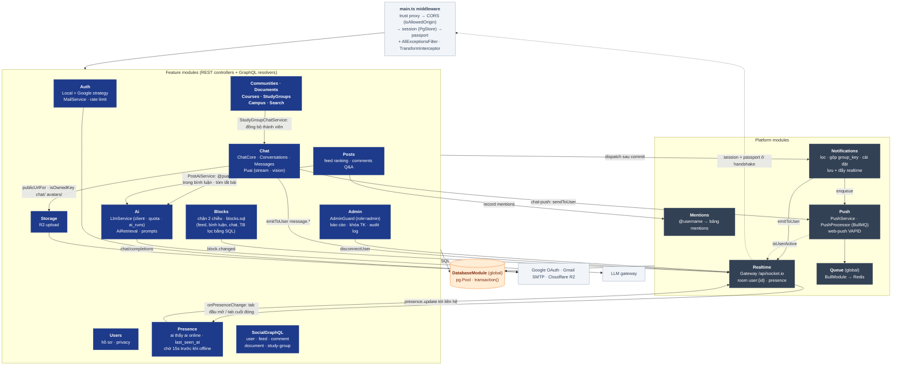

# 03 · API Components (C4 Level 3 — `apps/api`)

> Module NestJS, phụ thuộc giữa chúng và endpoint. Cập nhật lần cuối: **2026-10-14**.

## Module & phụ thuộc

> Quy tắc phụ thuộc: feature module → platform module → `DatabaseModule`. Platform module **không** import feature module (tránh vòng lặp). Token dùng chung đặt trong `*.constants.ts`.

## Endpoint

### REST (`/api`)

| Module | Endpoint |
|---|---|
| Auth | `GET auth/providers` · `POST auth/check-email` · `POST auth/register` · `POST auth/login` · `GET auth/me` · `POST auth/logout` · `GET auth/google` · `GET auth/google/callback` · `POST auth/verify-email` · `POST auth/forgot-password` · `POST auth/reset-password` · `POST auth/resend-verification` · `POST auth/onboarding` |
| Users | `GET users/:username` · `PATCH users/profile` · `PATCH users/privacy` · `POST users/verify-university` |
| Posts | `GET posts` (feedType `for_you`/`following`/`qa`/`courses`/`bookmarks`, `course=<mã>`) · `GET/PATCH/DELETE posts/:id` · `POST posts` · `POST posts/:id/{like,bookmark,vote-poll,pin,resolve,report}` · `POST posts/:id/summary` (PU AI, có cache) |
| Comments | `GET/POST posts/:postId/comments` · `POST comments/:id/like` · `POST comments/:id/accept-solution` · `DELETE comments/:id` |
| Communities | `GET communities` · `GET communities/:slug` · `POST communities/:slug/join` · `GET communities/:slug/posts` |
| Documents | `GET documents` (`type`, `search`, `course`) · `GET documents/:id` · `POST documents` · `POST documents/:id/download` |
| Courses | `GET courses` · `GET courses/:id` · `GET courses/:id/overview` (số liệu + người đóng góp) · `POST courses` |
| Study groups | `GET study-groups` · `GET study-groups/:id` · `POST study-groups` · `POST study-groups/:id/join` |
| Campus | `GET campus-events` · `POST campus-events` |
| Search | `GET search` |
| Notifications | `GET notifications` (cursor `before`, `unread`, `type`) · `GET notifications/unread-count` · `PATCH notifications/:id/read` · `PATCH notifications/read-all` · `GET/PATCH notifications/settings` |
| Storage | `POST upload/file` · `POST upload/multiple` |
| Push | `GET push/config` · `POST/DELETE push/subscriptions` · `POST push/test` |
| Admin (role `admin`) | `GET admin/stats` · `GET admin/reports?status=pending\|resolved` · `POST admin/posts/:id/{hide,unhide,dismiss-reports}` · `GET admin/users?q=&status=` · `POST admin/users/:id/{suspend,unsuspend}` · `GET admin/audit-logs` · `GET admin/search/zero-results?days=` |
| Presence | `GET presence` (`{ [userId]: { online, lastSeenAt } }` của người cùng hội thoại) |
| Blocks | `GET blocks` (mình đã chặn ai) · `PUT blocks/:userId` (chặn, idempotent, hủy theo dõi 2 chiều) · `DELETE blocks/:userId` |
| Chat | `GET conversations` · `GET conversations/unread-count` · `POST conversations/direct` · `POST conversations/ai` · `POST conversations` (nhóm) · `POST conversations/study-groups/:groupId` · `GET/PATCH conversations/:id` · `PATCH conversations/:id/settings` (tắt TB, ghim) · `GET/POST conversations/:id/members` · `DELETE conversations/:id/members/:userId` · `POST conversations/:id/owner` · `POST conversations/:id/read` · `POST conversations/:id/leave` · `GET/POST conversations/:id/messages` (keyset `before`, `clientMsgId` idempotent, `attachments`, `replyToId`, `aiMode`) · `GET conversations/:id/messages/search` · `GET conversations/:id/pinned` · `GET conversations/:id/attachments` · `PATCH/DELETE messages/:id` · `GET/POST messages/:id/reactions` · `POST messages/:id/pin` · `GET ai/quota` · `POST ai/conversations/:id/reset` |

### GraphQL (`/graphql`)

| Loại | Field |
|---|---|
| Query | `me` · `userProfile` · `suggestedUsers` · `userFollowers` · `userFollowing` · `feed` · `post` · `comments` · `documents` · `studyGroups` |
| Mutation | `toggleFollow` |

### WebSocket (`/api/socket.io`)

| Hướng | Event | Ghi chú |
|---|---|---|
| Server → client | `notification` | `{ notification, unreadCount }` vào room `user:{recipientId}` (NotificationsService.notify) |
| Server → client | `notification.read` | `{ ids?, all?, unreadCount }` — đồng bộ đã đọc giữa các tab |
| Client → server | `presence` | `{ visible }` — tab hiện/ẩn, quyết định có cần Web Push |
| Server → client | `message.new` · `message.updated` | `ChatMessage` tới room `user:{id}` của mọi thành viên |
| Server → client | `message.delta` | `{ conversationId, messageId, delta }` — PU AI trả lời dần |
| Server → client | `conv.read` · `conv.updated` · `conv.removed` | đã đọc `{conversationId, userId, lastReadMessageId}` (mọi thành viên) · đổi tên/thành viên · bị xóa khỏi nhóm |
| Server → client | `conv.read` · `conv.updated` | đồng bộ đã đọc / hội thoại mới giữa các tab |
| Server → client | `presence.update` | `{ userId, online, lastSeenAt }` tới người cùng hội thoại (không chặn nhau, cả hai bật `showActivityStatus`) |
| Server → client | `comments.changed` | `{ postId }` tới người gọi @puai khi PU AI đã trả lời bình luận |
| Server → client | `block.changed` | `{ userId }` tới cả 2 phía khi chặn / bỏ chặn ⇒ web làm mới hồ sơ, feed, hội thoại |
| Client ↔ server | `typing` | `{ conversationId, isTyping }` — server kiểm tra membership rồi chuyển cho thành viên khác |

**Changelog:**
- 2026-10-14 — `POST posts/:id/summary` (tóm tắt bài bằng PU AI, lưu `post_summaries`).
- 2026-10-14 — AiModule (LlmService, AiRetrieval) tách khỏi Chat; Posts → Ai: `PostAiService` trả lời @puai trong bình luận, event `comments.changed`.
- 2026-10-14 — PresenceModule: gateway đếm socket theo user (`isOnline`, `onPresenceChange`), `GET presence`, event `presence.update`.
- 2026-10-14 — BlocksModule: `GET/PUT/DELETE blocks`, event `block.changed`; GraphQL `User.blockState`; hội thoại trả `blockState`.
- 2026-10-13 — `POST conversations/:id/owner` (chuyển quyền trưởng nhóm).
- 2026-10-13 — Chat → Push: queue `chat-push` (`ChatPushService` / `ChatPushProcessor`), kênh cài đặt `chat_message`.
- 2026-10-13 — PuaiService dùng SDK `openai` (gateway OpenAI-compatible).
- 2026-10-13 — StudyGroups → Chat (`StudyGroupChatService`): `POST conversations/study-groups/:groupId`, tự thêm thành viên mới vào nhóm chat.
- 2026-10-13 — Chat: `GET messages/:id/reactions` (ai đã thả cảm xúc); `PATCH conversations/:id` nhận `avatarKey`.
- 2026-10-13 — ChatModule tách `chat-core` / `conversations` / `messages` / `puai`; thêm endpoint thành viên, cài đặt, cảm xúc, ghim, sửa, tìm kiếm, kho tệp, reset AI; Storage thêm thư mục `chat`; event `conv.removed`.
- 2026-10-13 — AdminModule, ChatModule (+ PuaiService), `courses/:id/overview`, lọc `course` cho posts/documents; StudyGroups lưu Postgres; event `message.*`, `typing`; khóa tài khoản chặn login/session/socket.
- 2026-10-04 — Search: unaccent + trigram, `search_logs` (xem [07-search](../core/07-search.md)).
- 2026-10-04 — Auth: `forgot-password`, `reset-password`.
- 2026-10-04 — PushModule + QueueModule (BullMQ), endpoint push, event `presence`.
- 2026-10-04 — Notification v1: `dispatch()` từ Posts/Comments/UserResolver/Auth, endpoint settings/unread-count, event `notification.read`; vá mạo danh (requireUserId).
- 2026-10-04 — tạo mới; thêm MentionsModule, RealtimeGateway có xác thực, NotificationsModule đẩy realtime.
