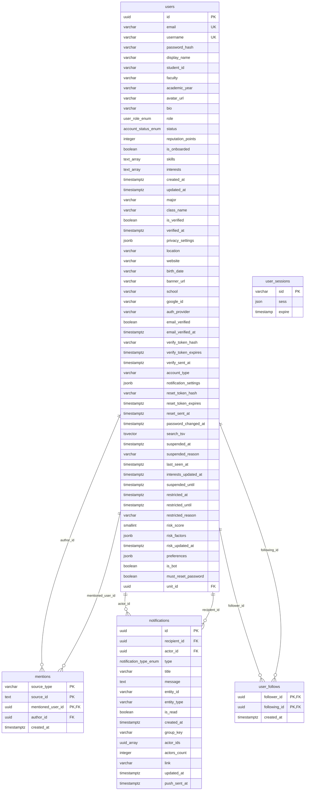
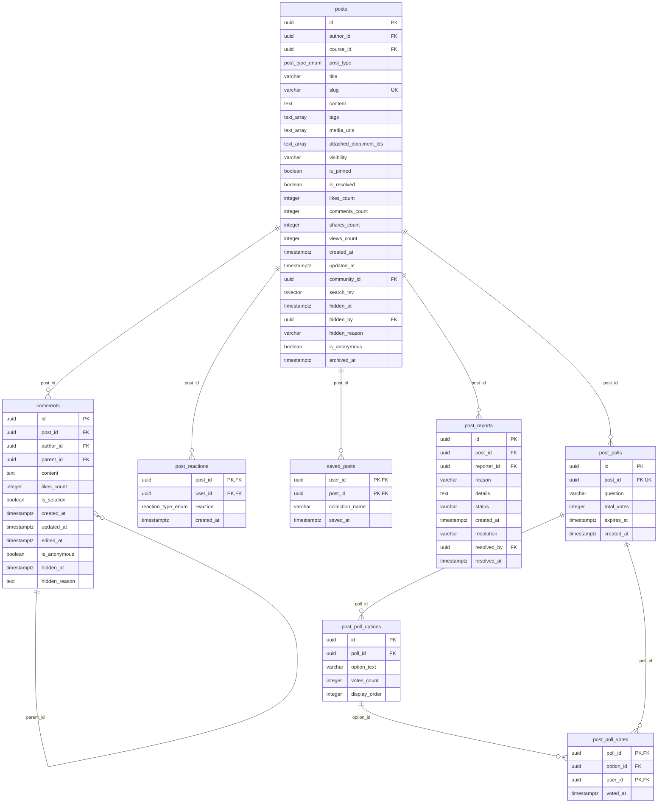
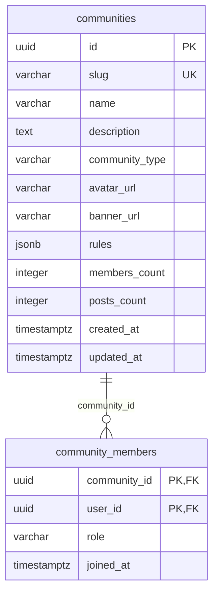
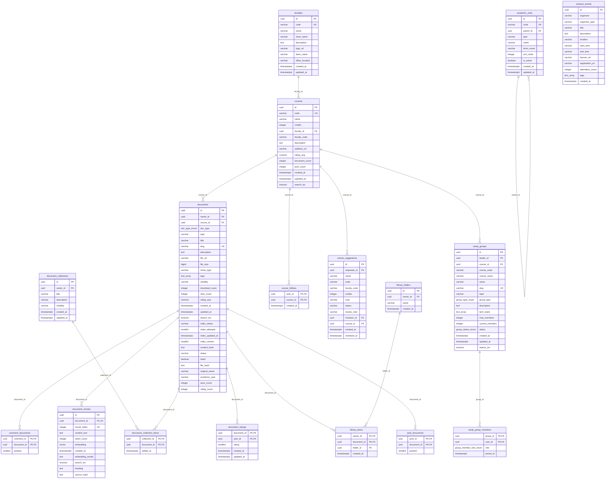
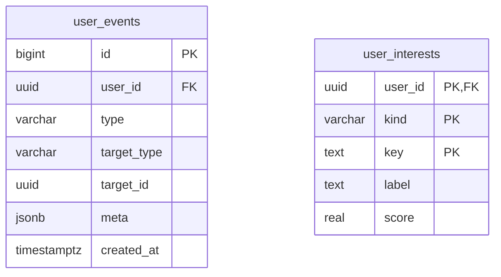

# 🗄️ ERD — Cơ sở dữ liệu (tự sinh)

> ⚙️ **File tự sinh** bởi `pnpm docs:erd` (`scripts/gen-erd.mjs`) từ database thật. **Không sửa tay.**
> Chạy lại sau mỗi migration. Nguồn: `information_schema` + `pg_constraint`.

Tổng: **78 bảng**, **123 khóa ngoại**. Ký hiệu: `PK` khóa chính · `FK` khóa ngoại · `UK` unique · `||` bắt buộc · `|o` có thể NULL.

## 1. Tổng quan quan hệ

```mermaid
erDiagram
  bot_activity {
    string no_fk
  }
  bot_topics {
    string no_fk
  }
  campus_events {
    string no_fk
  }
  deleted_records {
    string no_fk
  }
  migration_marks {
    string no_fk
  }
  news_crawler_config {
    string no_fk
  }
  search_logs {
    string no_fk
  }
  user_sessions {
    string no_fk
  }
  academic_units |o--o{ academic_units : "parent_id"
  users |o--o{ admin_audit_logs : "admin_id"
  users ||--o{ admin_saved_views : "admin_id"
  users |o--o{ admin_user_notes : "admin_id"
  users ||--o{ admin_user_notes : "user_id"
  messages ||--o{ ai_feedback : "message_id"
  users ||--o{ ai_feedback : "user_id"
  users ||--o{ ai_folders : "user_id"
  messages |o--o{ ai_memories : "source_message_id"
  study_sets |o--o{ ai_memories : "study_set_id"
  users ||--o{ ai_memories : "user_id"
  ai_providers |o--o{ ai_models : "provider_id"
  users ||--o{ ai_runs : "bot_id"
  users ||--o{ ai_runs : "requester_id"
  users ||--o{ ai_settings : "user_id"
  users ||--o{ ai_skills : "owner_id"
  ai_skills |o--o{ ai_skills : "source_skill_id"
  conversations |o--o{ ai_sources : "thread_id"
  users ||--o{ ai_sources : "user_id"
  conversations |o--o{ ai_support_tickets : "conversation_id"
  users |o--o{ ai_support_tickets : "user_id"
  conversations |o--o{ ai_tasks : "conversation_id"
  ai_skills |o--o{ ai_tasks : "skill_id"
  users ||--o{ ai_tasks : "user_id"
  conversations ||--o{ ai_thread_shares : "conversation_id"
  users ||--o{ ai_thread_shares : "owner_id"
  users |o--o{ bot_commands : "created_by"
  users |o--o{ bot_control : "updated_by"
  posts |o--o{ bot_feed_items : "post_id"
  users |o--o{ bot_profiles : "updated_by"
  users ||--o{ bot_profiles : "user_id"
  comments ||--o{ comment_documents : "comment_id"
  documents ||--o{ comment_documents : "document_id"
  comments ||--o{ comment_reactions : "comment_id"
  users ||--o{ comment_reactions : "user_id"
  users ||--o{ comments : "author_id"
  comments |o--o{ comments : "parent_id"
  posts ||--o{ comments : "post_id"
  communities ||--o{ community_members : "community_id"
  users ||--o{ community_members : "user_id"
  conversations ||--o{ conversation_members : "conversation_id"
  users ||--o{ conversation_members : "user_id"
  ai_folders |o--o{ conversations : "ai_folder_id"
  users |o--o{ conversations : "created_by"
  study_groups |o--o{ conversations : "study_group_id"
  courses ||--o{ course_follows : "course_id"
  users ||--o{ course_follows : "user_id"
  faculties |o--o{ courses : "faculty_id"
  courses |o--o{ course_suggestions : "course_id"
  users ||--o{ course_suggestions : "requester_id"
  users |o--o{ course_suggestions : "reviewer_id"
  documents ||--o{ document_chunks : "document_id"
  document_collections ||--o{ document_collection_items : "collection_id"
  documents ||--o{ document_collection_items : "document_id"
  users ||--o{ document_collections : "owner_id"
  documents ||--o{ document_ratings : "document_id"
  users ||--o{ document_ratings : "user_id"
  courses |o--o{ documents : "course_id"
  users ||--o{ documents : "owner_id"
  users ||--o{ library_folders : "owner_id"
  documents ||--o{ library_items : "document_id"
  library_folders |o--o{ library_items : "folder_id"
  users ||--o{ library_items : "owner_id"
  users |o--o{ mentions : "author_id"
  users ||--o{ mentions : "mentioned_user_id"
  conversations ||--o{ message_mentions : "conversation_id"
  messages ||--o{ message_mentions : "message_id"
  users ||--o{ message_mentions : "user_id"
  messages ||--o{ message_reactions : "message_id"
  users ||--o{ message_reactions : "user_id"
  conversations ||--o{ messages : "conversation_id"
  users |o--o{ messages : "pinned_by"
  messages |o--o{ messages : "reply_to_id"
  users |o--o{ messages : "sender_id"
  posts |o--o{ news_articles : "post_id"
  news_sources |o--o{ news_articles : "source_id"
  users |o--o{ notifications : "actor_id"
  users ||--o{ notifications : "recipient_id"
  documents ||--o{ post_documents : "document_id"
  posts ||--o{ post_documents : "post_id"
  posts ||--o{ post_embeddings : "post_id"
  post_polls ||--o{ post_poll_options : "poll_id"
  posts ||--o{ post_polls : "post_id"
  post_poll_options ||--o{ post_poll_votes : "option_id"
  post_polls ||--o{ post_poll_votes : "poll_id"
  users ||--o{ post_poll_votes : "user_id"
  posts ||--o{ post_reactions : "post_id"
  users ||--o{ post_reactions : "user_id"
  posts ||--o{ post_reports : "post_id"
  users ||--o{ post_reports : "reporter_id"
  users |o--o{ post_reports : "resolved_by"
  users ||--o{ posts : "author_id"
  communities |o--o{ posts : "community_id"
  courses |o--o{ posts : "course_id"
  users |o--o{ posts : "hidden_by"
  posts ||--o{ post_summaries : "post_id"
  users ||--o{ profile_views : "profile_id"
  users ||--o{ profile_views : "viewer_id"
  users ||--o{ push_subscriptions : "user_id"
  posts ||--o{ saved_posts : "post_id"
  users ||--o{ saved_posts : "user_id"
  study_items |o--o{ study_events : "item_id"
  study_sets |o--o{ study_events : "set_id"
  users ||--o{ study_events : "user_id"
  study_groups ||--o{ study_group_members : "group_id"
  users ||--o{ study_group_members : "user_id"
  courses |o--o{ study_groups : "course_id"
  users ||--o{ study_groups : "leader_id"
  study_sets ||--o{ study_items : "set_id"
  users ||--o{ study_sets : "owner_id"
  messages |o--o{ study_sets : "source_message_id"
  users ||--o{ user_blocks : "blocked_id"
  users ||--o{ user_blocks : "blocker_id"
  users ||--o{ user_connectors : "user_id"
  users ||--o{ user_events : "user_id"
  users ||--o{ user_follows : "follower_id"
  users ||--o{ user_follows : "following_id"
  users ||--o{ user_interests : "user_id"
  academic_units |o--o{ users : "unit_id"
  users |o--o{ user_sanctions : "admin_id"
  users |o--o{ user_sanctions : "revoked_by"
  users ||--o{ user_sanctions : "user_id"
  users |o--o{ user_security_events : "user_id"
```

## 2. Identity & Social graph

Liên kết ra ngoài nhóm: `admin_audit_logs.admin_id → users`, `admin_saved_views.admin_id → users`, `admin_user_notes.admin_id → users`, `admin_user_notes.user_id → users`, `ai_feedback.user_id → users`, `ai_folders.user_id → users`, `ai_memories.user_id → users`, `ai_runs.bot_id → users`, `ai_runs.requester_id → users`, `ai_settings.user_id → users`, `ai_skills.owner_id → users`, `ai_sources.user_id → users`, `ai_support_tickets.user_id → users`, `ai_tasks.user_id → users`, `ai_thread_shares.owner_id → users`, `bot_commands.created_by → users`, `bot_control.updated_by → users`, `bot_profiles.updated_by → users`, `bot_profiles.user_id → users`, `comment_reactions.user_id → users`, `comments.author_id → users`, `community_members.user_id → users`, `conversation_members.user_id → users`, `conversations.created_by → users`, `course_follows.user_id → users`, `course_suggestions.requester_id → users`, `course_suggestions.reviewer_id → users`, `document_collections.owner_id → users`, `document_ratings.user_id → users`, `documents.owner_id → users`, `library_folders.owner_id → users`, `library_items.owner_id → users`, `message_mentions.user_id → users`, `message_reactions.user_id → users`, `messages.pinned_by → users`, `messages.sender_id → users`, `post_poll_votes.user_id → users`, `post_reactions.user_id → users`, `post_reports.reporter_id → users`, `post_reports.resolved_by → users`, `posts.author_id → users`, `posts.hidden_by → users`, `profile_views.profile_id → users`, `profile_views.viewer_id → users`, `push_subscriptions.user_id → users`, `saved_posts.user_id → users`, `study_events.user_id → users`, `study_group_members.user_id → users`, `study_groups.leader_id → users`, `study_sets.owner_id → users`, `user_blocks.blocked_id → users`, `user_blocks.blocker_id → users`, `user_connectors.user_id → users`, `user_events.user_id → users`, `user_interests.user_id → users`, `users.unit_id → academic_units`, `user_sanctions.admin_id → users`, `user_sanctions.revoked_by → users`, `user_sanctions.user_id → users`, `user_security_events.user_id → users`

## 3. Feed & Q&A

Liên kết ra ngoài nhóm: `bot_feed_items.post_id → posts`, `comment_documents.comment_id → comments`, `comment_reactions.comment_id → comments`, `comments.author_id → users`, `news_articles.post_id → posts`, `post_documents.post_id → posts`, `post_embeddings.post_id → posts`, `post_poll_votes.user_id → users`, `post_reactions.user_id → users`, `post_reports.reporter_id → users`, `post_reports.resolved_by → users`, `posts.author_id → users`, `posts.community_id → communities`, `posts.course_id → courses`, `posts.hidden_by → users`, `post_summaries.post_id → posts`, `saved_posts.user_id → users`

## 4. Communities

Liên kết ra ngoài nhóm: `community_members.user_id → users`, `posts.community_id → communities`

## 5. Academic

Liên kết ra ngoài nhóm: `comment_documents.comment_id → comments`, `conversations.study_group_id → study_groups`, `course_follows.user_id → users`, `course_suggestions.requester_id → users`, `course_suggestions.reviewer_id → users`, `document_collections.owner_id → users`, `document_ratings.user_id → users`, `documents.owner_id → users`, `library_folders.owner_id → users`, `library_items.owner_id → users`, `post_documents.post_id → posts`, `posts.course_id → courses`, `study_group_members.user_id → users`, `study_groups.leader_id → users`, `users.unit_id → academic_units`

## 6. Personalization

Liên kết ra ngoài nhóm: `user_events.user_id → users`, `user_interests.user_id → users`

## 7. Chưa phân nhóm (cập nhật DOMAINS trong scripts/gen-erd.mjs)

```mermaid
erDiagram
  admin_audit_logs {
    bigint id PK
    uuid admin_id FK
    varchar action
    varchar target_type
    text target_id
    jsonb details
    timestamptz created_at
  }
  admin_saved_views {
    bigint id PK
    uuid admin_id FK
    varchar page
    varchar name
    text query
    boolean shared
    timestamptz created_at
  }
  admin_user_notes {
    bigint id PK
    uuid user_id FK
    uuid admin_id FK
    varchar body
    timestamptz created_at
  }
  ai_feedback {
    bigint message_id PK,FK
    uuid user_id PK,FK
    smallint rating
    varchar reason
    varchar comment
    timestamptz created_at
  }
  ai_folders {
    uuid id PK
    uuid user_id FK
    varchar name
    timestamptz created_at
    timestamptz updated_at
  }
  ai_memories {
    uuid id PK
    uuid user_id FK
    varchar content
    varchar source
    bigint source_message_id FK
    timestamptz created_at
    timestamptz updated_at
    boolean pinned
    uuid study_set_id FK
  }
  ai_models {
    varchar id PK
    varchar label
    varchar hint
    smallint cost
    boolean visible
    boolean enabled
    boolean is_default
    integer sort_order
    timestamptz created_at
    timestamptz updated_at
    uuid provider_id FK
    varchar upstream_model
    varchar reasoning_effort
    integer max_input_tokens
    integer max_output_tokens
  }
  ai_providers {
    uuid id PK
    varchar name
    text base_url
    text api_key_enc
    varchar key_hint
    varchar model_override
    boolean enabled
    integer priority
    timestamptz created_at
    timestamptz updated_at
  }
  ai_runs {
    uuid id PK
    uuid bot_id FK
    uuid requester_id FK
    varchar trigger
    varchar task
    jsonb source_ref
    jsonb reply_ref
    varchar status
    varchar model
    integer input_tokens
    integer output_tokens
    text error
    integer latency_ms
    timestamptz created_at
    timestamptz finished_at
  }
  ai_settings {
    uuid user_id PK,FK
    boolean memory_enabled
    integer retention_days
    text_array default_connectors
    timestamptz updated_at
    varchar profile_goal
    varchar profile_about
    varchar profile_style
    varchar ai_model
  }
  ai_skills {
    uuid id PK
    uuid owner_id FK,UK
    varchar slug UK
    varchar name
    varchar description
    text instructions
    varchar input_hint
    integer use_count
    timestamptz last_used_at
    timestamptz created_at
    timestamptz updated_at
    boolean is_public
    integer install_count
    uuid source_skill_id FK
    boolean enabled
    boolean pinned
  }
  ai_sources {
    uuid id PK
    uuid user_id FK
    uuid thread_id FK
    varchar kind
    varchar title
    text url
    text file_key
    varchar mime
    integer size
    text content
    timestamptz created_at
    jsonb meta
    boolean in_context
  }
  ai_support_tickets {
    uuid id PK
    uuid user_id FK
    varchar category
    text message
    uuid conversation_id FK
    jsonb context
    varchar status
    timestamptz created_at
  }
  ai_tasks {
    uuid id PK
    uuid user_id FK
    varchar title
    text prompt
    uuid skill_id FK
    text_array connectors
    varchar frequency
    time_without_time_zone run_time
    smallint weekday
    uuid conversation_id FK
    boolean enabled
    timestamptz next_run_at
    timestamptz last_run_at
    varchar last_status
    integer fail_count
    timestamptz created_at
  }
  ai_thread_shares {
    uuid conversation_id PK,FK
    uuid owner_id FK
    varchar token UK
    bigint until_message_id
    timestamptz created_at
    timestamptz updated_at
  }
  bot_activity {
    bigint id PK
    text bot_username
    text action
    text details
    text level
    timestamptz created_at
  }
  bot_commands {
    bigint id PK
    text type
    jsonb payload
    text status
    text result
    uuid created_by FK
    timestamptz created_at
    timestamptz finished_at
    timestamptz scheduled_at
  }
  bot_control {
    smallint id PK
    boolean enabled
    text speed
    timestamptz heartbeat_at
    timestamptz started_at
    jsonb stats
    uuid updated_by FK
    timestamptz updated_at
    boolean feed_enabled
    text ai_model
    text ai_base_url
    boolean feed_review
  }
  bot_feed_items {
    bigint id PK
    text source_key UK
    text content_hash UK
    text content
    text_array image_urls
    text status
    smallint attempts
    text posted_by
    uuid post_id FK
    timestamptz created_at
    timestamptz posted_at
    text raw_content
    text topic
    jsonb verdict
  }
  bot_profiles {
    uuid user_id PK,FK
    boolean enabled
    text_array topics
    boolean can_post
    boolean can_comment
    boolean can_like
    boolean interact_humans
    boolean feed_poster
    smallint max_posts_per_day
    smallint max_comments_per_day
    smallint max_likes_per_day
    uuid updated_by FK
    timestamptz updated_at
    text tone
    text major
    text soul
  }
  bot_topics {
    text slug PK
    text label
    text_array keywords
    boolean enabled
    timestamptz created_at
  }
  comment_reactions {
    uuid comment_id PK,FK
    uuid user_id PK,FK
    timestamptz created_at
  }
  conversation_members {
    uuid conversation_id PK,FK
    uuid user_id PK,FK
    varchar role
    bigint last_read_message_id
    timestamptz joined_at
    timestamptz left_at
    timestamptz muted_until
    timestamptz pinned_at
    timestamptz push_shown_at
  }
  conversations {
    uuid id PK
    varchar type
    varchar title
    varchar avatar_url
    uuid created_by FK
    varchar direct_key UK
    bigint last_message_id
    timestamptz last_message_at
    timestamptz created_at
    uuid study_group_id FK
    text ai_summary
    bigint ai_summary_upto
    uuid ai_folder_id FK
  }
  deleted_records {
    bigint id PK
    text table_name
    text row_id
    jsonb data
    bigint batch
    uuid deleted_by
    timestamptz deleted_at
  }
  message_mentions {
    bigint message_id PK,FK
    uuid user_id PK,FK
    uuid conversation_id FK
  }
  message_reactions {
    bigint message_id PK,FK
    uuid user_id PK,FK
    varchar emoji PK
    timestamptz created_at
  }
  messages {
    bigint id PK
    uuid conversation_id FK
    uuid sender_id FK,UK
    uuid client_msg_id UK
    varchar kind
    text content
    jsonb blocks
    bigint reply_to_id FK
    varchar status
    timestamptz deleted_at
    timestamptz created_at
    jsonb attachments
    timestamptz edited_at
    timestamptz pinned_at
    uuid pinned_by FK
    jsonb meta
  }
  migration_marks {
    text name PK
    timestamptz applied_at
  }
  news_articles {
    uuid id PK
    integer source_id FK
    text source_name
    text source_url UK
    text title
    text summary
    text impact
    text category
    text status
    timestamptz published_at
    uuid post_id FK
    text posted_by
    timestamptz posted_at
    timestamptz created_at
  }
  news_crawler_config {
    integer id PK
    boolean auto_post
    boolean telegram_enabled
    text telegram_bot_token
    text telegram_chat_id
    text default_bot
    text ai_model
    timestamptz updated_at
  }
  news_sources {
    integer id PK
    text name
    text url UK
    text category
    boolean enabled
    timestamptz last_run_at
    integer items_count
    timestamptz created_at
  }
  post_embeddings {
    uuid post_id PK,FK
    vector embedding
    text model
    text source_hash
    timestamptz updated_at
  }
  post_summaries {
    uuid post_id PK,FK
    character content_hash
    text summary
    varchar model
    timestamptz created_at
  }
  profile_views {
    bigint id PK
    uuid profile_id FK,UK
    uuid viewer_id FK,UK
    timestamp viewed_hour UK
    integer views
    timestamptz first_at
    timestamptz last_at
  }
  push_subscriptions {
    uuid id PK
    uuid user_id FK
    text endpoint UK
    varchar p256dh
    varchar auth
    varchar user_agent
    integer failure_count
    timestamptz created_at
    timestamptz last_used_at
  }
  search_logs {
    bigint id PK
    varchar q_norm
    varchar search_type
    integer result_count
    timestamptz created_at
  }
  study_events {
    bigint id PK
    uuid user_id FK
    uuid set_id FK
    uuid item_id FK
    varchar event
    varchar grade
    smallint score
    timestamptz created_at
    smallint correct
    smallint total
    integer duration_seconds
  }
  study_items {
    uuid id PK
    uuid set_id FK
    integer position
    jsonb content
    timestamptz due_at
    real interval_days
    real ease
    integer reps
    integer lapses
    timestamptz created_at
  }
  study_sets {
    uuid id PK
    uuid owner_id FK
    varchar kind
    varchar title
    varchar description
    varchar source
    bigint source_message_id FK
    integer item_count
    integer attempts
    smallint best_score
    timestamptz last_studied_at
    timestamptz created_at
    timestamptz updated_at
    jsonb options
  }
  user_blocks {
    uuid blocker_id PK,FK
    uuid blocked_id PK,FK
    timestamptz created_at
  }
  user_connectors {
    uuid user_id PK,FK
    varchar provider PK
    text refresh_token_enc
    varchar account_email
    text scope
    timestamptz created_at
    timestamptz updated_at
    timestamptz last_used_at
    varchar last_error
  }
  user_sanctions {
    bigint id PK
    uuid user_id FK
    uuid admin_id FK
    varchar kind
    varchar reason
    timestamptz starts_at
    timestamptz ends_at
    timestamptz revoked_at
    uuid revoked_by FK
    timestamptz created_at
  }
  user_security_events {
    bigint id PK
    uuid user_id FK
    varchar event
    boolean success
    varchar method
    inet ip
    varchar user_agent
    varchar device
    timestamptz created_at
    character country
    varchar region
    varchar city
    boolean unusual
  }
  messages ||--o{ ai_feedback : "message_id"
  messages ||--o{ ai_memories : "source_message_id"
  study_sets ||--o{ ai_memories : "study_set_id"
  ai_providers ||--o{ ai_models : "provider_id"
  ai_skills ||--o{ ai_skills : "source_skill_id"
  conversations ||--o{ ai_sources : "thread_id"
  conversations ||--o{ ai_support_tickets : "conversation_id"
  conversations ||--o{ ai_tasks : "conversation_id"
  ai_skills ||--o{ ai_tasks : "skill_id"
  conversations ||--o{ ai_thread_shares : "conversation_id"
  conversations ||--o{ conversation_members : "conversation_id"
  ai_folders ||--o{ conversations : "ai_folder_id"
  conversations ||--o{ message_mentions : "conversation_id"
  messages ||--o{ message_mentions : "message_id"
  messages ||--o{ message_reactions : "message_id"
  conversations ||--o{ messages : "conversation_id"
  messages ||--o{ messages : "reply_to_id"
  news_sources ||--o{ news_articles : "source_id"
  study_items ||--o{ study_events : "item_id"
  study_sets ||--o{ study_events : "set_id"
  study_sets ||--o{ study_items : "set_id"
  messages ||--o{ study_sets : "source_message_id"
```

Liên kết ra ngoài nhóm: `admin_audit_logs.admin_id → users`, `admin_saved_views.admin_id → users`, `admin_user_notes.admin_id → users`, `admin_user_notes.user_id → users`, `ai_feedback.user_id → users`, `ai_folders.user_id → users`, `ai_memories.user_id → users`, `ai_runs.bot_id → users`, `ai_runs.requester_id → users`, `ai_settings.user_id → users`, `ai_skills.owner_id → users`, `ai_sources.user_id → users`, `ai_support_tickets.user_id → users`, `ai_tasks.user_id → users`, `ai_thread_shares.owner_id → users`, `bot_commands.created_by → users`, `bot_control.updated_by → users`, `bot_feed_items.post_id → posts`, `bot_profiles.updated_by → users`, `bot_profiles.user_id → users`, `comment_reactions.comment_id → comments`, `comment_reactions.user_id → users`, `conversation_members.user_id → users`, `conversations.created_by → users`, `conversations.study_group_id → study_groups`, `message_mentions.user_id → users`, `message_reactions.user_id → users`, `messages.pinned_by → users`, `messages.sender_id → users`, `news_articles.post_id → posts`, `post_embeddings.post_id → posts`, `post_summaries.post_id → posts`, `profile_views.profile_id → users`, `profile_views.viewer_id → users`, `push_subscriptions.user_id → users`, `study_events.user_id → users`, `study_sets.owner_id → users`, `user_blocks.blocked_id → users`, `user_blocks.blocker_id → users`, `user_connectors.user_id → users`, `user_sanctions.admin_id → users`, `user_sanctions.revoked_by → users`, `user_sanctions.user_id → users`, `user_security_events.user_id → users`
