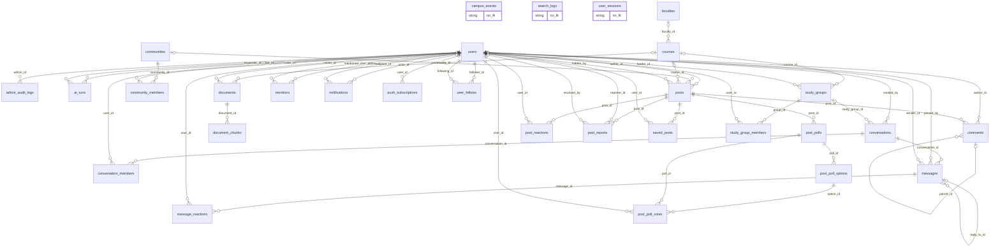
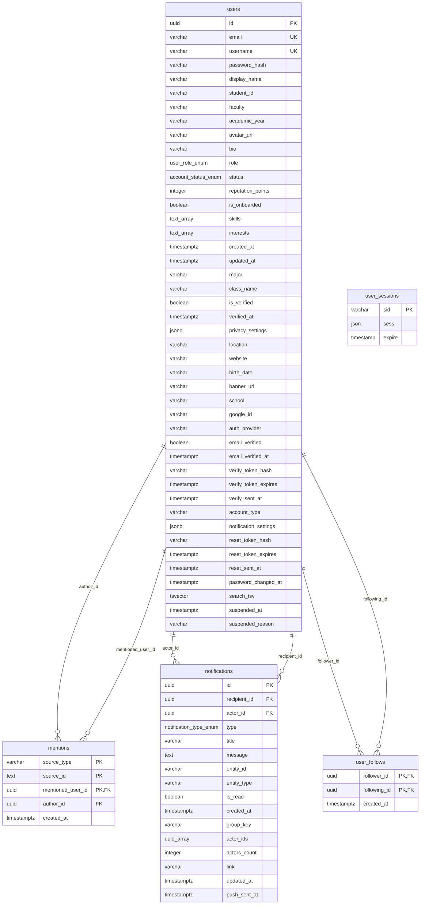
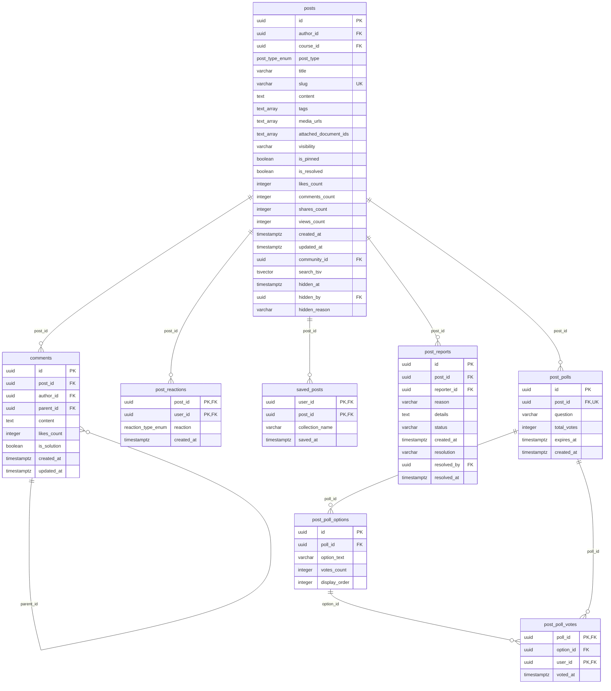
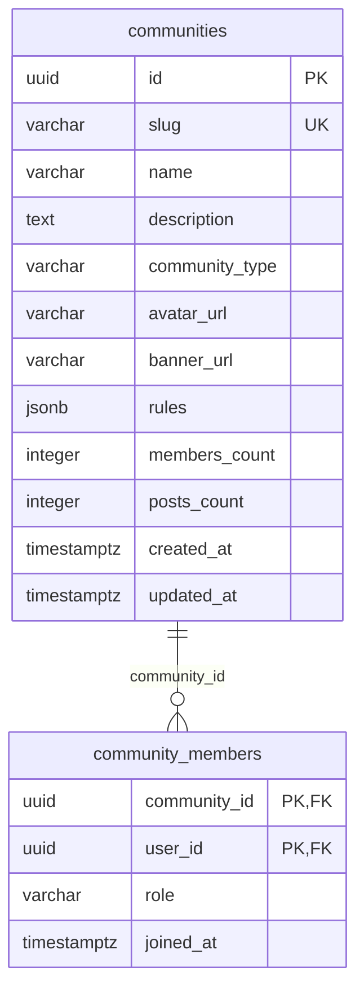
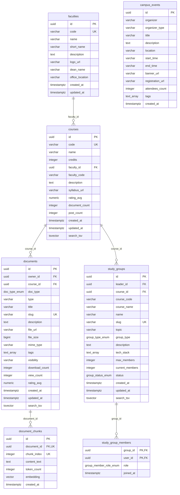
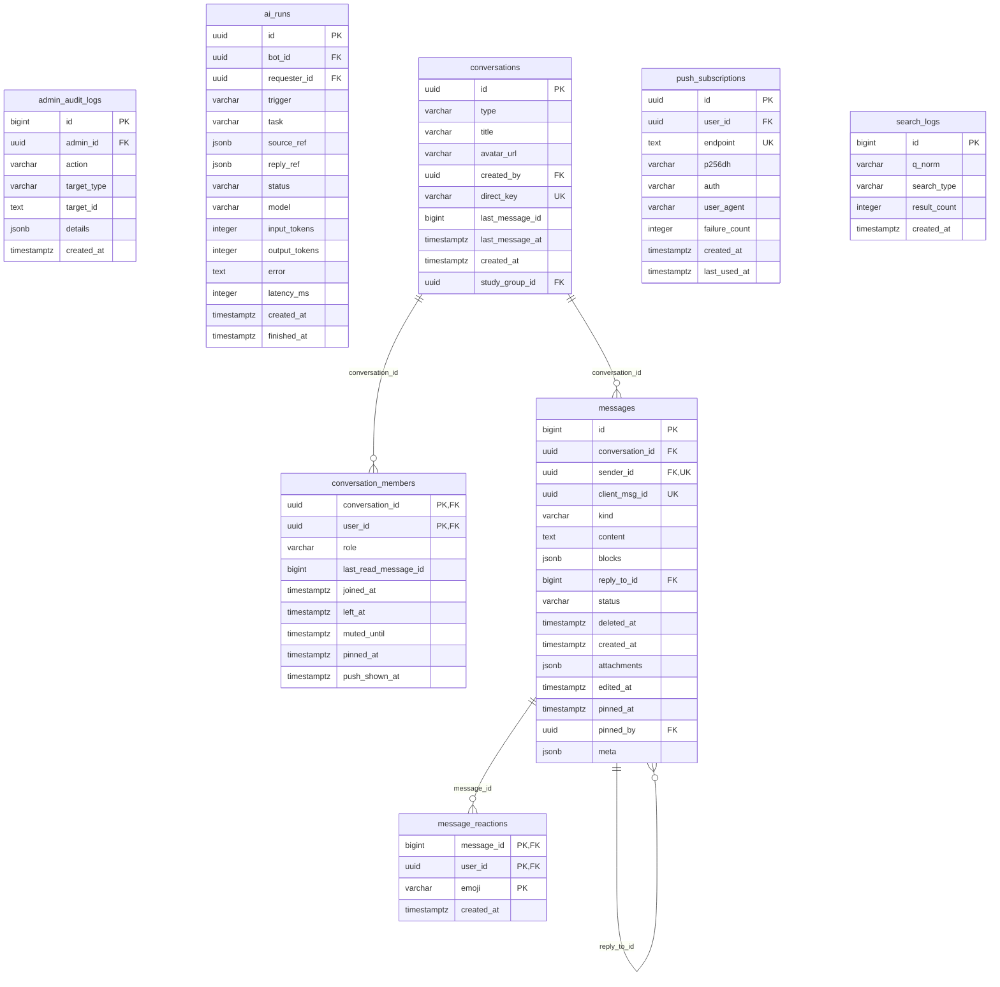

# 🗄️ ERD — Cơ sở dữ liệu (tự sinh)

> ⚙️ **File tự sinh** bởi `pnpm docs:erd` (`scripts/gen-erd.mjs`) từ database thật. **Không sửa tay.**
> Chạy lại sau mỗi migration. Nguồn: `information_schema` + `pg_constraint`.

Tổng: **30 bảng**, **49 khóa ngoại**. Ký hiệu: `PK` khóa chính · `FK` khóa ngoại · `UK` unique · `||` bắt buộc · `|o` có thể NULL.

## 1. Tổng quan quan hệ

## 2. Identity & Social graph

Liên kết ra ngoài nhóm: `admin_audit_logs.admin_id → users`, `ai_runs.bot_id → users`, `ai_runs.requester_id → users`, `comments.author_id → users`, `community_members.user_id → users`, `conversation_members.user_id → users`, `conversations.created_by → users`, `documents.owner_id → users`, `message_reactions.user_id → users`, `messages.pinned_by → users`, `messages.sender_id → users`, `post_poll_votes.user_id → users`, `post_reactions.user_id → users`, `post_reports.reporter_id → users`, `post_reports.resolved_by → users`, `posts.author_id → users`, `posts.hidden_by → users`, `push_subscriptions.user_id → users`, `saved_posts.user_id → users`, `study_group_members.user_id → users`, `study_groups.leader_id → users`

## 3. Feed & Q&A

Liên kết ra ngoài nhóm: `comments.author_id → users`, `post_poll_votes.user_id → users`, `post_reactions.user_id → users`, `post_reports.reporter_id → users`, `post_reports.resolved_by → users`, `posts.author_id → users`, `posts.community_id → communities`, `posts.course_id → courses`, `posts.hidden_by → users`, `saved_posts.user_id → users`

## 4. Communities

Liên kết ra ngoài nhóm: `community_members.user_id → users`, `posts.community_id → communities`

## 5. Academic

Liên kết ra ngoài nhóm: `conversations.study_group_id → study_groups`, `documents.owner_id → users`, `posts.course_id → courses`, `study_group_members.user_id → users`, `study_groups.leader_id → users`

## 6. Chưa phân nhóm (cập nhật DOMAINS trong scripts/gen-erd.mjs)

Liên kết ra ngoài nhóm: `admin_audit_logs.admin_id → users`, `ai_runs.bot_id → users`, `ai_runs.requester_id → users`, `conversation_members.user_id → users`, `conversations.created_by → users`, `conversations.study_group_id → study_groups`, `message_reactions.user_id → users`, `messages.pinned_by → users`, `messages.sender_id → users`, `push_subscriptions.user_id → users`
