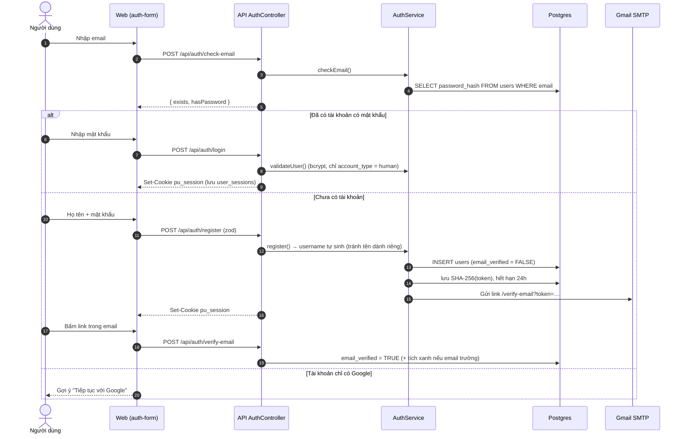
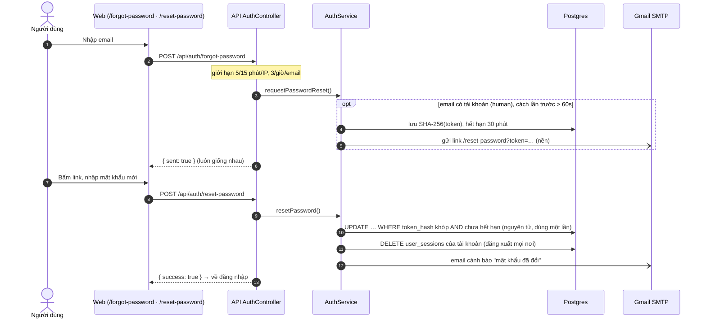
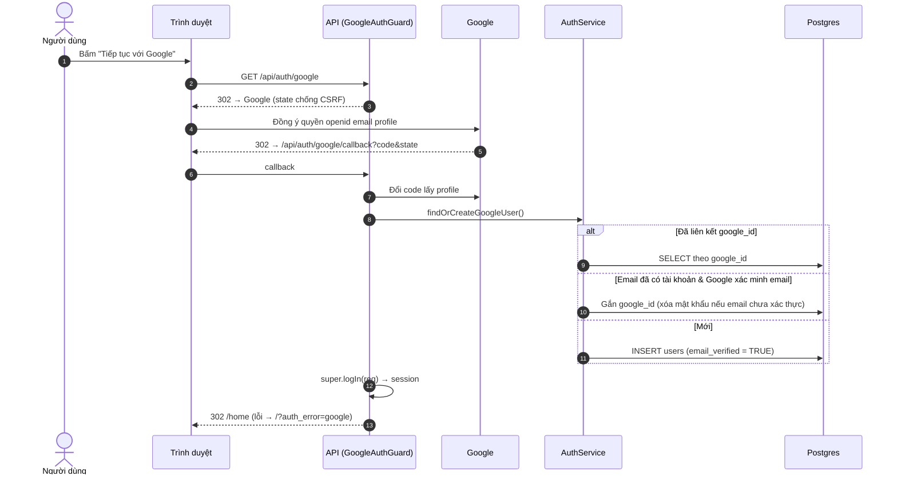
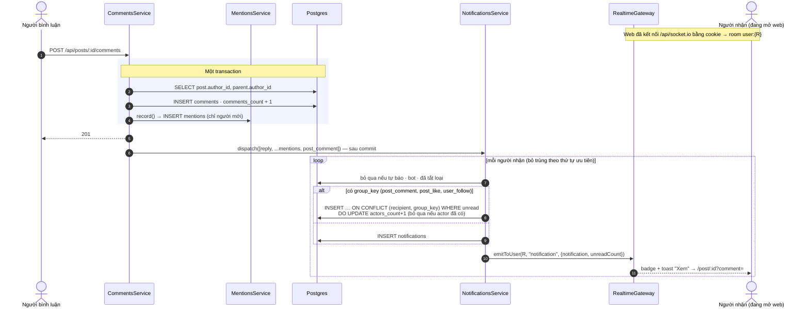
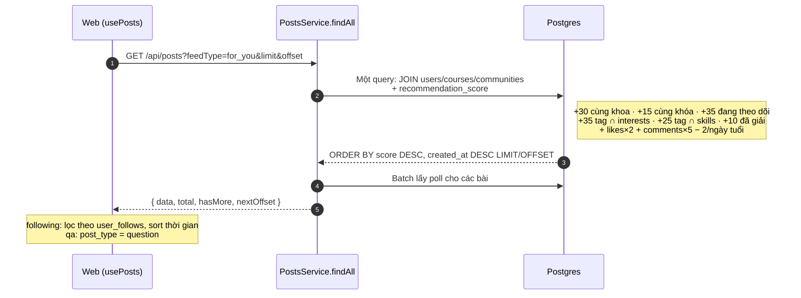
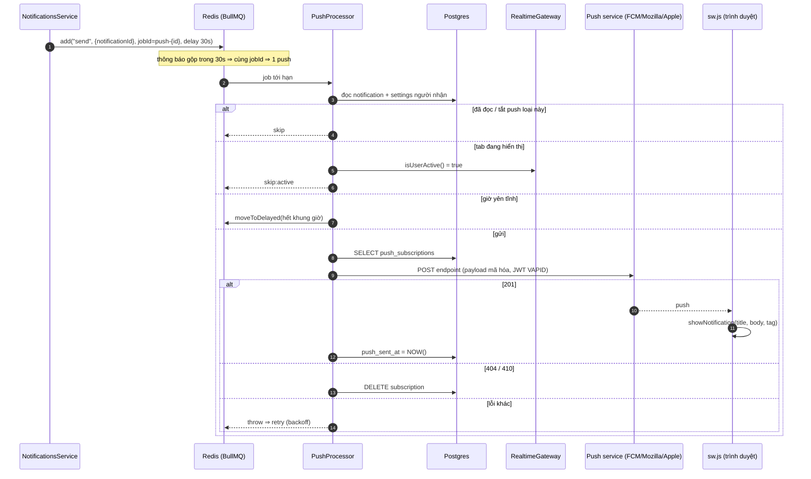

# 05 · Luồng Nghiệp Vụ Chính (Sequence)

> Thứ tự gọi giữa các thành phần cho các luồng quan trọng. Cập nhật lần cuối: **2026-10-04**.

## 5.1. Đăng ký / đăng nhập bằng email (email-first)

### 5.1b. Quên mật khẩu

## 5.2. Đăng nhập Google OAuth

## 5.3. Bình luận → thông báo (reply · mention · post_comment) realtime

## 5.4. Bảng tin "Dành cho bạn"

## 5.5. Web Push (BullMQ)

**Changelog:**
- 2026-10-04 — thêm 5.1b Quên mật khẩu.
- 2026-10-04 — thêm 5.5 Web Push qua BullMQ.
- 2026-10-04 — 5.3 cập nhật theo Notification v1 (dispatch, ưu tiên, gộp).
- 2026-10-04 — tạo mới: auth email-first, Google OAuth, mention → realtime, feed ranking.
