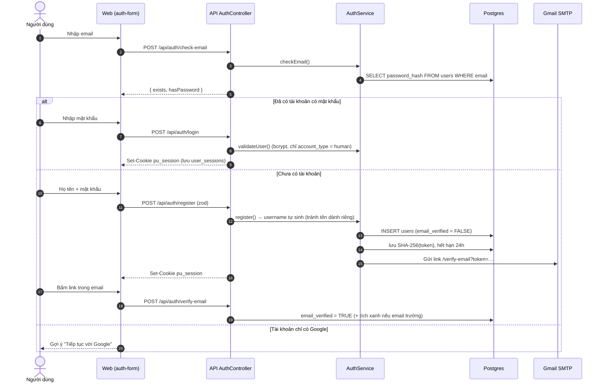
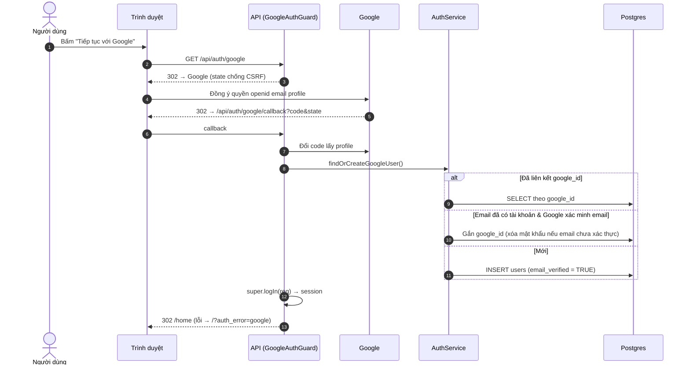
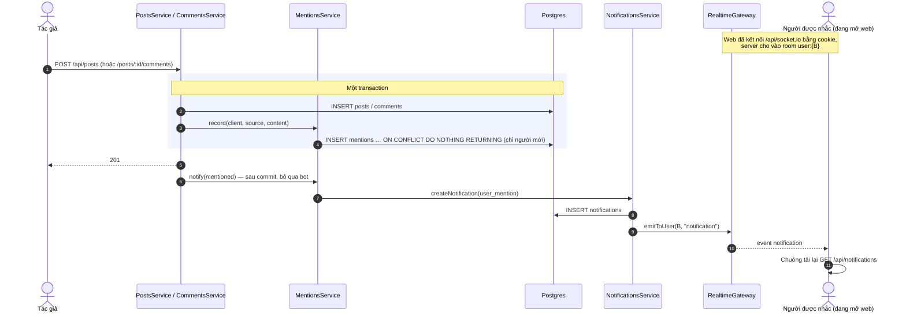
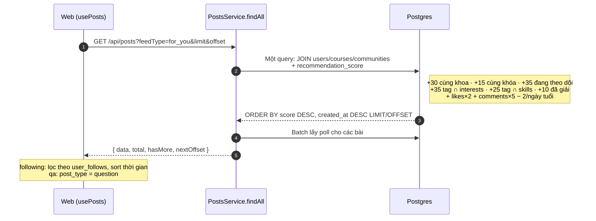

# 05 · Luồng Nghiệp Vụ Chính (Sequence)

> Thứ tự gọi giữa các thành phần cho các luồng quan trọng. Cập nhật lần cuối: **2026-10-04**.

## 5.1. Đăng ký / đăng nhập bằng email (email-first)

## 5.2. Đăng nhập Google OAuth

## 5.3. Đăng bài / bình luận có @mention → thông báo realtime

## 5.4. Bảng tin "Dành cho bạn"

**Changelog:**
- 2026-10-04 — tạo mới: auth email-first, Google OAuth, mention → realtime, feed ranking.
