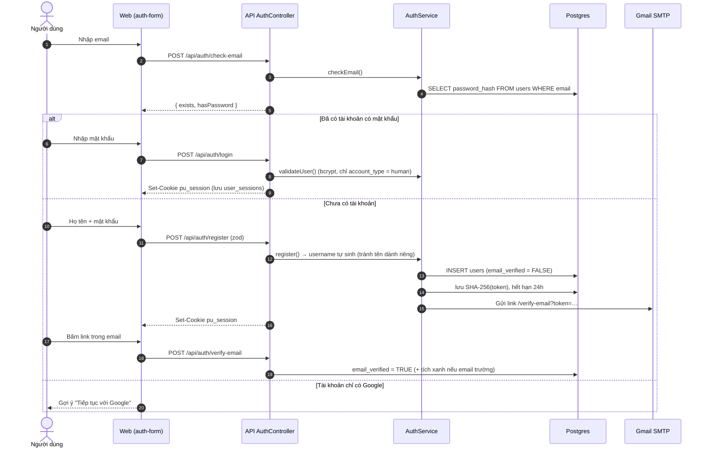
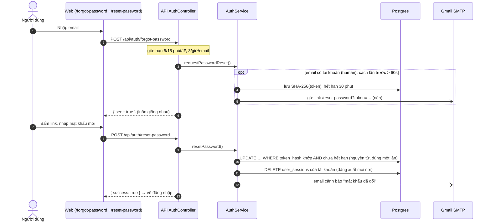
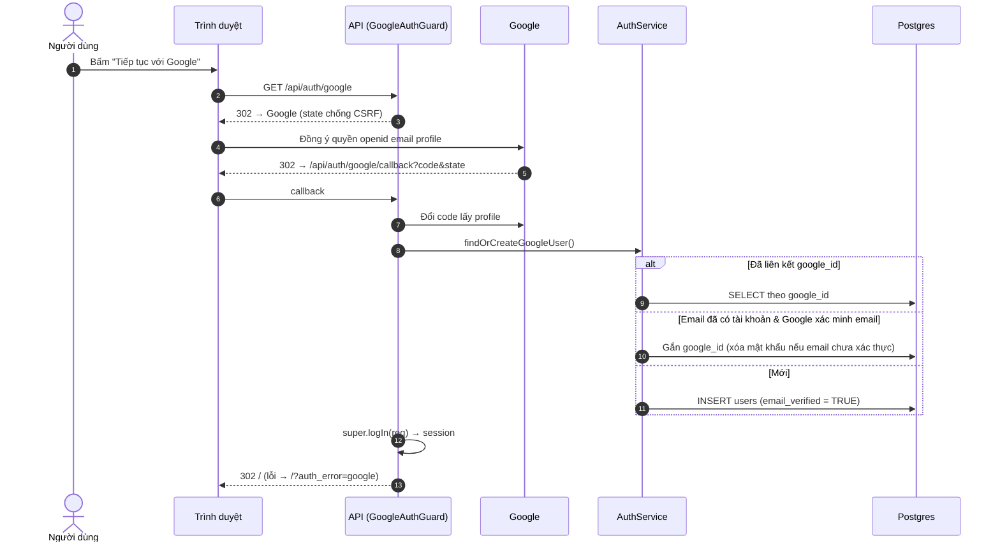
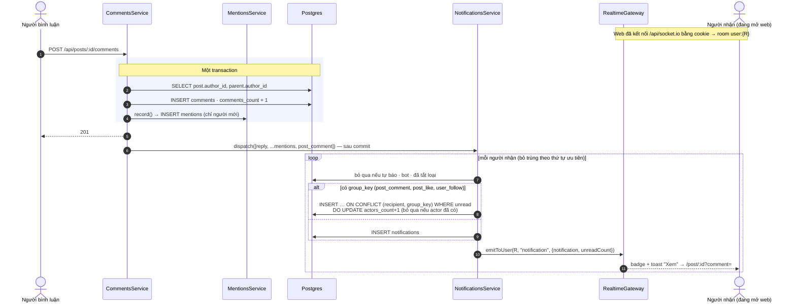
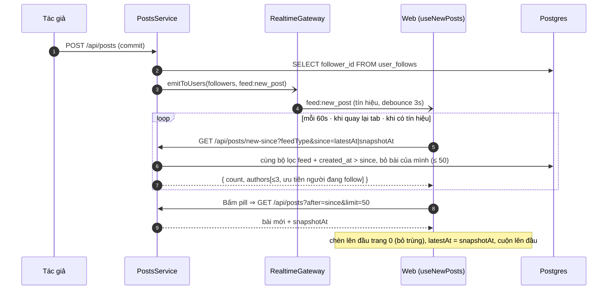
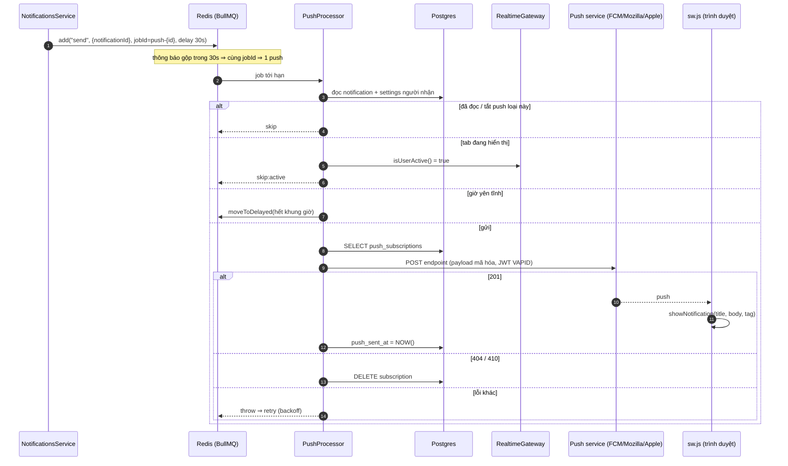
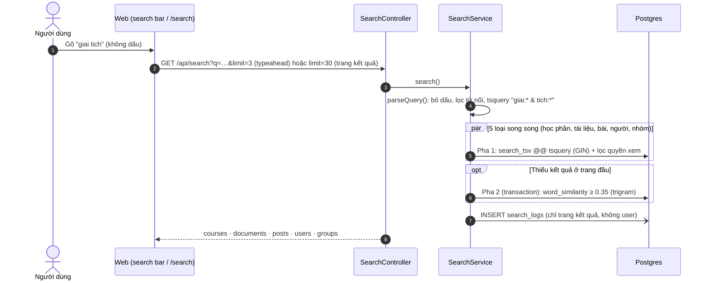
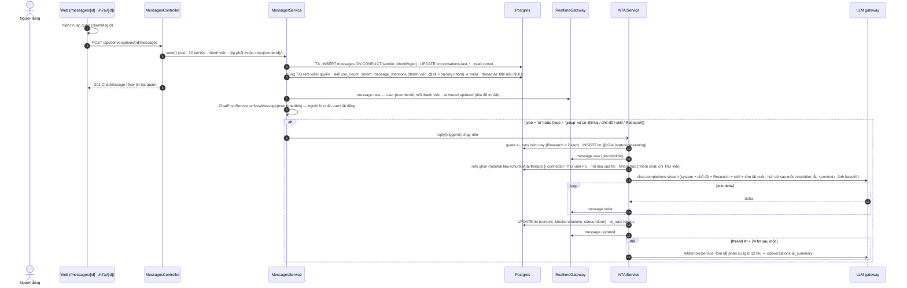
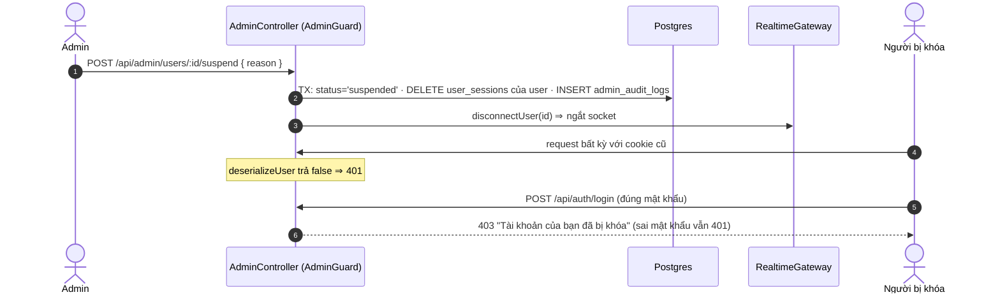
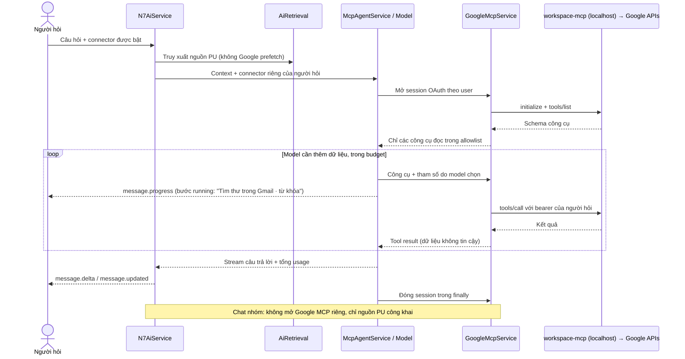

# 05 · Luồng Nghiệp Vụ Chính (Sequence)

> Thứ tự gọi giữa các thành phần cho các luồng quan trọng. Cập nhật lần cuối: **2026-10-16**.

## 5.1. Đăng ký / đăng nhập bằng email (email-first)



### 5.1b. Quên mật khẩu



## 5.2. Đăng nhập Google OAuth



## 5.3. Bình luận → thông báo (reply · mention · post_comment) realtime



## 5.4. Bảng tin "Dành cho bạn"

```mermaid
sequenceDiagram
  autonumber
  participant W as Web (usePosts)
  participant P as PostsService.findAll
  participant DB as Postgres

  W->>P: GET /api/posts?feedType=for_you&limit&offset
  P->>DB: Một query: JOIN users/courses/communities<br/>+ LEFT JOIN seen (post_view) + LATERAL rk.score
  Note right of DB: hot rank (feed-ranking.sql.ts):<br/>(10 + độ hợp + 10 đã giải + 12·ln(1+2L+5C)) / (giờ tuổi+2)^1.2<br/>độ hợp: khoa 30 · khóa 15 · follow 35 · interests 35 · skills 25 · hồ sơ 0..40<br/>× 0.7^lần đã xem × 0.5^(thứ hạng cùng tác giả − 2)
  DB-->>P: ORDER BY score DESC, created_at DESC LIMIT/OFFSET<br/>(chỉ bài created_at ≤ before = snapshotAt; tuổi tính theo snapshotAt)
  par Batch theo trang
    P->>DB: poll của các bài
  and
    P->>DB: featured comment (solution > top > relevance > latest > earliest)
  end
  P-->>W: { data, total, hasMore, nextOffset, snapshotAt }
  Note over W: trang sau gửi before = snapshotAt trang đầu ⇒ offset không lệch<br/>following: lọc theo user_follows, sort thời gian · qa: post_type = question
```

### 5.4b. Pill "bài mới" (kiểu X)



## 5.5. Web Push (BullMQ)



## 5.6. Tìm kiếm



## 5.7. Nhắn tin & N7AI



## 5.8. Khóa tài khoản (admin)



## N7AI Google MCP (hội thoại riêng)



**Changelog:**
- 2026-10-19 — Feed "Dành cho bạn" đổi sang hot rank (log tương tác / tuổi^1.2, giảm bài đã xem, đa dạng tác giả).
- 2026-10-18 — `message.progress` trước/sau mỗi tool call; tin hoàn tất lưu `meta.steps`.
- 2026-10-18 — MCP server = `workspace-mcp` tự host thay MCP chính thức của Google.
- 2026-10-17 — Luồng N7AI: Google MCP discovery → model tool loop → streaming; cách ly dữ liệu theo tài khoản và loại hội thoại.
- 2026-10-17 — 5.7: nguồn đánh số, N7AI ghi `[nguồn] n` ⇒ chỉ trích nguồn đã dùng; tìm thư viện khớp ≥ 2 từ khóa (bỏ hư từ); connector lỗi ⇒ `<connector_error>`.
- 2026-10-17 — 5.7: thread N7AI mở ở `/n7ai/[id]` (Web Push trỏ đúng không gian AI).
- 2026-10-16 — 5.7: mention trong nhóm (`message_mentions`, push vượt tắt tiếng), ngữ cảnh `refs`, skill, Research, connector, tóm tắt cuộn, tiêu đề thread AI.
- 2026-10-14 — 5.4: cộng điểm khớp hồ sơ quan tâm (`interestBoostSql`, chuẩn hóa theo chủ đề mạnh nhất).
- 2026-10-14 — 5.7: N7AI viết câu hỏi tiếp theo sau dấu mốc `<<<FOLLOWUPS>>>` trong cùng luồng stream; server giấu khỏi delta, lưu `meta.followUps`.
- 2026-10-13 — 5.7: `@n7ai` trong nhóm, chế độ học, ảnh đính kèm, kiểm tra tệp.
- 2026-10-16 — 5.4 thêm snapshot `before` + featured comment; thêm 5.4b Pill "bài mới".
- 2026-10-13 — thêm 5.7 Nhắn tin & N7AI, 5.8 Khóa tài khoản.
- 2026-10-04 — thêm 5.6 Tìm kiếm.
- 2026-10-04 — thêm 5.1b Quên mật khẩu.
- 2026-10-04 — thêm 5.5 Web Push qua BullMQ.
- 2026-10-04 — 5.3 cập nhật theo Notification v1 (dispatch, ưu tiên, gộp).
- 2026-10-04 — tạo mới: auth email-first, Google OAuth, mention → realtime, feed ranking.
