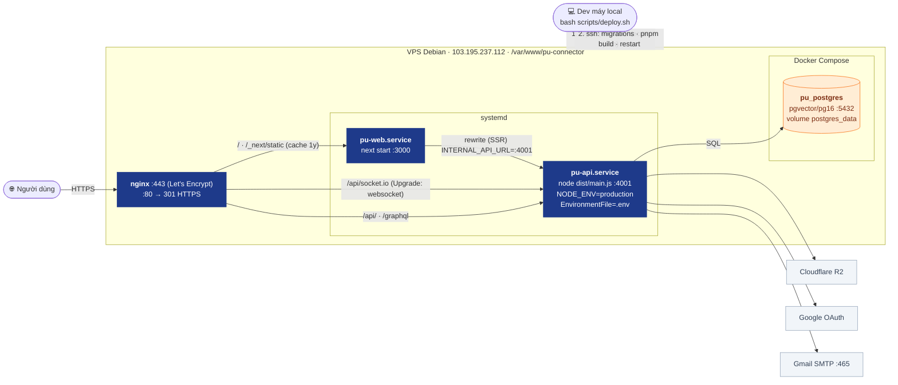
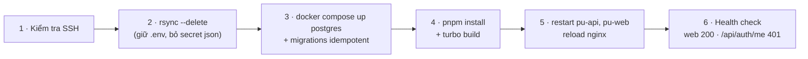

# 06 · Deployment (Production)

> Hạ tầng chạy `https://puc.vnhat.dev`. Cập nhật lần cuối: **2026-10-04**.

## Các bước `scripts/deploy.sh`

Migration chạy **mỗi lần deploy** theo thứ tự: `schema.sql` → `domain1-upgrade.sql` → `add-communities.sql` → `add-indexes.sql` → `auth-upgrade.sql` → `messaging-upgrade.sql`. ⇒ Mọi file phải **idempotent** và **không bao giờ UPDATE hàng loạt dữ liệu người dùng thật**.

## Secret & cấu hình

| Ở đâu | Chứa | Ghi chú |
|---|---|---|
| `/var/www/pu-connector/.env` | `DATABASE_URL`, `SESSION_SECRET`, `APP_URL`, `GOOGLE_*`, `SMTP_*`, `R2_*` | Không bị rsync ghi đè; backup `.env.bak.*` |
| `apps/web/.env` (VPS) | `INTERNAL_API_URL=http://localhost:4001` | Port API production là **4001** |
| `/etc/nginx/sites-available/pu-connector.conf` | Routing + SSL | Backup `/root/pu-connector.conf.bak.*` |

**Changelog:**
- 2026-10-04 — tạo mới; thêm `location /api/socket.io` (websocket), `messaging-upgrade.sql`, session lưu Postgres.
