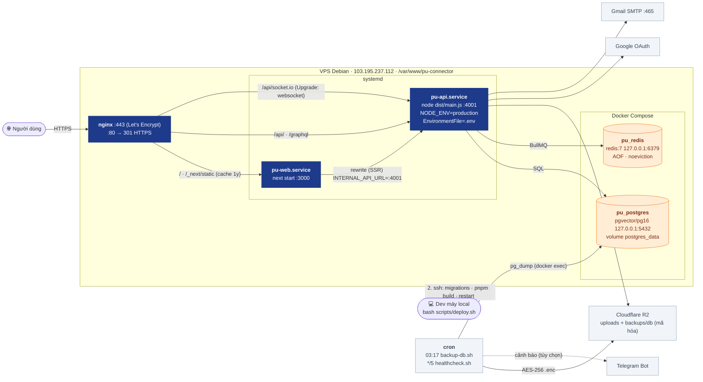
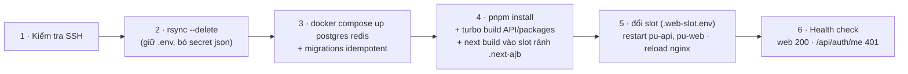

# 06 · Deployment (Production)

> Hạ tầng chạy `https://puc.vnhat.dev`. Cập nhật lần cuối: **2026-10-04**.

## Các bước `scripts/deploy.sh`

Migration chạy **mỗi lần deploy** theo thứ tự: `schema.sql` → `domain1-upgrade.sql` → `add-communities.sql` → `add-indexes.sql` → `auth-upgrade.sql` → `messaging-upgrade.sql` → `notifications-upgrade.sql` → `push-upgrade.sql`. ⇒ Mọi file phải **idempotent** và **không bao giờ UPDATE hàng loạt dữ liệu người dùng thật**.

**Web blue/green (không lỗi giữa lúc deploy):** trước đây `next build` ghi đè `.next` trong khi `next start` vẫn phục vụ từ đó ⇒ HTML trỏ tới chunk đã bị xóa, trình duyệt báo *"Application error: a client-side exception"* suốt thời gian build. Nay web build vào slot rảnh (`apps/web/.next-a` hoặc `.next-b`, qua `NEXT_DIST_DIR`), server cũ chạy tiếp tới lúc restart; slot đang chạy ghi trong `/var/www/pu-connector/.web-slot.env`, systemd drop-in `pu-web.service.d/slot.conf` nạp file này. Chunk JS bản trước được chép sang slot mới (giữ 7 ngày) ⇒ tab đang mở chuyển trang không gặp ChunkLoadError. Rollback: ghi lại slot cũ vào `.web-slot.env` rồi `systemctl restart pu-web`.

## Vận hành: backup & giám sát

| Việc | Lịch | Script | Kết quả |
|---|---|---|---|
| Backup Postgres | 03:17 hằng ngày | `scripts/ops/backup-db.sh` | `pu-YYYYmmdd-HHMMSS.sql.gz.enc` → R2 `backups/db/` (30 ngày) + `/var/backups/pu-connector` (7 bản) |
| Giám sát | mỗi 5 phút | `scripts/ops/healthcheck.sh` | Chỉ báo khi trạng thái đổi; Telegram nếu có `TELEGRAM_*` |
| Thử khôi phục | thủ công / định kỳ | `scripts/ops/restore-db.sh` | Nạp vào DB tạm, đếm bảng/users, xóa DB tạm |

Bucket R2 public ⇒ backup luôn mã hóa bằng `BACKUP_PASSPHRASE` (`.env`, giữ bản sao ngoài VPS).

## Secret & cấu hình

| Ở đâu | Chứa | Ghi chú |
|---|---|---|
| `/var/www/pu-connector/.env` | `DATABASE_URL`, `SESSION_SECRET`, `APP_URL`, `GOOGLE_*`, `SMTP_*`, `R2_*`, `REDIS_URL`, `VAPID_*`, `BACKUP_PASSPHRASE`, `TELEGRAM_*` (tùy chọn) | Không bị rsync ghi đè; backup `.env.bak.*` |
| `apps/web/.env` (VPS) | `INTERNAL_API_URL=http://localhost:4001` | Port API production là **4001** |
| `/etc/nginx/sites-available/pu-connector.conf` | Routing + SSL | Backup `/root/pu-connector.conf.bak.*` |

**Changelog:**
- 2026-10-13 — Web build blue/green (`.next-a`/`.next-b`), giữ chunk cũ 7 ngày; gián đoạn chỉ còn lúc restart.
- 2026-10-04 — thêm cron backup DB mã hóa lên R2, healthcheck 5 phút, restore-db.sh.
- 2026-10-04 — Postgres/Redis chỉ bind localhost (Docker bỏ qua firewall), thêm pu_redis, build tuần tự, migration push.
- 2026-10-04 — tạo mới; thêm `location /api/socket.io` (websocket), `messaging-upgrade.sql`, session lưu Postgres.
