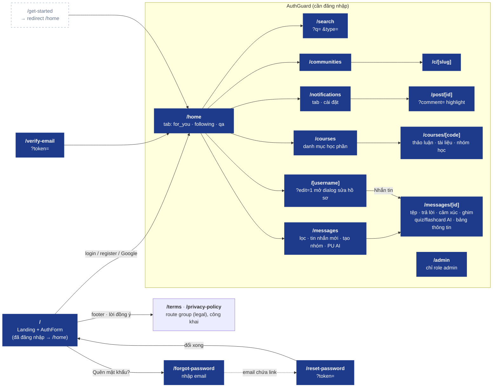
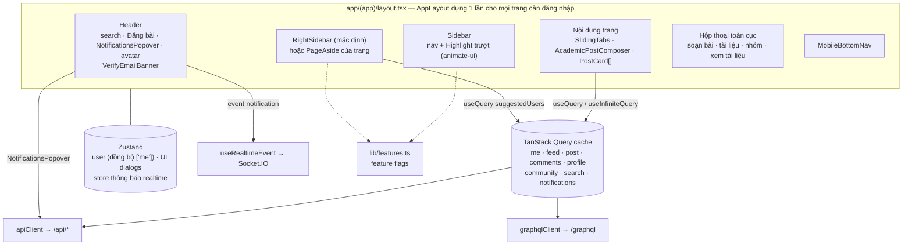

# 07 · Web App (`apps/web`)

> Route, component chính, state và nguồn dữ liệu. Cập nhật lần cuối: **2026-10-13**.

## Route map

## Bố cục & component chính

Quản lý state & cache: xem [08-web-state](../core/08-web-state.md).

## Nguồn dữ liệu theo màn hình

| Màn hình / component | REST | GraphQL | Realtime |
|---|---|---|---|
| Landing / AuthForm | `auth/providers`, `auth/check-email`, `auth/login`, `auth/register`, `auth/me` | — | — |
| `/home` feed, PostCard | `posts`, `posts/:id/*`, `posts/:postId/comments`, `comments/:id/*` | `toggleFollow` (follow trên PostCard) | — |
| RightSidebar | — | `suggestedUsers` | — |
| `/[username]` | `users/:username`, `users/profile` | `userProfile`, `userFollowers`, `userFollowing` | — |
| Communities | `communities`, `communities/:slug/*` | — | — |
| NotificationsPopover / `/notifications` | `notifications`, `notifications/*/read*`, `notifications/settings` | — | `notification`, `notification.read` |
| `/post/[id]` | `posts/:id`, `posts/:postId/comments` | — | — |
| `/courses`, `/courses/[code]` | `courses`, `courses/:code/overview`, `posts?course=`, `documents?course=`, `study-groups?course=`, `study-groups/:id/join` | — | — |
| `/messages`, `/messages/[id]`, badge Tin nhắn | `conversations*`, `messages/:id*`, `ai/*`, `upload/file?folder=chat`, `search?type=users` | — | `message.new/updated/delta`, `conv.read/updated/removed`, `typing` (useChatRealtime trong AppLayout, `hooks/chat/`) |
| `/admin` | `admin/*` | — | — |

## Feature flags (`lib/features.ts`)

Tính năng chưa hoàn thiện bị ẩn bằng flag (QR app mobile, lối tắt danh mục, môn học sôi nổi, xu hướng…). Bật flag ⇒ cập nhật bảng trên và sơ đồ route.

**Changelog:**
- 2026-10-13 — thêm `/terms`, `/privacy-policy` (route group `(legal)`, `LegalDocument`, link chung `lib/legal.ts`); bỏ flag `legalPages` và link footer chết.
- 2026-10-13 — chat P2: hooks tách `hooks/chat/`, component theo `components/chat/{thread,composer,ai,info}`; cột phải `/messages/[id]` = bảng thông tin hội thoại.
- 2026-10-13 — thêm `/courses`, `/courses/[code]`, `/messages`, `/messages/[id]`, `/admin`; sidebar & bottom nav có Học phần, Tin nhắn (badge chưa đọc), Quản trị (admin).
- 2026-10-09 — route group `(app)` + `AppLayout` dùng chung; dữ liệu server qua TanStack Query (cache, prefetch, cập nhật lạc quan); bỏ `AppShell`.
- 2026-10-04 — thêm `/forgot-password`, `/reset-password`.
- 2026-10-04 — thêm `/notifications`, `/post/[id]`, store thông báo dùng chung, mục Thông báo ở sidebar.
- 2026-10-04 — tạo mới; bỏ `/get-started` (redirect), thêm `/verify-email`, realtime notifications.
