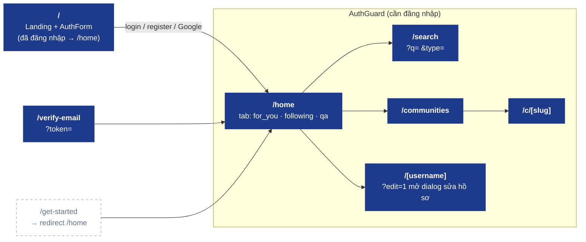
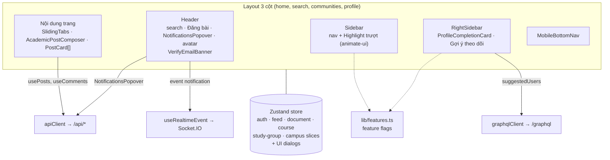

# 07 · Web App (`apps/web`)

> Route, component chính, state và nguồn dữ liệu. Cập nhật lần cuối: **2026-10-04**.

## Route map

## Bố cục & component chính

## Nguồn dữ liệu theo màn hình

| Màn hình / component | REST | GraphQL | Realtime |
|---|---|---|---|
| Landing / AuthForm | `auth/providers`, `auth/check-email`, `auth/login`, `auth/register`, `auth/me` | — | — |
| `/home` feed, PostCard | `posts`, `posts/:id/*`, `posts/:postId/comments`, `comments/:id/*` | `toggleFollow` (follow trên PostCard) | — |
| RightSidebar | — | `suggestedUsers` | — |
| `/[username]` | `users/:username`, `users/profile` | `userProfile`, `userFollowers`, `userFollowing` | — |
| Communities | `communities`, `communities/:slug/*` | — | — |
| NotificationsPopover | `notifications`, `notifications/*/read*` | — | `notification` |

## Feature flags (`lib/features.ts`)

Tính năng chưa hoàn thiện bị ẩn bằng flag (QR app mobile, trang pháp lý, lối tắt danh mục, môn học sôi nổi, xu hướng…). Bật flag ⇒ cập nhật bảng trên và sơ đồ route.

**Changelog:**
- 2026-10-04 — tạo mới; bỏ `/get-started` (redirect), thêm `/verify-email`, realtime notifications.
