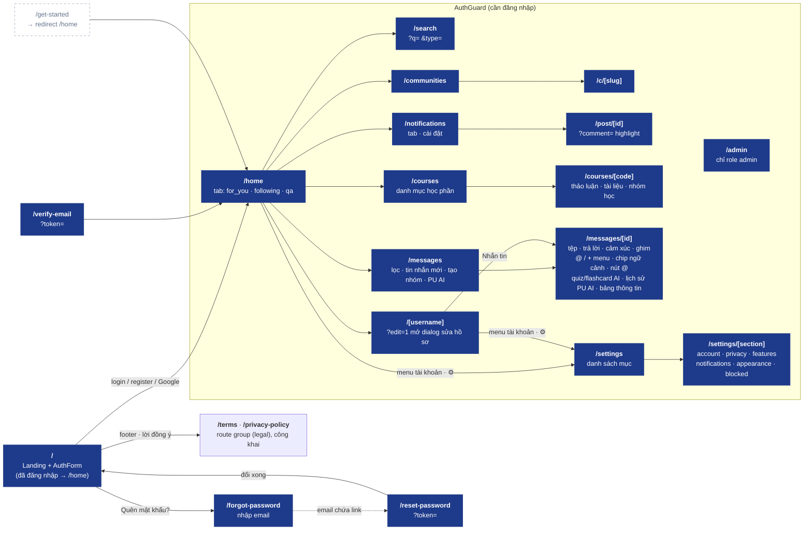
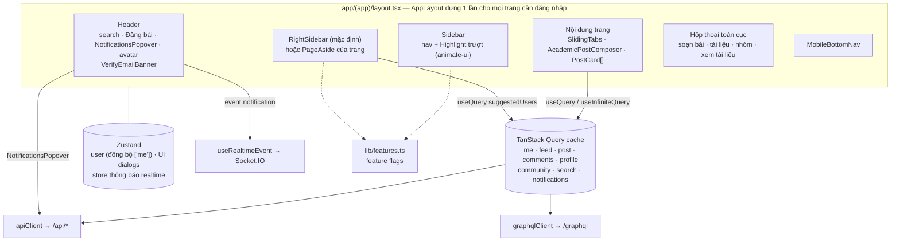

# 07 · Web App (`apps/web`)

> Route, component chính, state và nguồn dữ liệu. Cập nhật lần cuối: **2026-10-16**.

## Route map

## Bố cục & component chính

Quản lý state & cache: xem [08-web-state](../core/08-web-state.md).

## Trạng thái tải (Skeleton)

- `components/ui/skeleton.tsx`: `Skeleton` (khối `bg-muted` pulse, `aria-hidden`), `LoadingRegion` (`role="status"`, hiện sau 150ms qua class `.skeleton-reveal` ⇒ mạng nhanh không nháy; tôn trọng `prefers-reduced-motion`), `SkeletonRepeat`.
- `components/skeletons/*`: giữ chỗ theo đúng hình học component thật (cùng padding, cỡ avatar) ⇒ không xô lệch bố cục khi dữ liệu về.
- Quy tắc: skeleton chỉ cho **lần tải đầu** (`isPending` và chưa có dữ liệu); refetch giữ dữ liệu cũ; spinner chỉ cho thao tác (gửi, lưu, tải thêm).
- `AuthGuard fallback` = `AppShellSkeleton` (khung 3 cột) thay spinner toàn màn hình.
- Có sẵn: `PostCardSkeleton`, `FeedSkeleton`/`PostListSkeleton`, `CommunityHeaderSkeleton`, `CommentListSkeleton`, `UserRowSkeleton`/`UserListSkeleton`, `ConversationListSkeleton`, `MessageThreadSkeleton`, `MediaPanelSkeleton`, `ProfileSkeleton`, `NotificationListSkeleton`, `CommunityCardsSkeleton`, `CourseListSkeleton`, `CourseHeaderSkeleton`, `CardListSkeleton`, `SettingsListSkeleton`.

## Nguồn dữ liệu theo màn hình

| Màn hình / component | REST | GraphQL | Realtime |
|---|---|---|---|
| Landing / AuthForm | `auth/providers`, `auth/check-email`, `auth/login`, `auth/register`, `auth/me` | — | — |
| `/home` feed, PostCard (+ nút ✨ Tóm tắt) | `posts`, `posts/:id/*` (gồm `summary`), `posts/:postId/comments`, `comments/:id/*` (gồm `PATCH` sửa), `mentions/suggest` | `toggleFollow` (follow trên PostCard) | — |
| RightSidebar | — | `suggestedUsers` | — |
| `/[username]` (+ menu ⋯ Chặn) | `users/:username`, `users/profile`, `blocks`, `blocks/:userId` | `userProfile` (`blockState`), `userFollowers`, `userFollowing` | `block.changed` (useBlocksRealtime trong AppLayout) |
| Communities | `communities`, `communities/:slug/*` | — | — |
| NotificationsPopover / `/notifications` | `notifications`, `notifications/*/read*`, `notifications/settings` | — | `notification`, `notification.read` |
| `/post/[id]` | `posts/:id`, `posts/:postId/comments` | — | — |
| `/courses`, `/courses/[code]` | `courses`, `courses/:code/overview`, `posts?course=`, `documents?course=`, `study-groups?course=`, `study-groups/:id/join` | — | — |
| `/messages`, `/messages/[id]`, badge Tin nhắn | `conversations*`, `messages/:id*`, `ai/*` (threads, skills, connectors), `chat/refs`, `upload/file?folder=chat`, `search?type=users`, `presence` | localStorage `pu.ai.connectors` | `message.new/updated/delta`, `conv.read/updated/removed`, `ai.thread.updated`, `typing`, `presence.update` (useChatRealtime trong AppLayout, `hooks/chat/`) |
| `/admin` | `admin/*` | — | — |
| `/settings/[section]` | `users/privacy`, `users/preferences`, `users/verify-university`, `blocks`, `notifications/settings`, `push/*` | — | — |

## Feature flags (`lib/features.ts`)

Tính năng chưa hoàn thiện bị ẩn bằng flag (QR app mobile, lối tắt danh mục, môn học sôi nổi, xu hướng…). Bật flag ⇒ cập nhật bảng trên và sơ đồ route.

**Changelog:**
- 2026-10-16 — chat: ô soạn `@` (nhắc tên + ngữ cảnh) / `/` (chế độ, skill, lệnh) / `+` (tệp, skill, connector, Research) — `composer/use-composer-picker.ts`, `picker-popover`, `plus-menu`, `context-chips`, `skills-dialog`; lịch sử PU AI `ai/ai-thread-list.tsx` (`hooks/chat/use-ai-threads.ts`); `thread/message-text.tsx` (tô sáng @, chip ngữ cảnh), `thread/mention-jump.tsx`, badge @ ở danh sách.
- 2026-10-16 — `/home` tab Đang theo dõi: CTA "Khám phá thêm" cuối feed / khi trống ⇒ `FollowSuggestionsDialog` (`GET /users/suggestions`, `hooks/use-follow-suggestions.ts`); cột phải dùng chung endpoint + "Xem thêm".
- 2026-10-16 — bình luận: mention picker (`useMentionPicker` + `components/mentions/MentionPopover`, PU AI ghim đầu, gọi `GET /mentions/suggest`), sửa bình luận tại chỗ, nháp localStorage (`useDraft`).
- 2026-10-16 — thêm `/settings`, `/settings/[section]` (thay dialog quyền riêng tư; menu mục ở cột phải qua `PageAside`); feature plugs `useFeatureEnabled` gắn vào PostCard (bình luận nổi bật, tóm tắt) và `/home` (pill bài mới).
- 2026-10-14 — `lib/track.ts` (gom sự kiện hành vi, gửi `POST /events` theo lô) + `useDwellTracking` trên PostCard; PU AI: gợi ý mở đầu từ `GET /ai/suggestions` theo chế độ, bảng gợi ý trên ô soạn khi đổi chế độ, chip câu hỏi tiếp theo; công tắc "Cá nhân hóa gợi ý" trong quyền riêng tư.
- 2026-10-14 — khung app 1440px, cột giữa 760px (`lib/layout.ts` dùng chung cho Header/AppLayout/skeleton); xem trước tin nhắn bỏ ký hiệu Markdown (`lib/plain-text.ts`).
- 2026-10-14 — chat: danh sách hội thoại infinite query theo bộ lọc, cache vá theo socket (`hooks/chat/cache.ts`), tin cũ tự tải khi cuộn lên.
- 2026-10-14 — liên kết ngoài "Mở trong N7AI" (đầu hội thoại PU AI, màn chào); biến build `NEXT_PUBLIC_N7AI_URL`.
- 2026-10-14 — PostCard: nút "Tóm tắt" (bài bị thu gọn) mở `PostSummary`; bình luận PU AI có avatar N7AI, tự tải lại khi có `comments.changed`.
- 2026-10-14 — trạng thái hoạt động: `hooks/chat/use-presence.ts`, `PresenceDot` (avatar DM, thành viên nhóm), tiêu đề hội thoại "Đang hoạt động" / "Hoạt động N phút trước" / "K đang hoạt động"; hộp Cài đặt quyền riêng tư nạp cài đặt hiện tại + công tắc trạng thái hoạt động.
- 2026-10-14 — chặn người dùng: `hooks/use-blocks.ts`, `BlockUserControl` (hồ sơ), `BlockedUsersSection` (cài đặt quyền riêng tư), `BlockedComposer` thay ô soạn tin trong DM bị chặn.
- 2026-10-13 — skeleton loading toàn app: primitive `Skeleton`/`LoadingRegion`, `AppShellSkeleton` khi xác thực phiên, skeleton theo màn hình (`components/skeletons/`).
- 2026-10-13 — thêm `/terms`, `/privacy-policy` (route group `(legal)`, `LegalDocument`, link chung `lib/legal.ts`); bỏ flag `legalPages` và link footer chết.
- 2026-10-13 — chat P2: hooks tách `hooks/chat/`, component theo `components/chat/{thread,composer,ai,info}`; cột phải `/messages/[id]` = bảng thông tin hội thoại.
- 2026-10-13 — thêm `/courses`, `/courses/[code]`, `/messages`, `/messages/[id]`, `/admin`; sidebar & bottom nav có Học phần, Tin nhắn (badge chưa đọc), Quản trị (admin).
- 2026-10-09 — route group `(app)` + `AppLayout` dùng chung; dữ liệu server qua TanStack Query (cache, prefetch, cập nhật lạc quan); bỏ `AppShell`.
- 2026-10-04 — thêm `/forgot-password`, `/reset-password`.
- 2026-10-04 — thêm `/notifications`, `/post/[id]`, store thông báo dùng chung, mục Thông báo ở sidebar.
- 2026-10-04 — tạo mới; bỏ `/get-started` (redirect), thêm `/verify-email`, realtime notifications.
