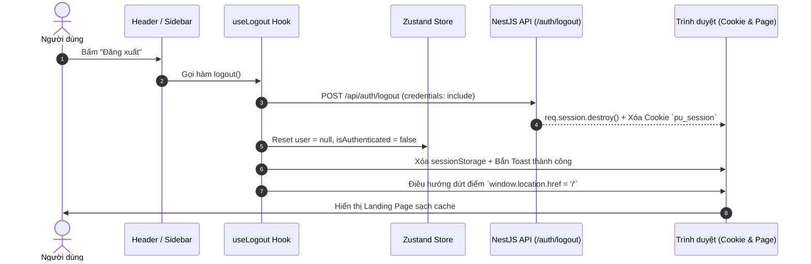

# 🚪 Đặc Tả Luồng Đăng Xuất — PU Connector Logout Flow

Tài liệu tóm tắt cơ chế và quy chuẩn xử lý **Đăng xuất (Logout)** an toàn, đồng bộ giữa Server và Client trong hệ thống **PU Connector**.

---

## 1. Sơ Đồ Luồng Hoạt Động (Flow Diagram)



---

## 2. Chi Tiết Triển Khai Các Tầng

### A. Backend (`apps/api` — NestJS & Express Session)
* **Endpoint:** `POST /api/auth/logout`
* **Xử lý:**
  1. `req.logout()`: Hủy định danh phiên của Passport.js.
  2. `req.session.destroy()`: Xóa dữ liệu session trên server.
  3. `res.clearCookie('pu_session', { path: '/' })`: Xóa cookie HttpOnly trên trình duyệt.

```typescript
// apps/api/src/modules/auth/auth.controller.ts
@Post('logout')
@HttpCode(HttpStatus.OK)
async logout(@Req() req: Request, @Res({ passthrough: true }) res: Response) {
  return new Promise((resolve) => {
    req.logout(() => {
      req.session.destroy(() => {
        res.clearCookie('pu_session', { path: '/' })
        resolve({ message: 'Đã đăng xuất an toàn' })
      })
    })
  })
}
```

---

### B. Client Hook Chuẩn Hóa (`apps/web` — `useLogout`)
* **Vị trí:** `apps/web/src/hooks/use-logout.ts`
* **Nhiệm vụ:**
  - Gửi request hủy session lên API.
  - Reset Zustand Store (`user: null`, `isAuthenticated: false`).
  - Dọn dẹp `sessionStorage`.
  - Hiển thị Toast thông báo đăng xuất.
  - Sử dụng `window.location.href = '/'` để reload trang về Landing Page sạch sẽ (xóa hoàn toàn in-memory state của React/GraphQL).

---

### C. Cơ Chế Bảo Vệ Route (`AuthGuard`)
* **Vị trí:** `apps/web/src/components/auth/auth-guard.tsx`
* **Cơ chế:** Tự động kích hoạt `useEffect` đẩy về `/` ngay khi phát hiện trạng thái `!isLoadingAuth && !user`, ngăn ngừa tình trạng kẹt màn hình trắng.

---

## 3. Các Điểm Kích Hoạt Trong Ứng Dụng
1. **Menu Avatar góc phải:** `apps/web/src/components/social/header.tsx`
2. **Nút Đăng xuất ở thanh bên:** `apps/web/src/components/social/sidebar.tsx`
3. **Fallback khi hết hạn Token/Session:** `apps/web/src/app/get-started/page.tsx`
