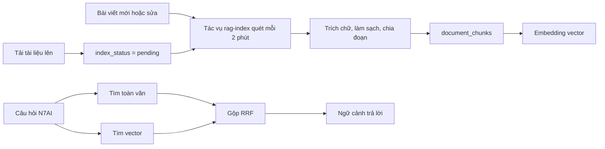

# Nguồn tài liệu và RAG

## Mục đích

Cho N7AI đọc đúng tài liệu mà không cần gửi lại tệp mỗi lượt, và tìm đúng tài liệu trong kho PU Connect dù người hỏi dùng từ khác với từ trong tài liệu.

## Nguồn của hội thoại

Mỗi thread (hoặc thư viện riêng) có danh sách nguồn mà N7AI đọc ở mọi lượt trả lời.

| Loại | Cách thêm | Lưu |
|---|---|---|
| Tệp | Tải lên, kéo thả, từ thư viện, từ Kho tài liệu | Tệp trên R2; tệp từ kho chỉ trỏ về tài liệu gốc |
| Văn bản | Dán, tối đa 100.000 ký tự | Nội dung |
| Liên kết | Trang web công khai | Chữ đã trích, tối đa 100.000 ký tự |
| YouTube | Video có phụ đề | Phụ đề gom đoạn khoảng 30 giây kèm mốc `[mm:ss]`; ưu tiên tiếng Việt rồi tiếng Anh, phụ đề người làm trước phụ đề tự động |
| Bộ sưu tập | Thêm cả bộ công khai hoặc của mình | Bỏ qua tài liệu trùng, chưa đọc được, vượt giới hạn |

### Định dạng đọc được

PDF, Word, PowerPoint (chữ từng slide), Excel (từng sheet, tối đa 500 dòng), văn bản, Markdown, CSV, mã nguồn, ảnh. ZIP, video, âm thanh bị từ chối.

### Giới hạn và quy tắc

| Mục | Giá trị |
|---|---|
| Nguồn mỗi hội thoại | 30 |
| Nguồn trong thư viện riêng | 100 |
| Chữ đưa vào mỗi nguồn mỗi lượt | Tối đa 30.000 ký tự |
| Bật hoặc tắt | `inContext` cho phép tắt nguồn mà không xóa |
| Trùng | Thêm lại cùng tệp hoặc liên kết vào cùng nơi thì trả dòng cũ |

Xóa nguồn chỉ xóa dòng nguồn, không xóa tệp trên R2. Xóa thread thì nguồn của thread bị xóa theo.

## RAG: lập chỉ mục và tìm kiếm

| Bước | Chi tiết |
|---|---|
| Trích chữ | PDF (tối đa 150 trang), Word, văn bản; làm sạch NFC, bỏ ký tự điều khiển, bỏ đầu trang và chân trang lặp, nối dòng bị ngắt giữa câu |
| OCR | Trang scan hoặc chữ rác thì render ảnh rồi đọc bằng model thị giác; tối đa 30 trang mỗi tài liệu |
| Chia đoạn | Khoảng 1.200 ký tự (tối đa 1.600), chồng lấn khoảng 200, tối đa 300 đoạn mỗi tài liệu, nhận diện tiêu đề chương, mục, câu |
| Embedding | Model `qwen3-embedding` chạy bằng Ollama; cấu hình endpoint do admin quản lý |
| Tìm | Toàn văn (tsvector bỏ dấu) cộng vector (HNSW cosine), gộp bằng Reciprocal Rank Fusion |
| Phạm vi vector | Nội dung tài liệu và bài hỏi đáp kèm lời giải đã duyệt. Môn học, người, nhóm, cộng đồng tìm theo từ khóa |

Khi dịch vụ embedding lỗi, hệ thống lùi về tìm toàn văn và tạm nghỉ 60 giây thay vì làm chậm mọi câu hỏi. Câu hỏi có thời gian chờ embedding 3 giây.

## Kiểm tra quyền

Mọi kết quả đi qua kiểm tra quyền xem của người hỏi. Tài liệu riêng chỉ chủ thấy. Công cụ `puc__read` kiểm lại quyền trước khi đọc sâu.

## Dữ liệu

| Bảng | Nội dung |
|---|---|
| `ai_sources` | Nguồn của thread hoặc thư viện; `thread_id` rỗng là thư viện riêng |
| `document_chunks` | Đoạn đã chia, embedding |
| `documents.index_status` | Trạng thái lập chỉ mục |

## API

| Phương thức | Đường dẫn | Việc |
|---|---|---|
| GET | `/ai/sources?threadId=` | Danh sách (bỏ `threadId` là thư viện) |
| GET | `/ai/sources/:id/content` | Chữ của nguồn |
| POST | `/ai/sources` | Thêm: `file`, `text`, `link`, `copy`, `document` |
| POST | `/ai/sources/collection` | Thêm cả bộ sưu tập |
| POST | `/ai/sources/:id/to-library` | Chuyển vào thư viện |
| PATCH, DELETE | `/ai/sources/:id` | Bật tắt, xóa |

Cấu hình endpoint embedding và OCR: [Admin: Vận hành AI](../admin/ai-operations).
