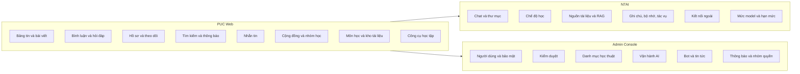

# Tổng quan sản phẩm

## Định vị

PU Connect gom nhu cầu học tập của một trường đại học vào một nơi: mạng xã hội để kết nối và hỏi đáp (kết hợp bảng tin, cộng đồng theo chủ đề), kho tài liệu theo môn học, nhóm học, nhắn tin, và trợ lý AI N7AI hiểu ngữ cảnh học tập của từng người. Sản phẩm tập trung vào giá trị học thuật, không dùng cơ chế trò chơi hóa gây xao nhãng.

## Đối tượng sử dụng

| Nhóm | Nhu cầu chính | Module thường dùng |
|---|---|---|
| Sinh viên | Hỏi bài, tìm đề thi và slide, lập nhóm học, ôn tập bằng flashcard và quiz, hỏi N7AI | Bảng tin, Hỏi đáp, Kho tài liệu, Nhóm học, Công cụ học tập, N7AI |
| Giảng viên, trợ giảng | Đăng thông báo và tài liệu, trả lời câu hỏi, theo dõi môn phụ trách | Bảng tin, Môn học, Kho tài liệu, Cộng đồng |
| Chủ nhiệm CLB | Tạo cộng đồng, đăng thông báo hoạt động | Cộng đồng, Bảng tin |
| Quản trị viên | Duyệt nội dung, xử lý vi phạm, quản lý danh mục, vận hành AI | Admin Console |

## Bản đồ hệ thống và module

## Luồng giá trị chính

1. Sinh viên đăng ký, hoàn tất hồ sơ học thuật (trường, lĩnh vực quan tâm) và nhận bảng tin được xếp hạng theo mức phù hợp.
2. Khi gặp bài khó, sinh viên đăng câu hỏi gắn môn học. Người khác trả lời, tác giả chấp nhận lời giải. Có thể gọi `@n7ai` ngay trong bình luận để được hỗ trợ.
3. Tài liệu đính kèm bài viết được phân loại và đưa vào kho môn học. N7AI lập chỉ mục nội dung để các lần hỏi sau tìm đúng tài liệu.
4. Sinh viên ôn tập bằng bộ flashcard, quiz tự soạn hoặc do N7AI soạn từ tài liệu.
5. Nhóm học và cộng đồng giúp duy trì kết nối lâu dài; nhắn tin và thông báo giữ mọi người cập nhật.
6. Quản trị viên duyệt báo cáo, đề xuất danh mục và theo dõi sức khỏe hệ thống qua Admin Console.

## Nguyên tắc sản phẩm

| Nguyên tắc | Ý nghĩa |
|---|---|
| Học thuật trước | Ưu tiên hỏi đáp, tài liệu, kết nối học tập; không điểm thưởng gây nhiễu |
| Quyền riêng tư theo mặc định | Dữ liệu riêng của người dùng chỉ phục vụ chính họ; nhóm chat không đọc bộ nhớ cá nhân |
| Con người quyết định | AI đề xuất, người dùng xác nhận trước khi lưu, đăng hoặc tham gia |
| Danh mục do quản trị quản lý | Trường, lĩnh vực, môn học có cơ chế đề xuất "Khác" và duyệt tập trung |
| Không đổi bố cục đột ngột | Kích thước phần tử được dự trước, tải bằng khung xương, tránh nhảy layout |

## Thành phần kỹ thuật

| Thành phần | Công nghệ |
|---|---|
| Web | Next.js, React, Tailwind CSS, TanStack Query, Zustand |
| API | NestJS, PostgreSQL (SQL thuần), Redis và BullMQ cho tác vụ nền, Socket.io cho thời gian thực |
| Lưu trữ tệp | Cloudflare R2 |
| AI | Gateway OpenAI-compatible do admin cấu hình, embedding qua Ollama, MCP cho kết nối ngoài |
| Admin, Docs | Vite và React, phục vụ tĩnh qua Nginx |

Chi tiết xem mục Kỹ thuật và vận hành: [Kiến trúc](architecture), [Cơ sở dữ liệu](database-schema), [Đặc tả API](api-specification).
