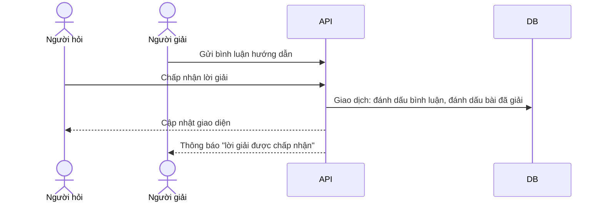

# Bình luận và hỏi đáp

## Mục đích

Cho phép thảo luận theo luồng dưới mỗi bài viết và xác nhận câu trả lời đúng cho bài hỏi đáp. Người dùng có thể gọi `@n7ai` trong bình luận để được hỗ trợ.

## Tính năng

| Tính năng | Mô tả |
|---|---|
| Bình luận phân cấp | Bình luận gốc và các phản hồi lồng nhau |
| Tải theo nhu cầu | Mỗi bài tải trước 3 bình luận gốc mới nhất; "Xem thêm bình luận" và "Xem phản hồi" tải tiếp, không làm giật bố cục |
| Thích bình luận | Có cập nhật lạc quan |
| Sửa, xóa | Chỉ tác giả (và admin kiểm duyệt) |
| Chấp nhận lời giải | Tác giả bài hỏi đáp chọn một bình luận; bài chuyển sang đã giải, bình luận được ghim lên đầu với nhãn "Lời giải được chấp nhận" |
| Đính kèm tài liệu | Nút kẹp giấy, tối đa 3 tệp mỗi bình luận, vào Kho tài liệu |
| Ẩn danh | Bình luận ẩn danh được ở mọi bài, theo hạn mức |
| Báo cáo | Báo cáo bình luận vi phạm vào hàng chờ kiểm duyệt |
| Gọi N7AI | `@n7ai` trong bình luận: N7AI đọc bài và nhánh bình luận đang hỏi rồi trả lời (xem [N7AI trong bình luận và chat](../n7ai/in-app-context)) |

## Luồng chấp nhận lời giải

## Quy tắc nghiệp vụ

- Chỉ tác giả của bài hỏi đáp chấp nhận được lời giải; thao tác chạy trong một giao dịch.
- Hạn chế tài khoản chặn đăng và sửa bình luận.
- Bình luận ẩn danh không hiện trong gợi ý nhắc tên và danh sách hoạt động của tác giả.
- Từ cấm nặng chặn bình luận khi kiểm duyệt tự động bật.

## Dữ liệu

| Bảng | Nội dung |
|---|---|
| `comments` | Nội dung, `parent_id`, `is_solution`, `is_anonymous`, số thích |
| `comment_reactions` | Thích bình luận |
| `comment_documents` | Tệp đính kèm bình luận |
| `comment_reports` | Báo cáo bình luận |

## API

| Phương thức | Đường dẫn | Việc |
|---|---|---|
| GET | `/posts/:postId/comments` | Danh sách, tham số `offset`, `limit` |
| POST | `/posts/:postId/comments` | Tạo (có `parentId`, `documentIds`, `isAnonymous`) |
| PATCH, DELETE | `/comments/:id` | Sửa, xóa |
| POST | `/comments/:id/like` | Thích |
| POST | `/comments/:id/accept-solution` | Chấp nhận lời giải |
| POST | `/comments/:id/report` | Báo cáo |
