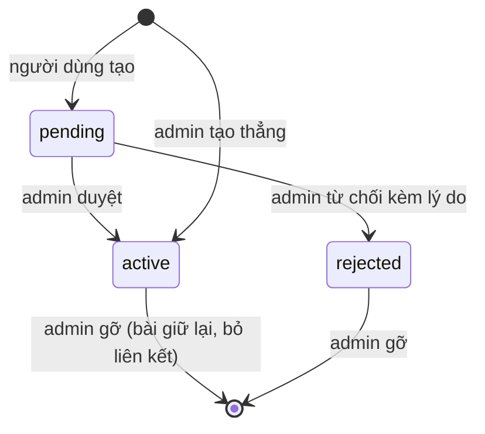

# Cộng đồng

## Mục đích

Cộng đồng (`/communities`, `/c/[slug]`) là không gian theo chủ đề: học thuật, đời sống hoặc câu lạc bộ. Người dùng đủ điều kiện tự tạo cộng đồng; admin duyệt.

## Tính năng

| Tính năng | Ai dùng |
|---|---|
| Xem danh sách, tham gia, rời cộng đồng | Mọi người |
| Đăng bài vào cộng đồng, xem bảng tin cộng đồng | Thành viên |
| Tạo cộng đồng | Người đủ điều kiện |
| Sửa giới thiệu, nội quy, ảnh đại diện, ảnh bìa | Chủ, điều hành viên |
| Quản lý thành viên: tìm, xóa, đặt điều hành viên | Chủ (đặt vai trò); điều hành viên xóa thành viên thường |
| Ẩn và khôi phục bài vi phạm, kèm lý do | Chủ, điều hành viên |
| Duyệt, từ chối, đổi chủ, gỡ, tạo trực tiếp | Admin (quyền `academic:manage`) |

## Vòng đời

Cộng đồng chờ duyệt chỉ chủ thấy. Cộng đồng bị từ chối chủ vẫn xem được kèm lý do. Tham gia hoặc đăng bài vào cộng đồng chưa duyệt không được.

## Điều kiện tạo cộng đồng

Tài khoản người thật đang hoạt động, và thỏa một trong hai:

- Có tích xanh; hoặc
- Email đã xác thực, tài khoản từ 14 ngày trở lên, có ít nhất 5 bài chưa bị ẩn.

Mỗi người tối đa 3 cộng đồng đang hoạt động hoặc chờ duyệt (khóa dòng người dùng để hai yêu cầu song song không vượt hạn mức). Người dùng thường chọn loại `academic`, `life`, `club`; loại `campus` và `faculty` chỉ admin. Slug gồm `a-z`, `0-9`, `-`, dài 3 đến 50 ký tự; trùng trả 409.

## Vai trò

Xem bảng vai trò trong [Vai trò và phân quyền](../roles-permissions). Tên, slug và loại do admin giữ.

## Ẩn bài

Dùng chung cột ẩn của bài viết (`hidden_at`, `hidden_by`, `hidden_reason`). Điều hành viên chỉ khôi phục được bài do chủ hoặc điều hành viên cộng đồng ẩn; bài do admin hệ thống ẩn thì chỉ admin gỡ. Tác giả nhận thông báo kèm lý do.

## Dữ liệu

| Bảng, cột | Nội dung |
|---|---|
| `communities` | Tên, slug, loại, mô tả, nội quy, ảnh, trạng thái, `posts_count` |
| `community_members` | Thành viên và vai trò; ràng buộc đúng một `owner` |
| `posts.community_id` | Liên kết bài với cộng đồng |

`posts_count` do trigger tính lại khi bài vào, rời, bị ẩn hoặc lưu trữ; mã ứng dụng không tự cộng trừ.

## API

| Phương thức | Đường dẫn | Việc |
|---|---|---|
| GET, POST | `/communities` | Danh sách, tạo |
| GET, PATCH | `/communities/:slug` | Chi tiết, sửa giới thiệu |
| POST | `/communities/:slug/join` | Tham gia hoặc rời |
| GET | `/communities/:slug/posts` | Bài trong cộng đồng |
| GET | `/communities/:slug/members` | Thành viên (chủ, điều hành viên) |
| PUT | `/communities/:slug/members/:userId/role` | Đặt vai trò |
| DELETE | `/communities/:slug/members/:userId` | Xóa thành viên |
| POST, DELETE | `/communities/:slug/posts/:postId/hide` | Ẩn, khôi phục bài |
| GET | `/communities/:slug/hidden-posts` | Bài đã ẩn |
| GET, POST | `/admin/communities`, `.../:id/approve`, `.../:id/reject` | Duyệt |
| PUT, DELETE | `/admin/communities/:id/owner`, `/admin/communities/:id` | Đổi chủ, gỡ |
