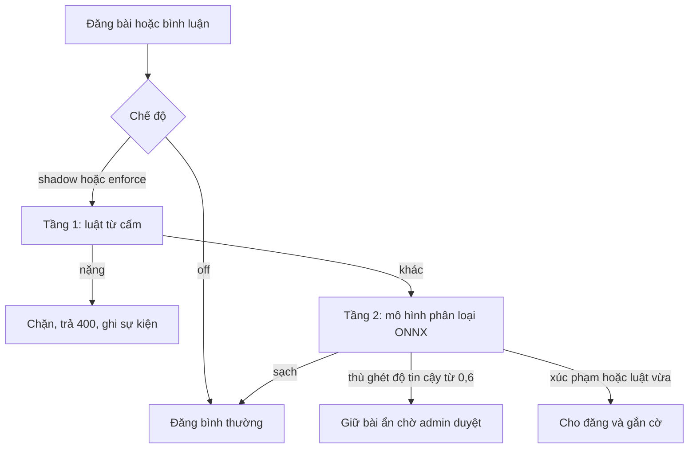

# An toàn nội dung

## Mục đích

Giữ môi trường học thuật lành mạnh bằng ba lớp: người dùng báo cáo, kiểm duyệt tự động tùy chọn, và xử lý của quản trị viên.

## Báo cáo của người dùng

| Đối tượng | Cách báo cáo | Hàng chờ |
|---|---|---|
| Bài viết | `POST /posts/:id/report` | Kiểm duyệt, báo cáo bài |
| Bình luận | `POST /comments/:id/report` | Kiểm duyệt, báo cáo bình luận |
| Người dùng | `POST /users/:id/report` | Báo cáo người dùng |

Admin xem chung một hàng chờ, lọc theo lý do, xử lý hàng loạt: ẩn, xóa hoặc bỏ qua.

## Kiểm duyệt tự động

Chặn từ tục và ngôn từ thù ghét tiếng Việt lúc đăng bài, bình luận. Không gọi mô hình ngoài ở luồng đăng. Điều khiển bằng biến `MODERATION_MODE`:

| Chế độ | Hành vi |
|---|---|
| `off` | Không kiểm duyệt tự động (mặc định) |
| `shadow` | Chạy và ghi nhật ký nhưng luôn cho đăng, để đo độ chính xác |
| `enforce` | Chặn hoặc giữ bài theo kết quả |

- Tầng 1 chuẩn hóa chữ (NFC, chữ thường, bỏ ký tự chèn, quy đổi leet, thu gọn chữ lặp) rồi so từ điển ba mức nặng, vừa, nhẹ có ngoại lệ. Admin thêm từ cấm ở Admin Console, tab Từ cấm; dán nhiều từ một lần.
- Tầng 2 là mô hình phân loại sạch, xúc phạm, thù ghét chạy cục bộ, khoảng 3 ms mỗi bài.
- Mọi quyết định ghi vào `moderation_events`; admin duyệt lại ở hàng chờ sự kiện kiểm duyệt (`POST /admin/moderation-events/review`).

## Xử phạt

Thang theo số vi phạm trong 180 ngày (bỏ bản đã hủy):

Cảnh cáo, Hạn chế 1 ngày, Hạn chế 7 ngày, Khóa 7 ngày, Khóa 30 ngày, Khóa vĩnh viễn.

Hiệu lực của Hạn chế và Khóa xem [Vai trò và phân quyền](../roles-permissions). Quy trình admin xem [Admin: Kiểm duyệt](../admin/moderation).

## Kiểm duyệt trong cộng đồng

Chủ và điều hành viên ẩn bài vi phạm kèm lý do; tác giả nhận thông báo (xem [Cộng đồng](communities)).

## Dữ liệu

| Bảng | Nội dung |
|---|---|
| `post_reports`, `comment_reports`, `user_reports` | Báo cáo |
| `moderation_terms` | Từ cấm do admin quản lý |
| `moderation_events` | Quyết định kiểm duyệt tự động |
| `user_sanctions` | Lịch sử xử phạt |
| `posts.hidden_at`, `hidden_by`, `hidden_reason` | Trạng thái ẩn |

## Giới hạn đã biết

Kiểm duyệt tự động mặc định tắt; bật `shadow` trước khi `enforce` để đo tỉ lệ nhầm.
