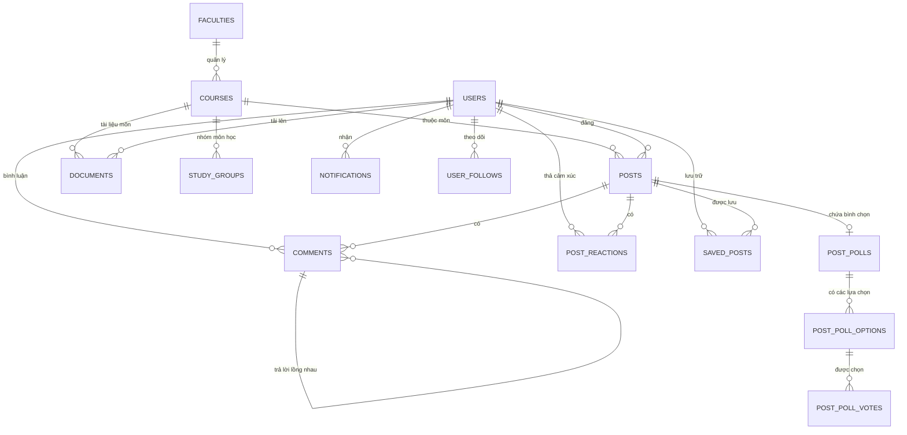

# CSE703014 – ĐỒ ÁN CHUYÊN NGÀNH
# ĐỀ XUẤT ĐỒ ÁN (PROJECT PROPOSAL)
## KIẾN TRÚC & TỔ CHỨC DỮ LIỆU HỆ THỐNG

---

# PU Connection — Mạng Xã Hội Học Thuật Sinh Viên Phenikaa
### (Social Learning Network Platform — Proposal Kiến Trúc & Dữ Liệu)

* **Mã học phần:** CSE703014 – Đồ án chuyên ngành (Khoa Công nghệ Thông tin)
* **Đơn vị đào tạo:** Trường Đại học Phenikaa (Phenikaa University)
* **Giảng viên hướng dẫn:** TS. Vũ Quang Dũng
* **Thời gian thực hiện:** Học kỳ 1, Năm học 2026 – 2027
* **Phiên bản:** 1.0 (Production-Ready Architecture)

---

## MỤC LỤC

- [PHẦN I: YÊU CẦU CHUNG & ĐỀ CƯƠNG ĐỒ ÁN](#phần-i-yêu-cầu-chung--đề-cương-đồ-án)
  - [1. Tổng Quan Đồ Án](#1-tổng-quan-đồ-án)
  - [2. Yêu Cầu Chức Năng Chi Tiết (Functional Requirements)](#2-yêu-cầu-chức-năng-chi-tiết-functional-requirements)
  - [3. Yêu Cầu Kỹ Thuật (Technical Requirements)](#3-yêu-cầu-kỹ-thuật-technical-requirements)
  - [4. Kế Hoạch & Lộ Trình Triển Khai Chi Tiết](#4-kế-hoạch--lộ-trình-triển-khai-chi-tiết)
- [PHẦN II: KIẾN TRÚC & TỔ CHỨC DỮ LIỆU HỆ THỐNG](#phần-ii-kiến-trúc--tổ-chức-dữ-liệu-hệ-thống)
  - [1. Kiến Trúc Phần Mềm Tổng Thể (System Architecture)](#1-kiến-trúc-phần-mềm-tổng-thể-system-architecture)
  - [2. Chiến Lược Giao Thức Đa Kênh (Hybrid Multi-Protocol Strategy)](#2-chiến-lược-giao-thức-đa-kênh-hybrid-multi-protocol-strategy)
  - [3. Tổ Chức Cơ Sở Dữ Liệu Quan Hệ (PostgreSQL 16 Schema)](#3-tổ-chức-cơ-sở-dữ-liệu-quan-hệ-postgresql-16-schema)
  - [4. Cấu Trúc Bộ Nhớ Tốc Độ Cao & Realtime State (Redis 7)](#4-cấu-trúc-bộ-nhớ-tốc-độ-cao--realtime-state-redis-7)
  - [5. Các Tính Năng Học Thuật Cốt Lõi & Khác Biệt](#5-các-tính-năng-học-thuật-cốt-lõi--khác-biệt)
  - [6. Kế Hoạch Dữ Liệu Thực Nghiệm (Data Seeding Plan)](#6-kế-hoạch-dữ-liệu-thực-nghiệm-data-seeding-plan)
- [PHẦN III: KẾT QUẢ DỰ ÁN & SẢN PHẨM BÀN GIAO](#phần-iii-kết-quả-dự-án--sản-phẩm-bàn-giao)

---

# PHẦN I: YÊU CẦU CHUNG & ĐỀ CƯƠNG ĐỒ ÁN

## 1. Tổng Quan Đồ Án

### 1.1. Bối cảnh & Lý do chọn đề tài
Tại Trường Đại học Phenikaa, việc trao đổi học tập giữa sinh viên và giảng viên hiện nay vẫn phân tán trên nhiều nền tảng rời rạc (Facebook Groups, Zalo, Teams, Google Drive cá nhân). Tình trạng này dẫn đến các hạn chế nghiêm trọng:
* **Thất lạc tri thức:** Đề thi cũ, slide bài giảng, lời giải bài tập bị trôi và biến mất sau mỗi kỳ học; sinh viên khóa dưới rất khó tiếp cận lại nguồn tư liệu chất lượng từ khóa trên.
* **Khó khăn ghép nhóm đồ án (PBL Matchmaking):** Sinh viên không có kênh chính thống để tìm kiếm bạn đồng hành có kỹ năng phù hợp (ví dụ: cần 1 bạn làm Frontend React, 1 bạn làm Backend NestJS, 1 bạn làm Embedded/IoT).
* **Nhiễu loạn thông tin:** Các hội nhóm mạng xã hội đại chúng tràn lan quảng cáo, thông tin sai lệch, không có cơ chế xác thực danh tính sinh viên/giảng viên của nhà trường.

### 1.2. Mục tiêu dự án
Xây dựng nền tảng mạng xã hội học thuật chuyên biệt dành riêng cho cộng đồng Trường Đại học Phenikaa (**PU Connection / PU Connector**), kết hợp giữa trải nghiệm mạng xã hội thế hệ mới (tương tự X/Twitter) và các tính năng học thuật chuyên sâu (Social Learning Network):
1. **Kết nối định danh học thuật:** Đồng bộ sinh viên, giảng viên, trợ giảng (TA) theo Khoa/Viện, Chuyên ngành và Niên khóa.
2. **Kho tri thức tập trung:** Quản lý, phân loại và chia sẻ tài liệu, slide, đề thi theo từng mã học phần chính quy.
3. **Học tập & Hợp tác dựa trên dự án:** Hỗ trợ hỏi đáp Q&A công thức toán học/thuật toán, bình chọn câu trả lời chuẩn xác, tuyển thành viên nhóm đồ án liên ngành.

### 1.3. Đối tượng sử dụng
* **Sinh viên Phenikaa:** Tra cứu đề thi/slide, hỏi đáp bài tập, đăng tin tìm bạn làm đồ án PBL, chia sẻ kinh nghiệm học tập.
* **Giảng viên & Trợ giảng (TA):** Chia sẻ thông báo môn học, tài liệu chính thống, giải đáp thắc mắc và duyệt câu trả lời chính xác cho sinh viên.
* **Ban Quản trị (Admin):** Quản lý danh mục Khoa/Môn học, kiểm duyệt nội dung, xử lý báo cáo vi phạm học thuật (lộ đề thi, đạo văn, spam).

---

## 2. Yêu Cầu Chức Năng Chi Tiết (Functional Requirements)

Hệ thống được chia thành 6 phân hệ chức năng hoàn chỉnh:

### 2.1. Phân hệ Quản lý Tài khoản & Danh tính Học thuật (Identity & Profile)
* **Đăng ký / Đăng nhập:**
  * Hỗ trợ định danh email sinh viên/cán bộ trường (`@phenikaa-uni.edu.vn` hoặc `@st.phenikaa-uni.edu.vn`).
  * Quản lý phiên an toàn qua Cookie `pu_session` (`HttpOnly`, `SameSite=Lax`, mã hóa Argon2id / Bcrypt).
* **Onboarding 4 Bước (Tân sinh viên):**
  * Bước 1: Khai báo Mã SV, Khoa/Viện đào tạo (`FIT`, `FEE`, `FBA`, `FAE`...), Niên khóa (`K15`, `K16`, `K17`...).
  * Bước 2: Chọn các học phần đang học trong kỳ $\rightarrow$ giải quyết bài toán khởi động lạnh (Cold-start recommendation).
  * Bước 3: Đăng ký kỹ năng công nghệ (`React`, `NestJS`, `Python AI`, `IoT`...) phục vụ thuật toán ghép nhóm PBL.
  * Bước 4: Tự động gợi ý kết nối bạn bè cùng khoa và giảng viên phụ trách, cộng ngay **+100 điểm danh vọng khởi đầu**.
* **Hồ sơ cá nhân đa năng (`/[username]`):**
  * Hiển thị Ảnh đại diện, Ảnh bìa, Tiểu sử, Khoa/Viện, Niên khóa, Điểm danh vọng (Reputation Points).
  * Hệ thống Huy hiệu học thuật trực quan: 🎓 Giảng viên (Verified Lecturer), 🌟 Trợ giảng (TA), 👑 Quản trị viên (Admin), 🏆 Top Contributor ($\ge 300$ điểm).
  * 4 Tab dữ liệu cá nhân: Bài viết đã đăng, Kho tài liệu đã chia sẻ, Nhóm đồ án đang tham gia, Huy hiệu vinh danh.
* **Mạng lưới kết nối (Social Graph):**
  * Theo dõi (Follow / Unfollow) sinh viên và giảng viên.
  * Danh sách Người đang theo dõi (Following) và Người theo dõi (Followers).

### 2.2. Phân hệ Bảng Tin Học Thuật & Tương Tác Chuẩn X (Academic Social Feed)
* **Bảng tin 3 cột chuẩn X:**
  * Cột trái: Thanh điều hướng tinh gọn (Home, Search/Explore, Courses, Vault, PBL Groups, Profile).
  * Cột giữa: Bảng tin chính với 3 tab dính (*Dành cho bạn / Môn học của tôi / Đã lưu*).
  * Cột phải: Tin học thuật nổi bật (*Academic Highlights*), Xu hướng (#Trending), Gợi ý kết nối cùng Khoa.
* **Trình soạn thảo bài viết học thuật (`AcademicPostComposer`):**
  * Soạn thảo trực tiếp tại đỉnh Feed (In-place Composer), vòng đo độ dài ký tự SVG (Progress Ring).
  * Phân loại mục đích học thuật: Thảo luận chung (`general`), Hỏi đáp bài tập (`qa`), Chia sẻ tài liệu (`document`), Tuyển thành viên đồ án (`group_recruit`).
  * Gắn nhãn mã môn học (ví dụ: `📘 IT101 - Cấu trúc dữ liệu và giải thuật`).
  * Đính kèm đa phương tiện: Lưới ảnh mosaic 1-4 ảnh chuẩn tỉ lệ, file tài liệu PDF/Slide.
  * Hỗ trợ khảo sát biểu quyết sinh viên (Post Polls & Voting) với 2-4 tùy chọn, thanh phần trăm thời gian thực.
  * Phân tích cú pháp tự động: Clickable Mentions `@username` và Clickable Hashtags `#tag`.
* **Luồng tương tác chuẩn hóa:**
  * Thích bài viết (Tym/Like), Bình luận phân cấp (Nested Replies), Lưu bài viết (Bookmark), Thống kê số lượt xem (Views Count).
  * Chia sẻ đa nền tảng: Sao chép liên kết (Copy Link + Toast), Chia sẻ lên X (Twitter), Chia sẻ nội bộ qua chat nhóm.
  * Menu tùy chọn 3 chấm (`...`): Báo cáo vi phạm học thuật (Report Post), Ẩn không quan tâm (Not Interested + Undo), Ghim lên đầu trang cá nhân (Pin Post), Chỉnh sửa và Xóa bài viết an toàn.
* **Hỏi đáp & Duyệt câu trả lời đúng (Accepted Solution):**
  * Tác giả bài đăng câu hỏi Q&A có quyền tích chọn một bình luận xuất sắc làm **"Lời giải chính xác"** (Accepted Answer).
  * Bình luận được duyệt sẽ tự động ghim lên vị trí đầu tiên, gắn viền xanh lá nổi bật và đánh dấu trạng thái bài viết `[ĐÃ GIẢI QUYẾT]`.
  * Tự động cộng **+10 điểm danh vọng** cho người đóng góp câu trả lời chính xác.

### 2.3. Phân hệ Kho Tài Liệu & Đề Thi Học Phần (Knowledge Vault)
* **Phân loại tài liệu đa định dạng:** Slide bài giảng (`lecture_slide`), Đề thi & Đáp án giữa kỳ/cuối kỳ (`exam`), Bài tập lớn & Hướng dẫn thực hành (`exercise`, `lab_guide`), Ghi chép tóm tắt môn học (`note`).
* **Trình xem trước In-App (PDF Previewer):**
  * Đọc trực tiếp tài liệu PDF ngay trên trình duyệt mà không bắt buộc phải tải về máy.
  * Hỗ trợ công cụ phóng to, thu nhỏ, chế độ xem toàn màn hình và nút tải tệp an toàn.
* **Đánh giá & Xếp hạng chất lượng tài liệu:**
  * Đánh giá sao (1-5 sao) kèm nhận xét đánh giá độ hữu ích của tài liệu.
  * Kiểm duyệt bởi Giảng viên/Mod: Tích xanh xác minh tài liệu chuẩn đề cương môn học.

### 2.4. Phân hệ Môn Học & Ghép Nhóm Đồ Án (Courses & PBL Matchmaking)
* **Hub Môn học theo Khoa/Viện:**
  * Tra cứu cây danh mục các môn học của 8 Khoa/Viện (FIT, FEE, FBA, FAE...).
  * Mỗi trang môn học tổng hợp: Thông tin số tín chỉ, mô tả, danh sách giảng viên phụ trách, toàn bộ bài thảo luận và kho tài liệu tương ứng.
* **Ghép nhóm đồ án môn học (PBL Groups):**
  * Đăng bài tuyển thành viên theo đề tài nghiên cứu hoặc bài tập lớn.
  * Lọc theo kỹ năng công nghệ yêu cầu (Frontend, Backend, AI, UI/UX, Hardware).
  * Cơ chế nộp đơn ứng tuyển (Apply), Trưởng nhóm xét duyệt/từ chối thành viên tham gia.
  * Phòng thảo luận nội bộ cho nhóm đồ án.

### 2.5. Phân hệ Tìm Kiếm & Khám Phá Chuyên Sâu (Search & Explore Engine)
* **Chế độ Khám phá (Mode A - Explore & Trends):**
  * Hiển thị bảng xếp hạng các chủ đề (#Hashtags) được thảo luận nhiều nhất trong tuần tại Phenikaa.
  * Danh sách các môn học đang có lượng thảo luận sôi nổi nhất kỳ thi.
* **Chế độ Tìm kiếm tích cực (Mode B - Active Search Stream):**
  * Hỗ trợ 6 Tabs lọc kết quả: *Hàng đầu, Mới nhất, Môn học, Tài liệu, Mọi người, Nhóm PBL*.
  * Tích hợp bộ lọc nâng cao: Tìm chính xác cụm từ, lọc theo Khoa/Viện đào tạo, lọc bài viết có file đính kèm.

### 2.6. Phân hệ Quản Trị & Điều Hành Hệ Thống (Admin & Moderation)
* Bảng điều khiển tổng quan (Dashboard): Thống kê số lượng sinh viên hoạt động, số bài viết, tài liệu được chia sẻ và lượt tương tác trong ngày.
* Quản lý báo cáo vi phạm: Xử lý các bài đăng có nội dung vi phạm bản quyền đề thi, ngôn từ không phù hợp hoặc quảng cáo rác; hỗ trợ khóa tài khoản tạm thời hoặc vĩnh viễn.

---

## 3. Yêu Cầu Kỹ Thuật (Technical Requirements)

* **Kiến trúc mã nguồn:** Monorepo quản lý bằng **Turborepo** và **pnpm workspaces** nhằm tối ưu hóa chia sẻ mã nguồn giữa Client Web, Client Mobile và Backend:
  * `apps/web`: Ứng dụng Web PWA hiện đại.
  * `apps/api`: Máy chủ Backend hiệu năng cao.
  * `packages/schemas`: Thư viện hợp đồng dữ liệu dùng chung (Zod validation schemas).
  * `packages/ui`: Thư viện thiết kế UI components dùng chung.
* **Giao diện Client (Frontend):**
  * Framework: **Next.js 15 (App Router)** kết hợp **React 19** và **TypeScript 5**.
  * Định kiểu: **Tailwind CSS v4** với thiết kế responsive hoàn hảo trên mọi kích thước màn hình (Mobile First, Tablet, Desktop).
  * Quản lý State: **Zustand v5** siêu nhẹ cho Auth State và UI State; Client cache với Apollo Client.
  * Soạn thảo & Hiển thị: Trình soạn thảo Markdown, hỗ trợ hiển thị công thức toán học **KaTeX**, biểu đồ **Mermaid.js**.
* **Máy chủ dịch vụ (Backend):**
  * Nền tảng: **Node.js (LTS)** với framework **NestJS** theo kiến trúc Modular Monolith (Domain-Driven Design).
  * Giao thức định tuyến: **Hybrid GraphQL + REST API + WebSocket**.
  * Quản lý tiến trình phát triển: Tập trung hóa qua `procman.yaml` (`procman up` khởi chạy đồng thời DB, API, Web).
* **Cơ sở dữ liệu & Lưu trữ (Data & Storage Tier):**
  * Cơ sở dữ liệu chính: **PostgreSQL 16** với các chuẩn tối ưu hiệu năng (GIN Index, Composite B-Tree, ACID Transactions với `pg.Pool`).
  * Bộ nhớ đệm & State: **Redis 7** (In-memory Cache, Session Store, Feed Timeline ZSET, WebSocket Pub/Sub).
  * Lưu trữ đám mây: **Cloudflare R2 Object Storage** (chuẩn S3 API) với chi phí Egress bằng 0, phục vụ lưu trữ file PDF tài liệu và hình ảnh bài viết.
* **Bảo mật & Hiệu năng:**
  * Xác thực: Session-based Auth với cookie `pu_session` (`HttpOnly`, `SameSite=Lax`, mã hóa Argon2id).
  * Bảo vệ giao dịch: Bọc các luồng ghi liên hoàn trong `db.transaction()` với cơ chế Row-level Lock (`FOR UPDATE`), tự động rollback khi lỗi và giám sát `Slow Transaction [>300ms]`.
  * Phân quyền RBAC: Phân quyền theo vai trò người dùng (`student`, `lecturer`, `ta`, `admin`).

---

## 4. Kế Hoạch & Lộ Trình Triển Khai Chi Tiết

Đồ án được triển khai theo quy trình công nghệ phần mềm tiêu chuẩn kéo dài trong 12 tuần:

| Giai đoạn | Thời gian | Nhiệm vụ chi tiết | Kết quả đầu ra |
| :--- | :---: | :--- | :--- |
| **Giai đoạn 1: Khảo sát & Thiết kế** | Tuần 1 – Tuần 2 | • Phân tích yêu cầu thực tế của sinh viên Phenikaa.<br>• Thiết kế sơ đồ kiến trúc 5 tầng, luồng giao thức đa kênh.<br>• Thiết kế mô hình cơ sở dữ liệu quan hệ (ERD 11 bảng chuẩn).<br>• Thiết kế Wireframe & UI/UX phong cách X trên Figma. | • Bản thuyết minh đề tài (Proposal).<br>• Sơ đồ ERD, Architecture Diagrams.<br>• Bộ thiết kế UI/UX trên Figma. |
| **Giai đoạn 2: Xây dựng Nền tảng & Backend Core** | Tuần 3 – Tuần 5 | • Khởi tạo Monorepo Turborepo + pnpm.<br>• Thiết lập PostgreSQL 16, tạo DDL bảng, viết script migration và Seeder 100 tài khoản sinh viên/giảng viên.<br>• Xây dựng tầng truy cập dữ liệu `DatabaseService` bọc ACID transaction.<br>• Lập trình REST API cho Xác thực (Session Auth), Tải file Cloudflare R2.<br>• Tích hợp Apollo Server GraphQL cho Bảng tin và Profile. | • Máy chủ NestJS API chạy ổn định.<br>• Hệ thống DB và 100 tài khoản mẫu.<br>• Bộ API Endpoint & GraphQL Playground. |
| **Giai đoạn 3: Phát triển Giao diện Web & Bảng Tin** | Tuần 6 – Tuần 8 | • Xây dựng Landing Page phong cách X và luồng Onboarding 4 bước (`/get-started`).<br>• Xây dựng Bảng tin 3 cột chuẩn X (`/home`) với cuộn vô hạn (Infinite Scroll).<br>• Lập trình bộ soạn thảo `AcademicPostComposer`, tính năng đính kèm ảnh, tạo khảo sát Polls.<br>• Phát triển tính năng Bình luận lồng nhau, Duyệt câu trả lời đúng (Accepted Solution) và Cơ chế thưởng điểm danh vọng tự động. | • Giao diện Web Client hoàn thiện tương tác thời gian thực.<br>• Bảng tin hoạt động mượt mà, không giật lag. |
| **Giai đoạn 4: Kho Tài Liệu, Môn Học & Tìm Kiếm** | Tuần 9 – Tuần 10 | • Xây dựng phân hệ Hub môn học theo 8 Khoa/Viện.<br>• Xây dựng Kho tài liệu (Knowledge Vault) kèm trình đọc PDF In-App.<br>• Lập trình thuật toán gợi ý bài viết cá nhân hóa (Hybrid Recommendation).<br>• Tối ưu hóa Full-Text Search Backend với thời gian phản hồi $<10\text{ms}$. | • Phân hệ Kho tài liệu và Học phần.<br>• Công cụ tìm kiếm chuyên sâu 6 tab. |
| **Giai đoạn 5: Kiểm Thử, Tối Ưu & Báo Cáo** | Tuần 11 – Tuần 12 | • Kiểm thử đơn vị (Unit Test) và Kiểm thử tích hợp (Integration Test).<br>• Kiểm thử hiệu năng truy vấn SQL, đảm bảo Zero CLS trên Web.<br>• Hoàn thiện tài liệu báo cáo chính thức theo mẫu `CSE703014_Report_Template_VI_V1`.<br>• Chuẩn bị slide trình chiếu, video demo và triển khai môi trường Production. | • Báo cáo tổng kết đồ án hoàn chỉnh.<br>• Hệ thống vận hành trực tiếp (Live Demo).<br>• Slide thuyết minh bảo vệ đồ án. |

---

# PHẦN II: KIẾN TRÚC & TỔ CHỨC DỮ LIỆU HỆ THỐNG

## 1. Kiến Trúc Phần Mềm Tổng Thể (System Architecture)

Hệ thống áp dụng mô hình kiến trúc **5 Tầng Kỹ Thuật (5-Tier Layered Architecture)** theo triết lý **Backend-For-Frontend (BFF)** và **Module-based (DDD)**:

```mermaid
graph TD
  subgraph T1 [TẦNG 1: Client Presentation Layer]
    Web["Web Client Next.js 15 PWA (apps/web)"]
    Mobile["Mobile Client Expo React Native (apps/mobile)"]
    SharedPkg["Shared Schemas & UI Tokens (@pu/schemas, @pu/ui)"]
  end

  subgraph T2 [TẦNG 2: Gateway & Protocol Routing Tier]
    Gateway["NestJS API Gateway & Security Filter"]
    P_REST["REST Router (Auth, Upload, CRUD)"]
    P_GQL["GraphQL Engine Apollo Server (Feed, Profile, Vault)"]
    P_WS["WebSocket Hub Socket.io (Chat, Realtime Notification)"]
  end

  subgraph T3 [TẦNG 3: Business Domain Modules (DDD)]
    M_Auth["Auth & Onboarding Module"]
    M_Posts["Academic Post & Feed Module"]
    M_Comments["Comments & Accepted Solution"]
    M_Vault["Knowledge Vault & Documents"]
    M_Courses["Courses & Academic Taxonomy"]
    M_PBL["Study Groups & PBL Matchmaking"]
    M_Gamify["Reputation & Gamification Engine"]
  end

  subgraph T4 [TẦNG 4: Intelligence & Asynchronous Services]
    Recommendation["Hybrid Recommendation Engine"]
    SearchEngine["PostgreSQL FTS / Semantic Engine"]
    BackgroundQueue["BullMQ Background Workers"]
  end

  subgraph T5 [TẦNG 5: Persistence & Infrastructure Tier]
    Postgres[("PostgreSQL 16 + pgvector (11 Bảng chuẩn hóa)")]
    RedisCache[("Redis 7 (Session, Cache, Feed ZSET, Pub/Sub)")]
    R2Storage[("Cloudflare R2 Object Storage (PDFs & Media)")]
  end

  Web -->|HTTP REST| P_REST
  Web -->|GraphQL Query/Mutation| P_GQL
  Web -->|WebSocket Bi-directional| P_WS
  Mobile -->|HTTP REST| P_REST
  Mobile -->|GraphQL Query/Mutation| P_GQL
  Mobile -->|WebSocket Bi-directional| P_WS

  Gateway --> P_REST
  Gateway --> P_GQL
  Gateway --> P_WS

  P_REST --> T3
  P_GQL --> T3
  P_WS --> T3

  T3 --> Postgres
  T3 --> RedisCache
  T3 --> R2Storage
  T3 --> T4
  T4 --> Postgres
  T4 --> RedisCache
```

---

## 2. Chiến Lược Giao Thức Đa Kênh (Hybrid Multi-Protocol Strategy)

Để giải quyết bài toán băng thông mạng và tối ưu độ trễ cho từng tính năng đặc thù của mạng xã hội, PU Connection không dùng đơn lẻ một giao thức mà áp dụng chiến lược **Hybrid Multi-Protocol**:

| Phân hệ nghiệp vụ | Giao thức | Cơ chế kỹ thuật | Lý do lựa chọn |
| :--- | :---: | :--- | :--- |
| **Bảng Tin & Trang Cá Nhân** | **GraphQL** | Apollo Server `/graphql` gom nhiều thực thể trong 1 Round-trip | • Loại bỏ thừa dữ liệu (**No Over-fetching**) cho thiết bị di động.<br>• Client tự chọn trường dữ liệu cần thiết (bài viết, tác giả, huy hiệu, lượt thích, môn học). |
| **Xác Thực & Phiên Làm Việc** | **REST API** | `POST /api/auth/login`, Cookie `pu_session` | • Khai thác triệt để chuẩn HTTP Cookie `HttpOnly`, `SameSite=Lax`, ngăn chặn hoàn toàn tấn công XSS. |
| **Tải Lên Tệp Tin Dung Lượng Lớn** | **REST API** | `@aws-sdk/client-s3` Streaming / Presigned URLs | • Tải trực tiếp tài liệu PDF lớn (20MB - 100MB) lên Cloudflare R2 mà không gây nghẽn tiến trình Node.js API. |
| **Chat Nhóm Đồ Án & Đang Gõ** | **WebSocket** | Full-duplex TCP Socket.io | • Gửi và nhận tin nhắn thời gian thực với độ trễ cực thấp **$< 20\text{ms}$**, hỗ trợ sự kiện trạng thái `typing...`. |
| **Thông Báo Đẩy Thời Gian Thực** | **WebSocket / SSE** | Real-time Event Broadcaster | • Bắn thông báo nổi tức thì khi có người bình luận, trả lời câu hỏi Q&A hoặc xin vào nhóm đồ án. |
| **Tra Cứu Danh Mục Tĩnh** | **REST API** | `GET /api/courses`, `GET /api/faculties` | • Dễ dàng tận dụng bộ đệm HTTP Caching (Browser Cache & CDN) cho các dữ liệu ít biến động. |

---

## 3. Tổ Chức Cơ Sở Dữ Liệu Quan Hệ (PostgreSQL 16 Schema)

Cơ sở dữ liệu được chuẩn hóa cao độ với 11 bảng cốt lõi, bọc trong giao dịch ACID với Native `pg.Pool`:



### 3.1. Phân hệ Định danh & Mạng lưới quan hệ (Users & Social Graph)

```sql
-- 1. Bảng Tài khoản người dùng (Users)
CREATE TABLE users (
    id UUID PRIMARY KEY DEFAULT gen_random_uuid(),
    student_id VARCHAR(20) UNIQUE,              -- Mã SV hoặc Mã Cán bộ (ví dụ: '23010960')
    email VARCHAR(255) UNIQUE NOT NULL,         -- Email định danh Phenikaa (@phenikaa-uni.edu.vn)
    password_hash VARCHAR(255) NOT NULL,        -- Mã hóa mật khẩu an toàn
    full_name VARCHAR(150) NOT NULL,            -- Họ và tên đầy đủ
    username VARCHAR(50) UNIQUE NOT NULL,       -- Tên định danh người dùng (@handle)
    avatar_url TEXT,                            -- Đường dẫn ảnh đại diện
    cover_url TEXT,                             -- Đường dẫn ảnh bìa trang cá nhân
    bio TEXT,                                   -- Tiểu sử học thuật
    faculty VARCHAR(100),                       -- Khoa/Viện đào tạo (ví dụ: 'Công nghệ thông tin')
    major VARCHAR(100),                         -- Chuyên ngành đào tạo
    cohort VARCHAR(20),                         -- Niên khóa sinh viên (ví dụ: 'K17')
    role VARCHAR(20) DEFAULT 'student',         -- student, lecturer, ta, admin
    is_verified BOOLEAN DEFAULT FALSE,          -- Xác thực tài khoản chính chủ trường
    reputation_points INT DEFAULT 0,            -- Điểm danh vọng cống hiến
    onboarding_completed BOOLEAN DEFAULT FALSE, -- Trạng thái hoàn thành Onboarding
    interests TEXT[] DEFAULT '{}',              -- Mảng chủ đề học thuật quan tâm
    skills TEXT[] DEFAULT '{}',                 -- Mảng kỹ năng công nghệ
    created_at TIMESTAMPTZ DEFAULT NOW(),
    updated_at TIMESTAMPTZ DEFAULT NOW()
);

-- Chỉ mục tối ưu hóa tìm kiếm người dùng và GIN Index cho mảng kỹ năng
CREATE INDEX idx_users_username ON users(username);
CREATE INDEX idx_users_faculty_cohort ON users(faculty, cohort);
CREATE INDEX idx_users_skills ON users USING GIN(skills);
CREATE INDEX idx_users_interests ON users USING GIN(interests);

-- 2. Bảng Quan hệ theo dõi (User Follows)
CREATE TABLE user_follows (
    follower_id UUID NOT NULL REFERENCES users(id) ON DELETE CASCADE,
    following_id UUID NOT NULL REFERENCES users(id) ON DELETE CASCADE,
    created_at TIMESTAMPTZ DEFAULT NOW(),
    PRIMARY KEY (follower_id, following_id)
);
CREATE INDEX idx_user_follows_following ON user_follows(following_id);
```

### 3.2. Phân hệ Bảng Tin Học Thuật & Bình Chọn (Posts, Polls & Content)

```sql
-- 3. Bảng Môn học chính quy (Courses)
CREATE TABLE courses (
    id UUID PRIMARY KEY DEFAULT gen_random_uuid(),
    code VARCHAR(30) UNIQUE NOT NULL,           -- Mã học phần (ví dụ: 'IT101', 'CSE703014')
    name VARCHAR(255) NOT NULL,                 -- Tên học phần
    faculty VARCHAR(100) NOT NULL,              -- Khoa/Viện phụ trách
    credits INT DEFAULT 3,                      -- Số tín chỉ
    description TEXT,
    created_at TIMESTAMPTZ DEFAULT NOW()
);
CREATE INDEX idx_courses_faculty ON courses(faculty);

-- 4. Bảng Bài viết học thuật (Posts)
CREATE TABLE posts (
    id UUID PRIMARY KEY DEFAULT gen_random_uuid(),
    author_id UUID NOT NULL REFERENCES users(id) ON DELETE CASCADE,
    course_id UUID REFERENCES courses(id) ON DELETE SET NULL,
    post_type VARCHAR(30) NOT NULL DEFAULT 'general', -- 'general', 'qa', 'document', 'group_recruit'
    title VARCHAR(300),                         -- Tiêu đề thảo luận
    content TEXT NOT NULL,                      -- Nội dung bài viết (Markdown + LaTeX)
    media_urls TEXT[] DEFAULT '{}',             -- Mảng ảnh đính kèm Cloudflare R2
    tags TEXT[] DEFAULT '{}',                   -- Mảng thẻ môn học / từ khóa (#Hashtags)
    likes_count INT DEFAULT 0,                  -- Đếm nhanh lượt thích (Denormalized)
    comments_count INT DEFAULT 0,               -- Đếm nhanh lượt bình luận (Denormalized)
    shares_count INT DEFAULT 0,                 -- Số lượt chia sẻ
    views_count INT DEFAULT 0,                  -- Số lượt xem bài viết
    is_solved BOOLEAN DEFAULT FALSE,            -- Trạng thái đã giải quyết (dành cho bài Q&A)
    is_pinned BOOLEAN DEFAULT FALSE,            -- Trạng thái ghim đầu trang cá nhân
    created_at TIMESTAMPTZ DEFAULT NOW(),
    updated_at TIMESTAMPTZ DEFAULT NOW()
);

-- Chỉ mục phục vụ truy vấn Bảng tin tốc độ cao
CREATE INDEX idx_posts_created_at_desc ON posts(created_at DESC);
CREATE INDEX idx_posts_author_id ON posts(author_id);
CREATE INDEX idx_posts_course_id ON posts(course_id);
CREATE INDEX idx_posts_tags ON posts USING GIN(tags);

-- 5. Bảng Bình chọn khảo sát (Post Polls & Options)
CREATE TABLE post_polls (
    id UUID PRIMARY KEY DEFAULT gen_random_uuid(),
    post_id UUID UNIQUE NOT NULL REFERENCES posts(id) ON DELETE CASCADE,
    question VARCHAR(300) NOT NULL,
    expires_at TIMESTAMPTZ,
    total_votes INT DEFAULT 0
);

CREATE TABLE post_poll_options (
    id UUID PRIMARY KEY DEFAULT gen_random_uuid(),
    poll_id UUID NOT NULL REFERENCES post_polls(id) ON DELETE CASCADE,
    option_text VARCHAR(200) NOT NULL,
    votes_count INT DEFAULT 0,
    sort_order SMALLINT DEFAULT 0
);

CREATE TABLE post_poll_votes (
    user_id UUID NOT NULL REFERENCES users(id) ON DELETE CASCADE,
    poll_id UUID NOT NULL REFERENCES post_polls(id) ON DELETE CASCADE,
    option_id UUID NOT NULL REFERENCES post_poll_options(id) ON DELETE CASCADE,
    created_at TIMESTAMPTZ DEFAULT NOW(),
    PRIMARY KEY (user_id, poll_id)
);
```

### 3.3. Phân hệ Tương Tác, Bình Luận & Lời Giải Đúng (Reactions & Q&A)

```sql
-- 6. Bảng Cảm xúc bài viết (Post Reactions)
CREATE TABLE post_reactions (
    post_id UUID NOT NULL REFERENCES posts(id) ON DELETE CASCADE,
    user_id UUID NOT NULL REFERENCES users(id) ON DELETE CASCADE,
    reaction_type VARCHAR(20) DEFAULT 'like',   -- 'like', 'celebrate', 'insightful'
    created_at TIMESTAMPTZ DEFAULT NOW(),
    PRIMARY KEY (post_id, user_id)
);

-- 7. Bảng Bình luận phân cấp & Duyệt Lời giải đúng (Comments)
CREATE TABLE comments (
    id UUID PRIMARY KEY DEFAULT gen_random_uuid(),
    post_id UUID NOT NULL REFERENCES posts(id) ON DELETE CASCADE,
    author_id UUID NOT NULL REFERENCES users(id) ON DELETE CASCADE,
    parent_id UUID REFERENCES comments(id) ON DELETE CASCADE, -- Trả lời lồng nhau (Nested Reply)
    content TEXT NOT NULL,                      -- Nội dung bình luận
    is_accepted_solution BOOLEAN DEFAULT FALSE, -- Được tác giả câu hỏi chọn làm Lời giải chính xác
    likes_count INT DEFAULT 0,
    created_at TIMESTAMPTZ DEFAULT NOW(),
    updated_at TIMESTAMPTZ DEFAULT NOW()
);
CREATE INDEX idx_comments_post_id ON comments(post_id);
CREATE INDEX idx_comments_parent_id ON comments(parent_id);

-- 8. Bảng Lưu trữ bài viết cá nhân (Saved Posts / Bookmarks)
CREATE TABLE saved_posts (
    user_id UUID NOT NULL REFERENCES users(id) ON DELETE CASCADE,
    post_id UUID NOT NULL REFERENCES posts(id) ON DELETE CASCADE,
    created_at TIMESTAMPTZ DEFAULT NOW(),
    PRIMARY KEY (user_id, post_id)
);
```

### 3.4. Phân hệ Kho Tài Liệu & Thông Báo (Vault & Notifications)

```sql
-- 9. Bảng Tài liệu học phần (Study Documents)
CREATE TABLE study_documents (
    id UUID PRIMARY KEY DEFAULT gen_random_uuid(),
    uploader_id UUID NOT NULL REFERENCES users(id) ON DELETE CASCADE,
    course_id UUID NOT NULL REFERENCES courses(id) ON DELETE CASCADE,
    title VARCHAR(300) NOT NULL,
    description TEXT,
    file_url TEXT NOT NULL,                     -- URL Cloudflare R2
    file_name VARCHAR(255) NOT NULL,
    file_type VARCHAR(20) NOT NULL,             -- 'pdf', 'docx', 'pptx', 'zip'
    file_size_bytes BIGINT NOT NULL,
    doc_type VARCHAR(30) NOT NULL,              -- 'lecture_slide', 'exam', 'exercise', 'lab_guide', 'note'
    semester VARCHAR(20),                       -- Học kỳ (ví dụ: '2026-1')
    academic_year VARCHAR(20),                  -- Năm học (ví dụ: '2026-2027')
    download_count INT DEFAULT 0,
    rating_avg NUMERIC(3, 2) DEFAULT 5.0,
    is_verified BOOLEAN DEFAULT FALSE,          -- Giảng viên/Mod đã duyệt
    created_at TIMESTAMPTZ DEFAULT NOW()
);
CREATE INDEX idx_documents_course ON study_documents(course_id);
CREATE INDEX idx_documents_type ON study_documents(doc_type);

-- 10. Bảng Trung tâm thông báo người dùng (Notifications)
CREATE TABLE notifications (
    id UUID PRIMARY KEY DEFAULT gen_random_uuid(),
    recipient_id UUID NOT NULL REFERENCES users(id) ON DELETE CASCADE,
    actor_id UUID REFERENCES users(id) ON DELETE SET NULL,
    event_type VARCHAR(50) NOT NULL,            -- 'post_like', 'comment_reply', 'accepted_solution', 'pbl_invite'
    entity_id UUID,                             -- ID bài viết / comment / nhóm liên quan
    message TEXT NOT NULL,
    is_read BOOLEAN DEFAULT FALSE,
    created_at TIMESTAMPTZ DEFAULT NOW()
);
CREATE INDEX idx_notifications_recipient ON notifications(recipient_id, is_read);
```

---

## 4. Cấu Trúc Bộ Nhớ Tốc Độ Cao & Realtime State (Redis 7)

Redis 7 được cấu hình làm việc song song với PostgreSQL nhằm giảm tải 85% các truy vấn đọc định kỳ và xử lý trạng thái thời gian thực:

```redis
# 1. Quản lý phiên đăng nhập (Session Store - TTL 7 ngày)
# pu_session cookie map tới thông tin user trong RAM
SETEX session:{session_id} 604800 "{'userId': 'uuid', 'role': 'student', 'faculty': 'FIT'}"

# 2. Luồng Bảng tin cá nhân hóa (User Timeline ZSET)
# Lưu trữ danh sách post_id theo trọng số thời gian (Timestamp) phục vụ phân trang mượt mà
ZADD user:{user_id}:feed {timestamp} "{post_id}"
ZREVRANGEBYSCORE user:{user_id}:feed +inf -inf LIMIT 0 20

# 3. Bảng xếp hạng xu hướng thịnh hành (Trending Academic Topics - tính mỗi 5 phút)
ZADD global:trending_tags {interaction_score} "#{tag_name}"

# 4. Trạng thái người dùng trực tuyến (Online Presence - TTL 5 phút heartbeat)
SETEX user:{user_id}:online 300 "1"

# 5. Bộ đếm thông báo chưa đọc (Unread Notifications Count)
INCR user:{user_id}:unread_notifications
GET user:{user_id}:unread_notifications
```

---

## 5. Các Tính Năng Học Thuật Cốt Lõi & Khác Biệt

### 5.1. Thuật Toán Gợi Ý Bảng Tin Cá Nhân Hóa (Hybrid Recommendation Engine)
Bảng tin trên Tab *"Dành cho bạn"* không chỉ sắp xếp theo thời gian thuần túy mà được tính điểm ưu tiên phân phối theo công thức cá nhân hóa theo từng người dùng:

$$S(u, p) = w_{\text{course}} \cdot C(u, p) + w_{\text{faculty}} \cdot F(u, p) + w_{\text{follow}} \cdot Follow(u, p) + w_{\text{engage}} \cdot E(p) - \lambda \cdot \Delta t$$

* **Trọng số học thuật môn học ($w_{\text{course}} \cdot C(u, p)$):** $+40$ điểm nếu bài viết gắn mã môn học sinh viên đang theo học kỳ này.
* **Trọng số Khoa/Viện ($w_{\text{faculty}} \cdot F(u, p)$):** $+25$ điểm nếu tác giả cùng Khoa với người đọc.
* **Trọng số mạng lưới quan hệ ($w_{\text{follow}} \cdot Follow(u, p)$):** $+30$ điểm nếu người đọc đang theo dõi tác giả bài viết.
* **Điểm tương tác chất lượng ($E(p)$):** $E(p) = 2 \times \text{Likes} + 5 \times \text{Comments} + 15 \times \text{AcceptedSolution}$.
* **Hệ số suy giảm thời gian ($\lambda \cdot \Delta t$):** Trừ dần $1.5$ điểm cho mỗi $24\text{h}$ trôi qua, đảm bảo các tin mới được ưu tiên làm mới trên dòng thời gian.

### 5.2. Cơ Chế Gamification & Điểm Danh Vọng (Reputation System)
Hệ thống khuyến khích sinh viên chia sẻ tri thức qua các hành động cộng điểm tự động được thực hiện trong **ACID Transaction**:
* Đăng bài thảo luận học thuật chất lượng: **+5 điểm danh vọng**.
* Bình luận giải đáp thắc mắc của bạn học: **+2 điểm danh vọng**.
* Được chọn làm câu trả lời chính xác (**Accepted Solution**): **+10 điểm danh vọng**.
* Tài liệu chia sẻ được Giảng viên bộ môn phê duyệt chính thống: **+25 điểm danh vọng**.

### 5.3. Công Cụ Tìm Kiếm Thông Minh (Smart Full-Text Search)
* Sử dụng **PostgreSQL Full-Text Search (tsvector & tsquery)** tối ưu cho tiếng Việt không dấu và có dấu.
* Hỗ trợ tìm kiếm song song trên 5 thực thể cùng lúc: Người dùng, Bài viết thảo luận, Đề thi/Slide tài liệu, Môn học chính quy và Nhóm đồ án PBL.

---

## 6. Kế Hoạch Dữ Liệu Thực Nghiệm (Data Seeding Plan)

Hệ thống được trang bị kịch bản khởi tạo dữ liệu giả lập có độ chân thực cao (**Realistic Synthetic Database Seeder**) tương ứng với quy mô thực tế của Trường Đại học Phenikaa:

| Bảng dữ liệu | Số lượng mục tiêu | Ghi chú nguồn dữ liệu |
| :--- | :---: | :--- |
| **Khoa / Viện đào tạo (`faculties`)** | **8 Khoa/Viện** | FIT, FEE, FBA, FAE, Dược, Điều dưỡng, Ngôn ngữ, KH-KT Vật liệu. |
| **Học phần chính quy (`courses`)** | **50+ môn học** | Phân bổ đủ các môn cơ sở ngành, chuyên ngành (IT101, MAT201, PHY102...). |
| **Tài khoản người dùng (`users`)** | **100+ tài khoản** | Tỷ lệ 85% Sinh viên, 10% Giảng viên khoa, 5% Trợ giảng & Quản trị viên. |
| **Bài viết học thuật (`posts`)** | **300+ bài viết** | Đa dạng 4 thể loại: Thảo luận, Hỏi đáp Q&A, Chia sẻ tài liệu, Tuyển nhóm đồ án. |
| **Bình luận & Phản hồi (`comments`)** | **600+ bình luận** | Có đầy đủ phản hồi lồng nhau và các lời giải đã được duyệt xanh (`Accepted`). |
| **Kho tài liệu & Đề thi (`study_documents`)** | **120+ tệp PDF** | File PDF mẫu liên kết lưu trữ đám mây Cloudflare R2. |
| **Quan hệ theo dõi (`user_follows`)** | **500+ liên kết** | Tạo Social Graph thực tế cho thuật toán đề xuất bảng tin. |

---

# PHẦN III: KẾT QUẢ DỰ ÁN & SẢN PHẨM BÀN GIAO

1. **Mã nguồn hoàn chỉnh (Source Code Repository):**
   * Mã nguồn Monorepo tiêu chuẩn công nghiệp (`apps/web`, `apps/api`, `packages/schemas`, `packages/ui`).
   * Script khởi chạy trọn gói 1 lệnh duy nhất với Procman (`procman up`) và docker-compose cho hạ tầng PostgreSQL 16 & Redis 7.
2. **Bộ cơ sở dữ liệu mẫu & Migration Scripts:**
   * Tập lệnh DDL tạo cấu trúc bảng, chỉ mục GIN Index và Seeder dữ liệu thực nghiệm mẫu Phenikaa.
3. **Ứng dụng vận hành thực tế (Live Application):**
   * Bản Web Application PWA đáp ứng 100% tiêu chuẩn responsive từ Mobile đến Desktop.
   * Bản dựng ứng dụng di động sẵn sàng cho lộ trình mở rộng App Mobile.
4. **Tập tài liệu kỹ thuật & Báo cáo đồ án:**
   * Quyển báo cáo đồ án chuyên ngành chuẩn quy cách mẫu khoa CNTT `CSE703014_Report_Template_VI_V1`.
   * Slide thuyết trình đồ án và video phóng sự demo toàn bộ các luồng nghiệp vụ chính.

---

Hà Nội, Ngày 04 tháng 09 năm 2026

**XÁC NHẬN CỦA GIẢNG VIÊN HƯỚNG DẪN**  
*(Ký và ghi rõ họ tên)*

<br><br><br>

**TS. Vũ Quang Dũng**
